# Settings basics

Set up your profile, your clinic's details and hours, your team and referral partners, your services and prices, how you take payments, and how the app looks.
{ .meta }

**Time:** about 15 minutes the first time · **You'll need:** your clinic's address, opening hours and prices.
{ .meta }

## Before you start

- Most settings save as you go. There's no Save button: a change is kept when you leave the box or flip the switch.
- Some settings are yours alone (your profile, the theme, date formats). Others apply to the whole clinic (clinic details, services, payments).

## Steps

### 1. Open Settings

At the bottom of the sidebar, tap your name. In the menu, tap **Settings**.

You should see: Settings open on **Profile**. The list on the left has four groups: **Account**, **App**, **Practice** and **EasyJoey**.
{ .see }

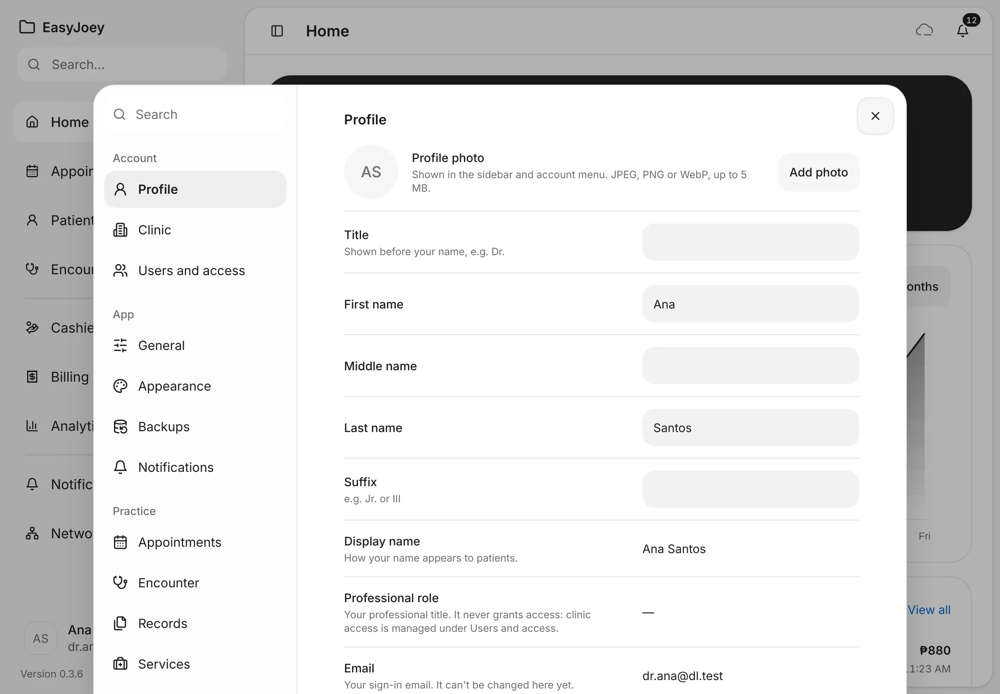

To find a setting fast, type in **Search** at the top of the list. Tap **✕** at the top right to close Settings.

### 2. Your profile

In **Profile**, fill in your **Title** (for example *Dr.*), your name, your **Professional role**, and your **PRC licence number**, **PTR number** and **S2 number** (they print on prescriptions). Tap **Add photo** for a profile photo. Your signature is further down.

Your **Display name** is how your name appears to patients.

### 3. Your clinic and opening hours

Tap **Clinic**. Fill in the **Clinic name**, **Address**, **Phone** and **Email**.

You should see: your clinic's details, then **Operating hours**.
{ .see }

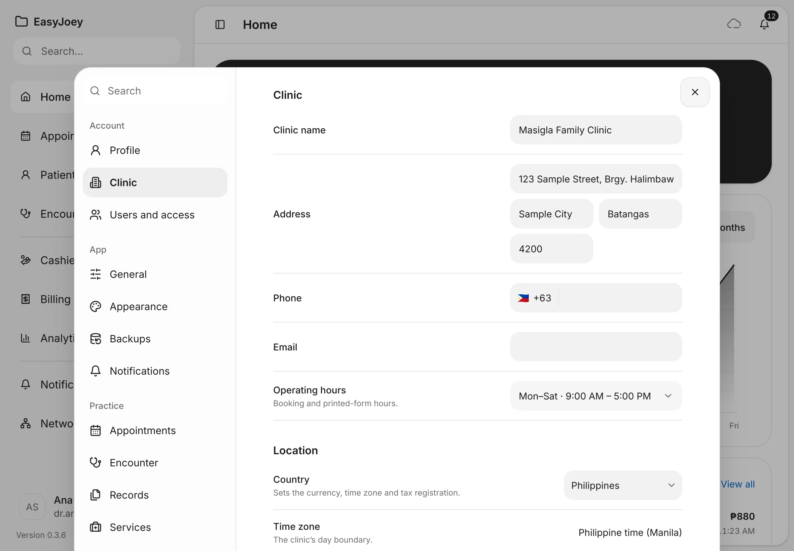

Tap **Operating hours** to set the days and times you're open. Bookings and printed forms use these hours.

Scroll down for **Location** (country, time zone and currency) and **Tax**. Under **Tax registration**, choose **Non-VAT** or **VAT-registered**. New bills follow this; bills you've already issued keep theirs.

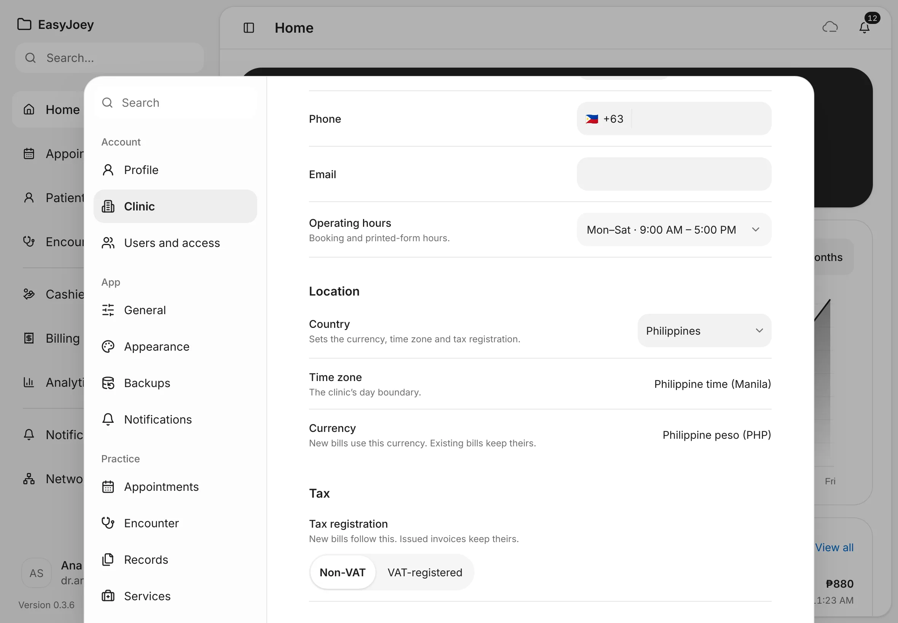

### 4. Your team

Only the clinic owner can manage the team. Tap **Users and access**. **Users** lists everyone in your clinic, with their role and status:

- **Active**: they can sign in and use the clinic.
- **Invited**: they haven't accepted their invitation yet. They have no access until they do.
- **Suspended**: they can't use the clinic until you make them **Active** again.

You should see: your clinic's users and an **Invite user** button.
{ .see }

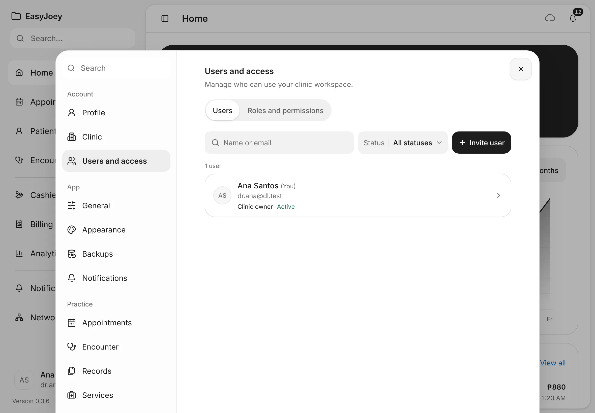

Tap **Roles and permissions** to see what each role can do. EasyJoey comes with four roles:

- **Clinic owner**: everything. This role is protected and can't be changed or given to someone else.
- **Doctor**: patient care, clinical records, orders and appointments.
- **Receptionist**: registering patients, appointments, charges and payments.
- **Billing officer**: invoices, collections, balances and insurance claims.

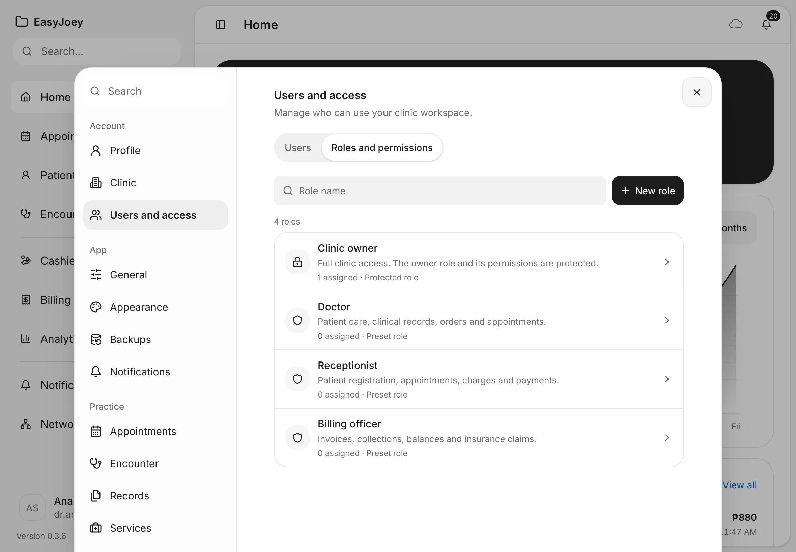

Tap a role to see its pages and tasks one by one. Tap **New role** to make your own.

### 5. Invite a colleague

On the **Users** tab, tap **Invite user**.

1. **Email address**: your colleague's email.
2. **Access role**: choose **Doctor**, **Receptionist** or **Billing officer** (or a role you made).

You should see: **Invite user**, with the role's permissions below, for example **14 of 29 permissions allowed**.
{ .see }

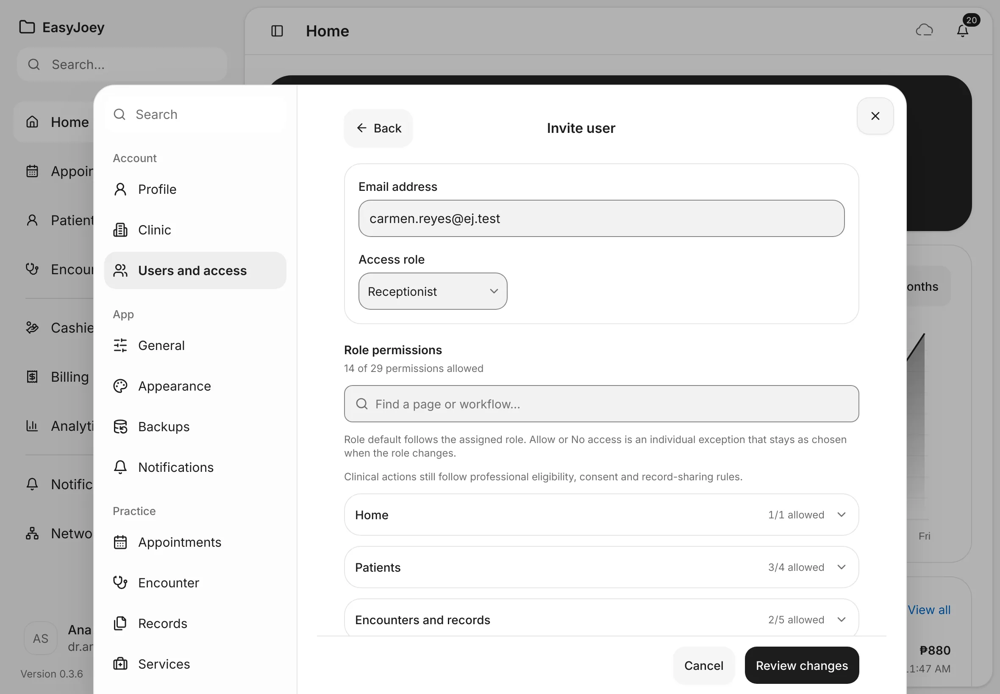

Most clinics leave the permissions as the role sets them. Tap **Review changes**.

You should see: **Review invitation**, with the email, the role and **Status Invited**.
{ .see }

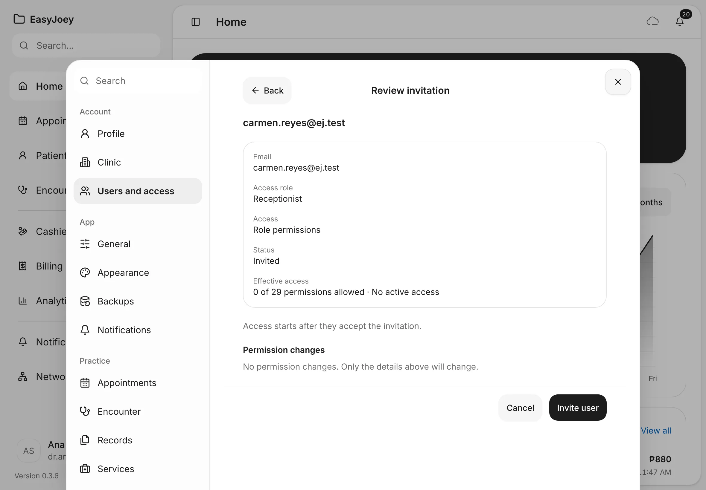

Tap **Invite user**.

You should see: **Invited carmen.reyes@ej.test. They have no access until they accept.** Your colleague is in the list as **Invited**.
{ .see }

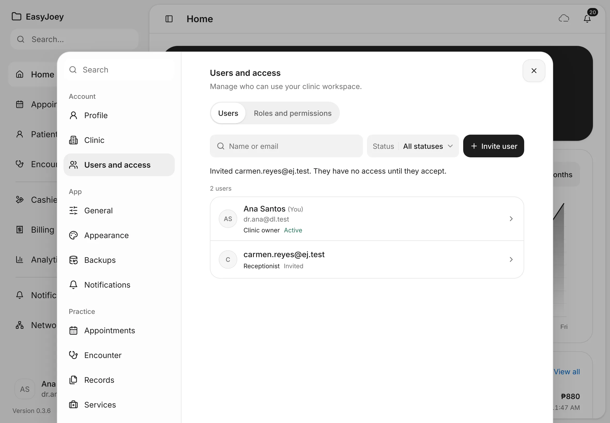

**What your colleague does next:** they get an email titled **"(your name) invited you to join (your clinic) on EasyJoey"**. They tap **Accept invitation** in it and create their EasyJoey sign-in. Then they sign in on the clinic iPad with that same email and password. See [Sign in and a first look around](../getting-started/sign-in-and-home.md). The invitation works for 7 days.

Tap an invited person to change their role before they accept, or to **Resend invitation** or **Revoke invitation**.

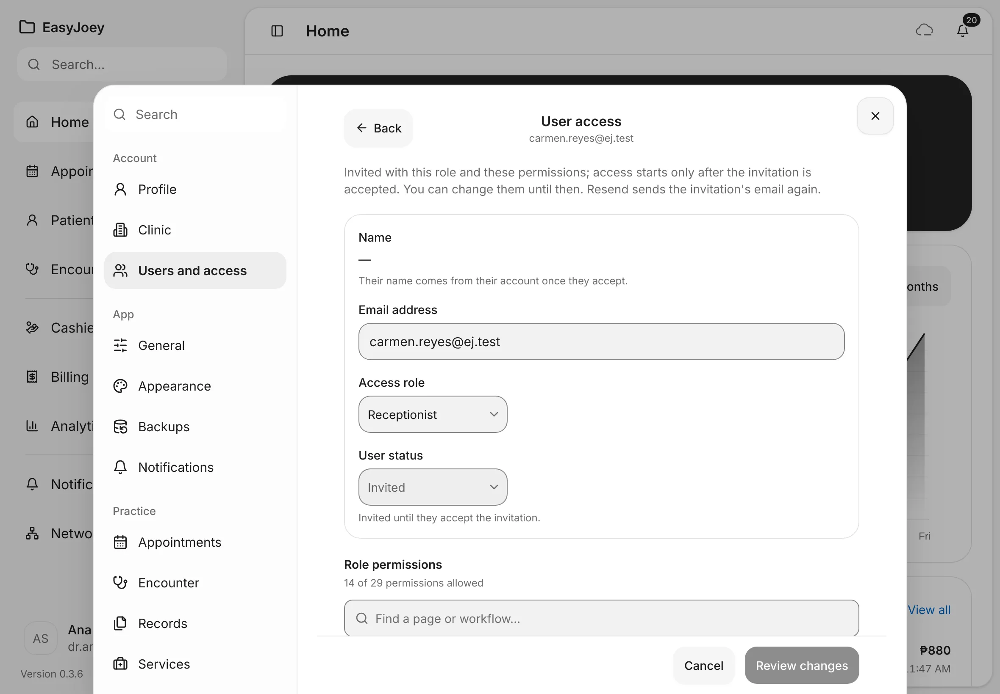

### 6. Change someone's role, or suspend them

Tap the person in **Users**.

- To change what they can do, choose another **Access role**.
- To stop them using the clinic, set **User status** to **Suspended**. To let them back in, set it to **Active**.

Tap **Review changes**, check what will change, then tap **Save changes**.

You should see: a message such as **Suspended** with their name, or **Access updated for** their name.
{ .see }

### 7. Start page and formats

Tap **General**.

- **Open after sign-in**: which page opens first (**Home**, **Appointments** or **Patients**).
- **Formats**: how dates, times and amounts are written, and whether the week starts on **Sunday** or **Monday**.
- **Show updates at login**: opens **What's new** when you sign in after an update.

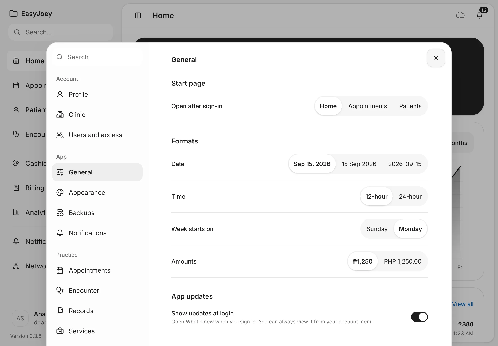

### 8. Light or dark

Tap **Appearance**. Under **Theme**, pick the screen icon (follow your iPad), the sun (light) or the moon (dark). Under **Motion**, choose **Reduced** to turn off animations.

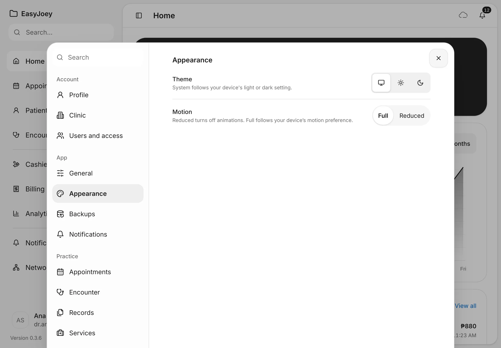

### 9. Appointments

Tap **Appointments**.

- **Default view**: whether the calendar opens on **Day**, **Week**, **Month** or **List**.
- **New bookings start as**: **Patient confirmed**, or **Awaiting confirmation** until you confirm them.
- **Show walk-ins**: show visits without an appointment on the calendar.
- **Booking hours**: the days and times each service can be booked. A service without its own hours uses the clinic's **Operating hours**.

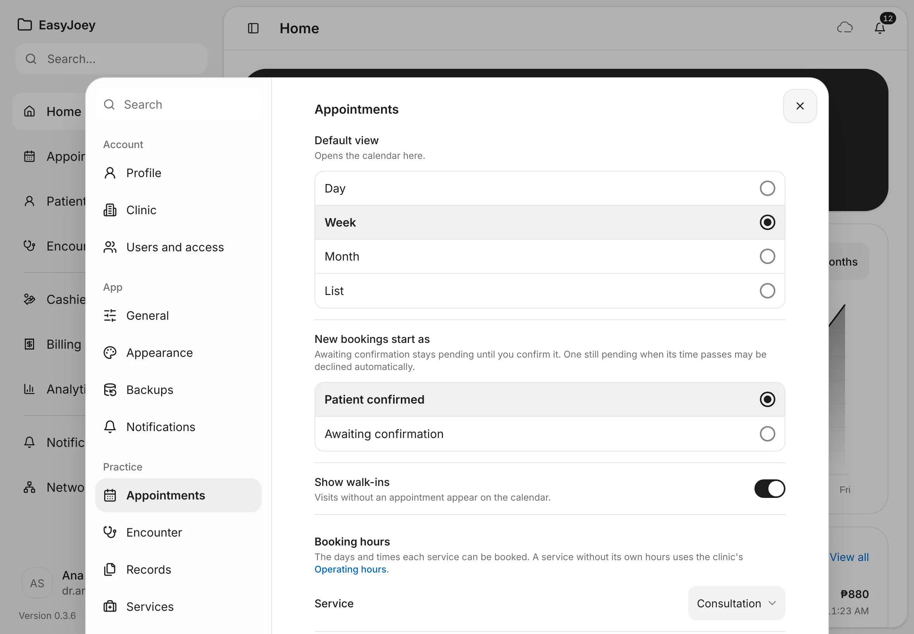

### 10. Encounter

Tap **Encounter**.

- **Auto-save drafts**: the encounter **Notes** save as you type. Turn it off to save them yourself with **Save note**.
- **Require a diagnosis before closing**: **End encounter** is blocked until the visit has a diagnosis with an ICD-10 code. See [Finish the visit](../visits/finish-the-visit.md).
- **Confirm before closing an encounter**: asks **End this encounter?** before it ends.
- **Show patient history by default**: shows the patient's earlier history records when you open an encounter.

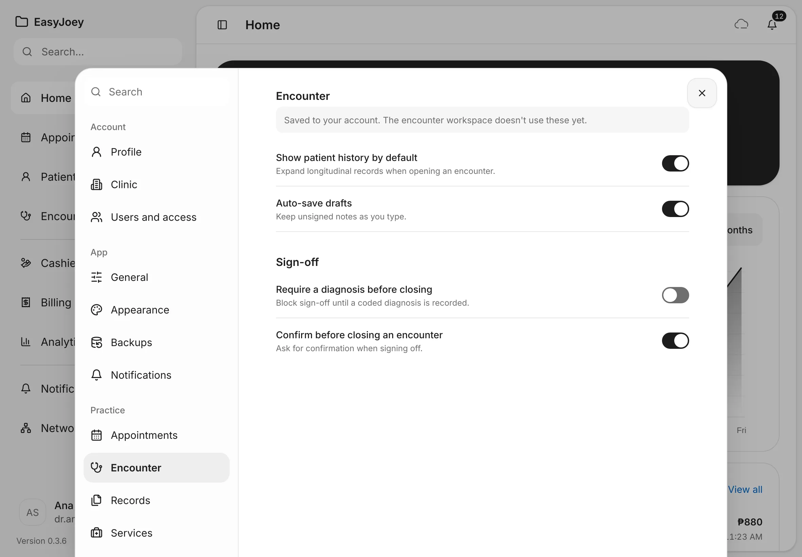

!!! note
    The panel says **The encounter workspace doesn't use these yet.** That note is out of date: the switches above already work.

### 11. Your price list

Tap **Services**. This is the list EasyJoey uses for charges and the **Cashier**.

- Tap a service to change its name, type or price.
- Tap **Add service** to add one.
- Use **Type** and **Sort** to narrow a long list.

You should see: every service with its type and price.
{ .see }

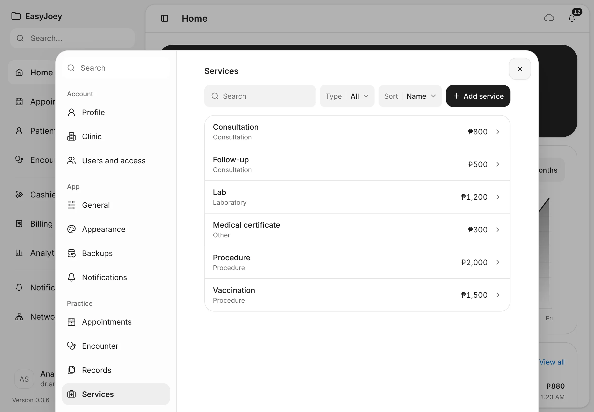

### 12. Referral partners

Tap **Referral partners**. These are the hospitals, labs and clinics outside your practice that you send patients or orders to. When you write an order or prescription, you can then choose **Referral partner** as its **Destination** and pick the partner by name.

Tap **Add referral partner**. Fill in the **Partner name** and the **Records email**, then tap **Add partner**.

You should see: **Add referral partner**, with the name and email filled in.
{ .see }

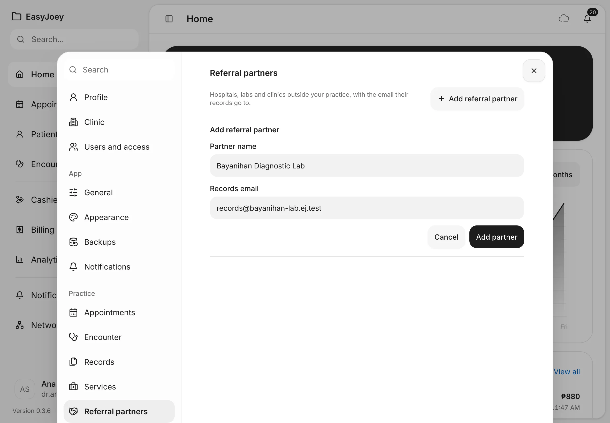

To change or remove a partner, tap **⋯** next to it, then **Edit** or **Remove**.

### 13. Payments

Tap **Billing**.

- **Payment methods**: the ways you accept payment, such as **Cash**, **GCash**, **Card** and **Bank transfer**. The one marked **Default** is chosen first. Tap **Make default** to change it, or **Add payment method** to add one.
- **Discounts**: **Ask for a Senior Citizen or PWD ID** before the first payment of a patient aged 60 or over, or with a PWD ID on file.
- **Professional fees**: who can change a preset fee split, and whether to ask for a reason.

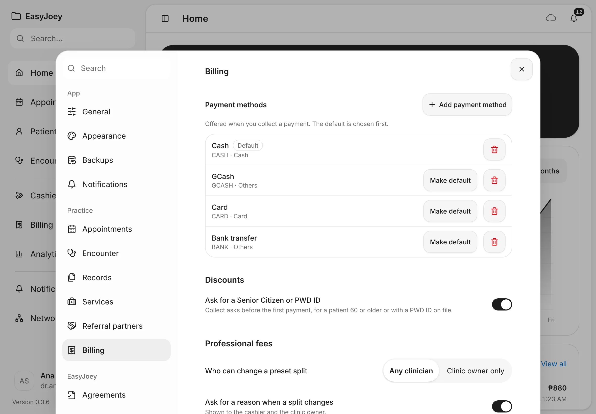

### 14. Notifications and records

Tap **Notifications** to choose which kinds of notifications you get, such as **Lab and imaging results**, **Appointment reminders** and **Payments**. Critical results always notify.

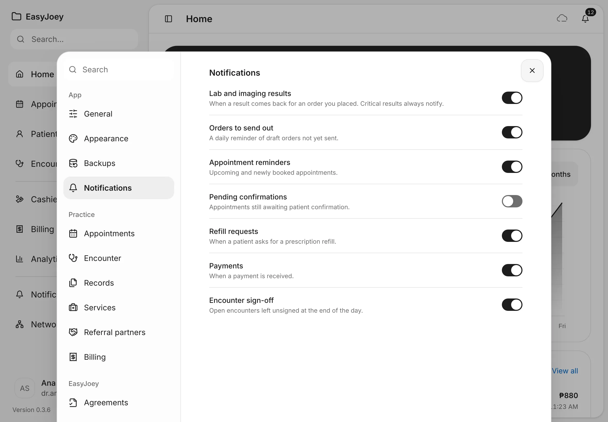

Tap **Records** for **Measurement units** (°C or °F, cm or ft, kg or lb) and the **Record types** shown by default in a new encounter.

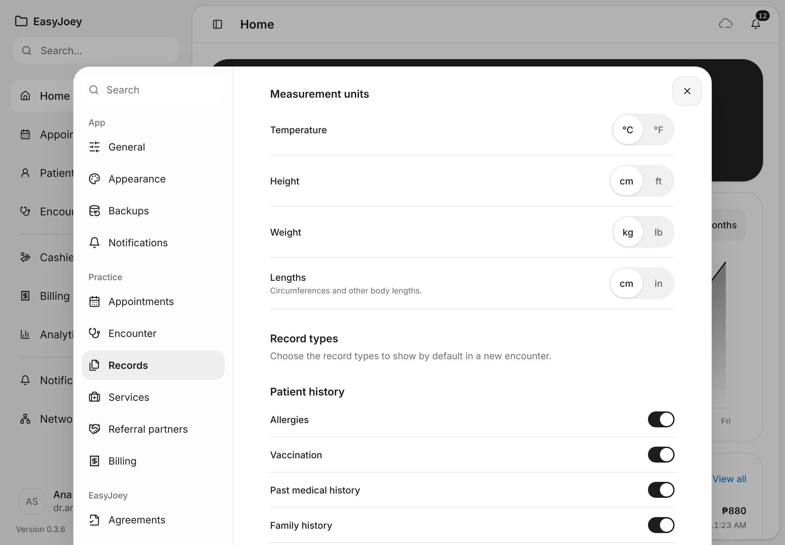

### 15. Backups

Tap **Backups**. On the iPad this shows when it last backed up, with **Back up now**. See [Syncing and working offline](sync-and-offline.md#6-keep-a-backup).

## Tips

!!! tip "Do these first"
    Before your first patient: **Clinic** (name, address, hours and tax), **Services** (your prices) and **Billing** (payment methods). Everything else can wait.

!!! warning "If something goes wrong"
    **"Every seat on the clinic's license is in use."**: your licence has no free seat for another user. Add seats to your licence, or suspend someone first.

    **"This email already has a pending invitation."**: open that person in **Users** and tap **Resend invitation**. If it says the invitation has expired, tap **Revoke invitation** and invite them again.

!!! info "Good to know"
    - Your email can't be changed in **Profile** yet.
    - **Account** and **Settings** in the account menu both open Settings on **Profile**.
    - A colleague's name comes from their own account. You can't change it in **Users and access**.

## What's next

- [Notifications and Analytics](notifications-and-analytics.md)
- [Syncing and working offline](sync-and-offline.md)
