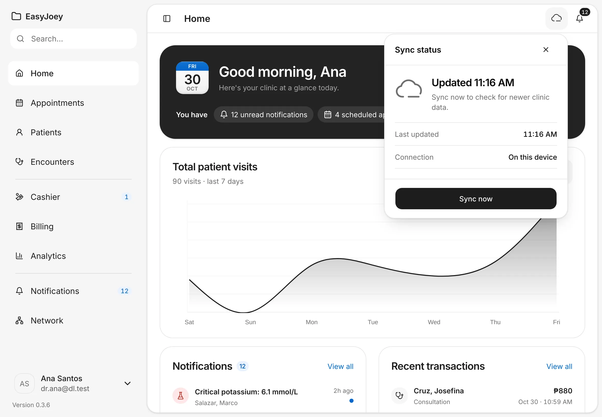
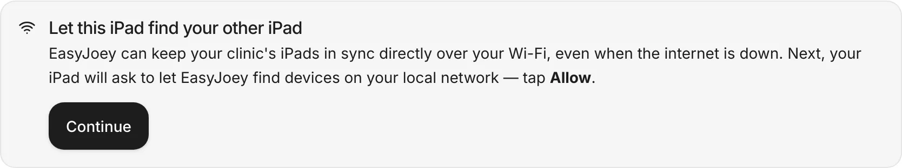
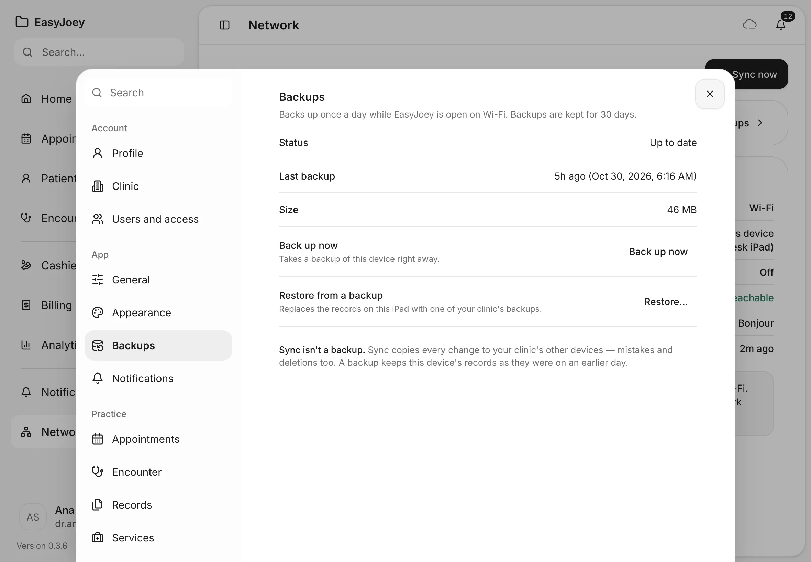
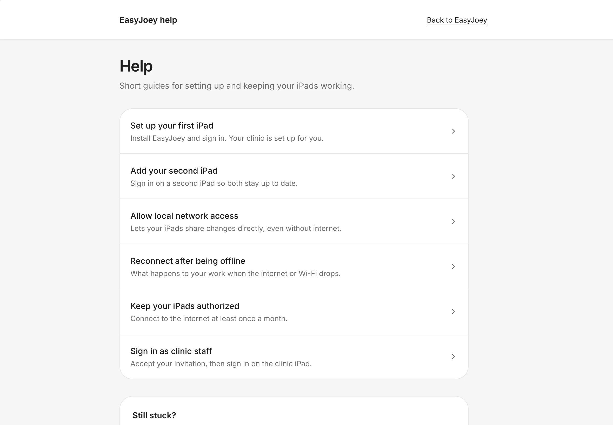

# Syncing and working offline

EasyJoey keeps working on the iPad without the internet. Learn how your iPads stay in step, what to do when they don't, and how backups keep your records safe.
{ .meta }

**Time:** about 5 minutes · **You'll need:** an iPad that is already set up ([Get your account and set up your iPad](../getting-started/set-up-your-ipad.md)).
{ .meta }

## Before you start

- Your clinic's records live on the iPad. Everything you enter is saved there first, even with no internet.
- **Syncing** copies each change to your clinic's other iPads: directly over the clinic Wi-Fi, and through the internet when your plan includes **EasyJoey Cloud**.

## Steps

### 1. Check the sync status

Tap the **cloud** at the top right of any page.

You should see: **Sync status**, with what's happening now, **Last updated** and **Connection**, and a **Sync now** button.
{ .see }

The heading tells you where things stand:

- **Up to date**: your clinic data is up to date.
- **Syncing…**: changes are on their way. You can keep working.
- **You're offline**: syncing needs a connection. **Pending changes** shows how many haven't reached the clinic yet.
- **Couldn't finish syncing**: tap **Try again**.

Tap **Sync now** to check for newer data straight away. Opening the panel never syncs by itself.

### 2. Keep working when the internet drops

Just keep working. Everything you enter is saved on the iPad.

When the Wi-Fi or internet comes back, EasyJoey shares your changes by itself. You don't need to do anything.

You should see: the cloud says you're offline, then up to date again once you're back online.
{ .see }

### 3. See which devices this iPad syncs with

Tap **Network** in the sidebar.

You should see: a map with **This device** in the middle, **EasyJoey cloud** and your other iPads around it, and **Your network** on the right.
{ .see }

- A solid line is a **Direct connection**. A dashed line goes **Through the cloud relay**. A faded device isn't connected right now.
- Tap a device for its details. Drag to move the map, pinch to zoom.
- **Your network** lists this iPad's **Connection**, **Local network**, **VPN**, **Cloud**, **Nearby search** and **Last sync**. Under it, EasyJoey says what to check if something is off.
- Tap **Sync now** to restart syncing on this iPad. You see **Sync started**.

!!! note
    Without **EasyJoey Cloud**, the page says **Syncing through the cloud is part of EasyJoey Cloud.** Your iPads still sync with each other over the clinic Wi-Fi.

### 4. Let your iPads find each other

The first time, EasyJoey shows **Let this iPad find your other iPad**. Tap **Continue**. When the iPad asks to let EasyJoey find devices on your local network, tap **Allow**.

You should see: the message goes away. Your other iPad appears on the **Network** page once both are on the same Wi-Fi.
{ .see }

If you tapped **Don't Allow** by mistake, EasyJoey shows **This iPad can't see your other iPad yet**. Open the iPad's **Settings** › **Privacy & Security** › **Local Network**, turn on **EasyJoey**, and keep both iPads on the same Wi-Fi.

### 5. Connect to the internet at least once a month

EasyJoey renews its permission to run by itself whenever the iPad is online. An iPad can work offline for up to 30 days at a time.

- Seven days before the limit, you see **Connect this iPad to the internet soon**, with the date to connect by.
- After 30 days offline, EasyJoey turns read-only: **Reconnect to the internet to keep editing**. You can still open and view every record. Nothing is deleted.

You should see: the notice at the top of the page, with **Reconnect now** and **Learn more**.
{ .see }

Connect the iPad to the internet and tap **Reconnect now**. The notice clears by itself once EasyJoey has renewed.

### 6. Keep a backup

Syncing isn't a backup: it copies every change to your other iPads, mistakes and deletions too. A backup keeps the records as they were on an earlier day.

The iPad backs up once a day while EasyJoey is open on Wi-Fi. Backups are kept for 30 days. To check, tap **Backups** on the **Network** page, or open **Settings › Backups**.

You should see: **Status**, **Last backup** and **Size**, with **Back up now** and, for the clinic owner, **Restore…**.
{ .see }

- **Back up now** takes a backup of this iPad right away.
- **Restore from a backup** replaces the records on this iPad with one of your clinic's backups. Only the clinic owner sees it. The records the iPad had before are kept as a safety copy.

### 7. Find help

The **Help** pages have short guides for setting up and keeping your iPads working. They open from **Learn more**, **Show me how** and **Step-by-step guide** on EasyJoey's notices.

You should see: **Help**, with guides such as **Add your second iPad**, **Allow local network access** and **Reconnect after being offline**.
{ .see }

Still stuck? Email **support@mycure.md**. Say what you were doing and what the screen says. Please don't send patient names or details.

## Tips

!!! tip "Keep the iPads charged and on the clinic Wi-Fi"
    iPads on the same Wi-Fi sync directly, even when the internet is down. Turn off a VPN if a nearby iPad doesn't appear.

!!! warning "If something goes wrong"
    **Sync needs attention.** A red notice says what's wrong and gives one button to fix it, such as **Allow local network**, **Reconnect this iPad**, **Restart syncing** or **Get the update**. Tap **Not now** to hide it for a while.

    **Syncing is paused on this iPad.** You can keep working. Tap **Sign in to reconnect** to connect it to your clinic again.

    **This iPad's date and time look wrong.** Open the iPad's **Settings › General › Date & Time** and turn on **Set Automatically**.

    **Your clinic's EasyJoey license needs attention — contact your clinic owner.** EasyJoey is read-only until the owner sorts out the plan.

!!! info "Good to know"
    - The **Network** page and backups are only on the iPad. In a web browser, Network says **Network view is available in the EasyJoey app**.
    - Backups need to be part of your clinic's plan. If not, **Status** says **Not included in this clinic's plan**.
    - There's no pause button for syncing, and no way to sync only some records.

## What's next

- [Settings basics](settings-basics.md)
- [Back to the start of the guide](../index.md)
