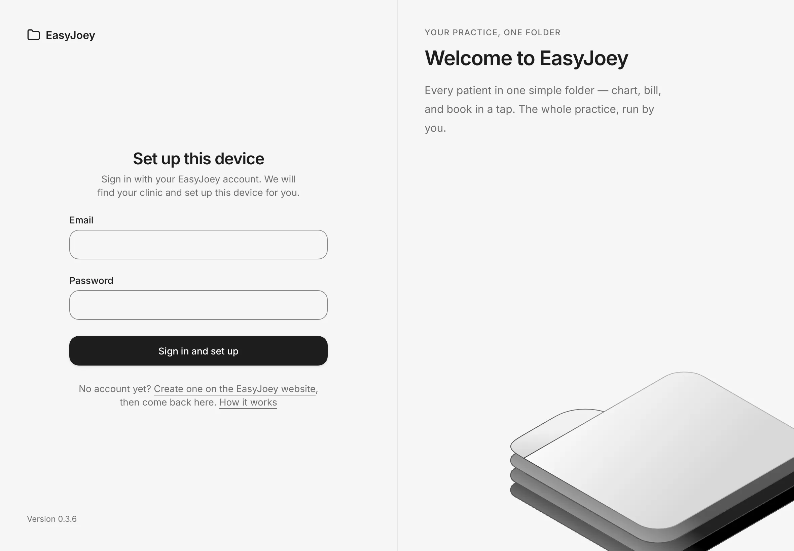
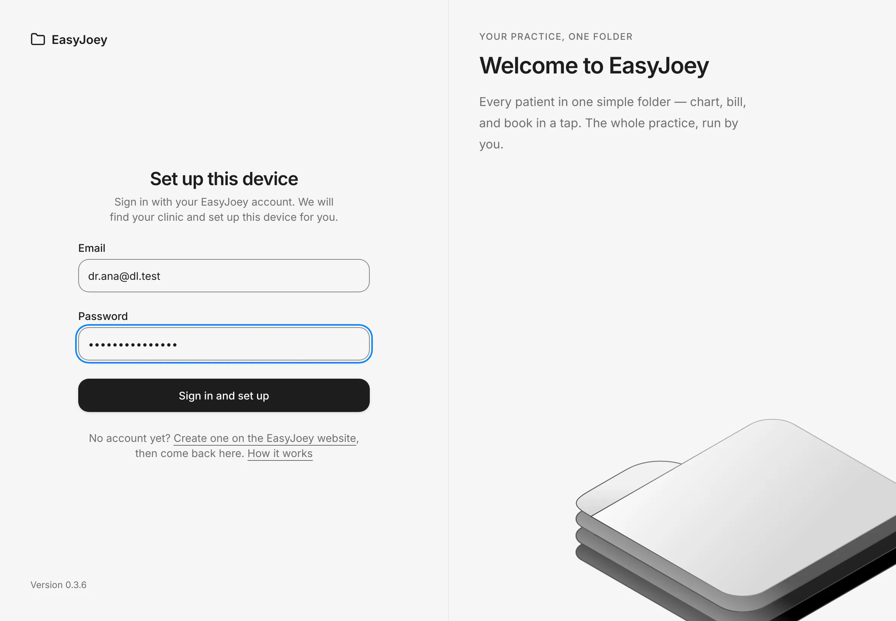
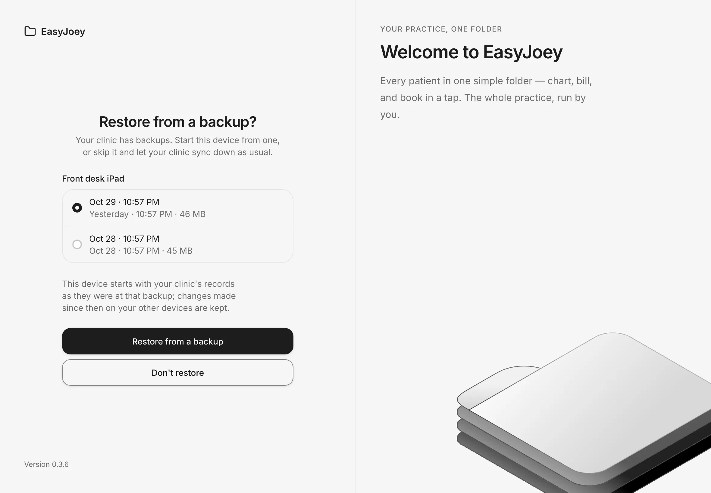
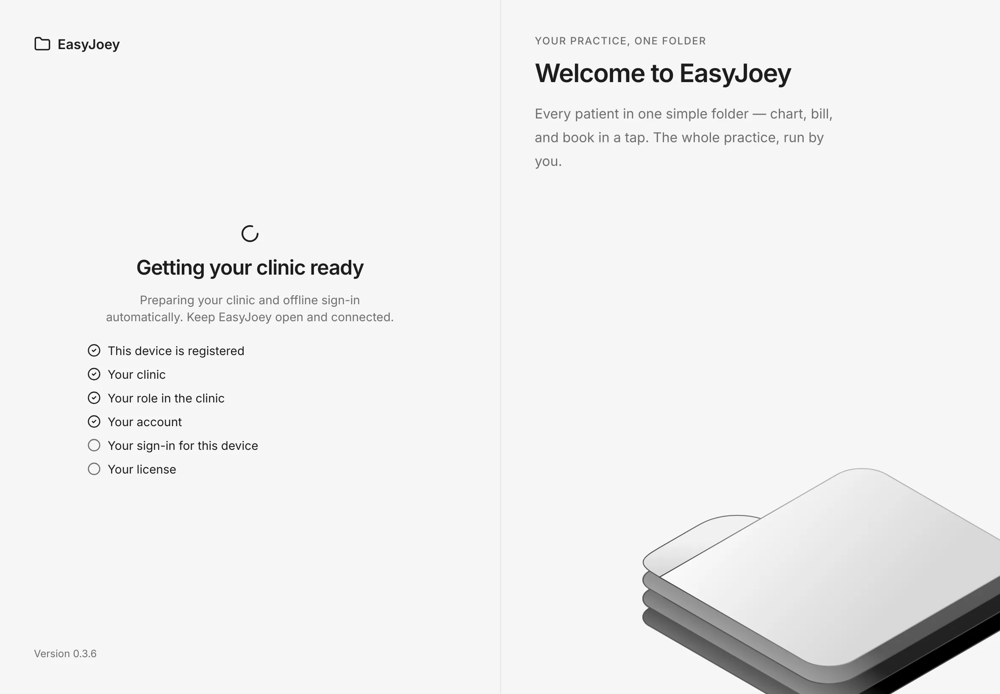
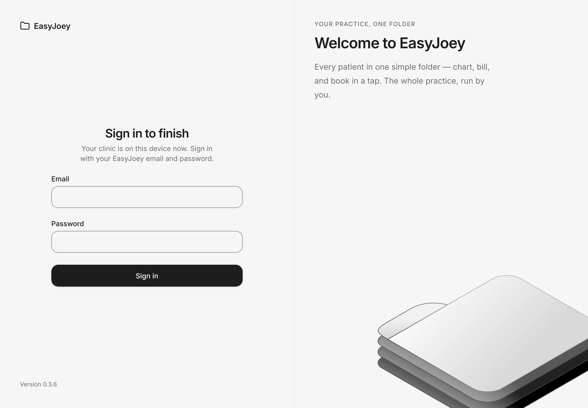
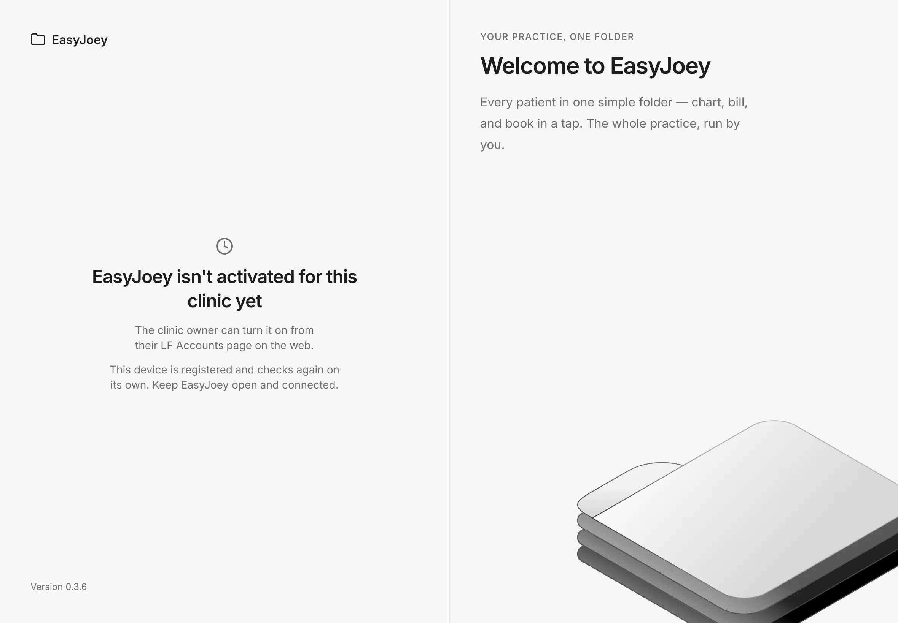
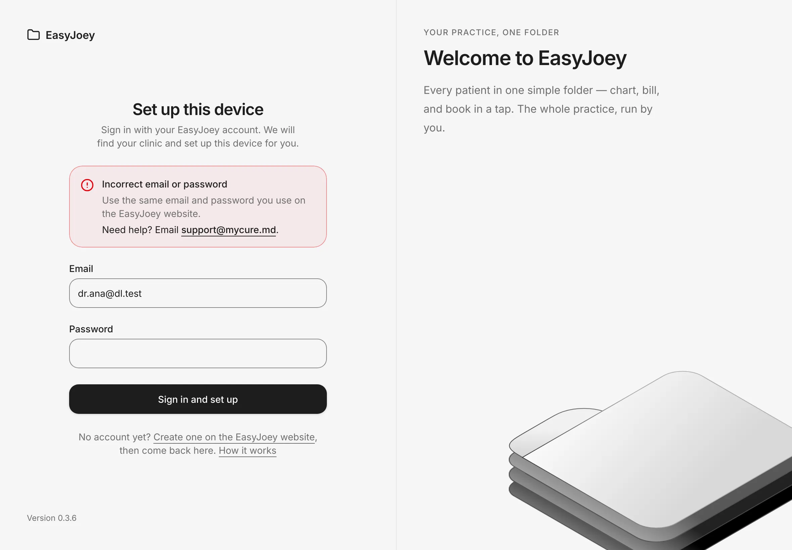
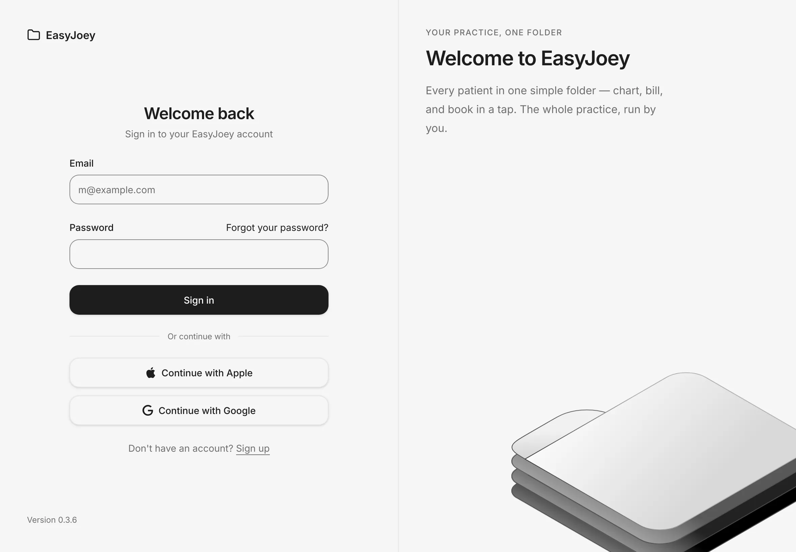

# Get your account and set up your iPad

Create your EasyJoey account, then connect your iPad to your clinic. You only do this once per iPad.
{ .meta }

**Time:** about 5 minutes · **You'll need:** your iPad with the EasyJoey app installed, and an internet connection for the first setup.
{ .meta }

## Before you start

- **Create your account on the EasyJoey website.** Your EasyJoey contact will send you the link.
  The website is where you create your account, set up your clinic and choose your plan.
- Remember the email and password you used. The iPad asks for them.
- Set up the iPad with the **clinic owner's** account. Staff don't set up iPads. They sign in later on an iPad that is already set up.

## Steps

### 1. Open EasyJoey on your iPad

Open the EasyJoey app.

You should see: **Set up this device**, with boxes for your **Email** and **Password**.
{ .see }

### 2. Sign in with your EasyJoey account

Type the **Email** and **Password** you used on the EasyJoey website, then tap **Sign in and set up**.

You should see: your email and password filled in. After you tap the button, it reads **Setting up this device…** while EasyJoey finds your clinic.
{ .see }

### 3. Choose whether to restore a backup

This screen only shows when your clinic already has backups, for example from your first iPad. On your first iPad you usually skip this step.

The newest backup is already picked. Tap a different date if you need one. Then tap **Restore from a backup**.
Or tap **Don't restore** to start fresh and let your clinic's records sync down as usual.

You should see: **Restore from a backup?**, with your backups listed under the iPad that made them, newest first.
{ .see }

Changes made on your other iPads after that backup are kept. They sync to this iPad afterwards.

### 4. Wait while your clinic downloads

Keep the app open and the iPad connected to the internet. This usually takes less than a minute.

You should see: **Getting your clinic ready**, with a list that fills with ticks as each part reaches the iPad:
**This device is registered**, **Your clinic**, **Your role in the clinic**, **Your account**, **Your sign-in for this device** and **Your license**.
{ .see }

### 5. Sign in to finish, if asked

Usually EasyJoey signs you in by itself when the download is done. You don't need to do anything.

If the app was closed during the download, you may see **Sign in to finish** instead. Type your **Email** and **Password**, then tap **Sign in**.

You should see: **Sign in to finish** and **Your clinic is on this device now.**
{ .see }

### 6. Start using EasyJoey

You should see: **Home**. Setup is done.
{ .see }

When the iPad asks to find devices on your local network, tap **Allow**. This lets your iPads share changes directly.

## If EasyJoey isn't activated yet

After you sign in, you may see **EasyJoey isn't activated for this clinic yet**. This is not an error. Your iPad is registered, but the clinic's plan isn't turned on yet.

1. The clinic owner turns it on from their **LF Accounts** page on the web. That's the account page where the owner manages the clinic's plan and payment. Your EasyJoey contact can send you the link.
2. Keep EasyJoey open and connected on the iPad. It checks again by itself, about once a minute.
3. When the plan is on, setup carries on from where it stopped.

## If setup shows a message

When something stops setup, a red box shows above the sign-in boxes. It says what happened and what to do.
Some messages have a **Show me how** link to a short help guide. Every message shows the support email.

| Message | What to do |
|---|---|
| **Enter your email and password.** | Fill in both boxes, then tap **Sign in and set up**. |
| **Incorrect email or password** | Use the same email and password you use on the EasyJoey website. |
| **No internet connection** | Connect the iPad to the internet and try again. Setup needs the internet once. |
| **Your clinic is not set up yet** | Sign in on the EasyJoey website first. It sets up your clinic. Then sign in on the iPad again. |
| **Complete your payment to start using EasyJoey** | The clinic owner pays from their **LF Accounts** page on the web. Then sign in on the iPad again. |
| **All device slots are in use** | Your plan has no room for another iPad. Remove one you no longer use from your account on the EasyJoey website, then try again. |
| **This device's date and time look wrong** | In the iPad's Settings, turn on automatic date and time. Then try again. |
| **This device was removed from your clinic** | Sign in with the clinic owner's account to add it back. Records on the iPad are kept. |
| **We could not finish setup** | Wait a moment and try again. The steps already done are kept. |
| **Your clinic is still downloading** | Check the internet connection, then sign in again to continue. The steps already done are kept. |
| **We need to check your account** | Your account is linked to more than one clinic. Contact support. |
| **We could not set up syncing for this device** | Contact support. |
| **Your clinic's EasyJoey license is paused** | Contact support to turn it back on. |
| **Your clinic's EasyJoey license needs attention** | Ask your clinic owner. |

## Set up another iPad

A second iPad uses the same steps as the first. Both iPads then share the same patients and records.

1. Install EasyJoey on the second iPad and open it.
2. Sign in with the **same** clinic owner email and password, then tap **Sign in and set up**.
3. If your first iPad has made backups, you see **Restore from a backup?**.
   Pick a backup to start the second iPad with your records already on it, or tap **Don't restore** to let them sync down.
4. Wait for **Getting your clinic ready** to finish. EasyJoey opens **Home**.
5. Keep both iPads on the same clinic Wi-Fi the first time, with the internet on. Tap **Allow** when asked about devices on your local network.

You should see: patients and records from the first iPad on the second. Changes on either iPad now reach the other.
{ .see }

To check that the two iPads see each other, see [Syncing and working offline](../clinic/sync-and-offline.md).

## Signing in on a computer

If your plan includes **EasyJoey Cloud**, you can also open EasyJoey in a web browser.
Use the web address your EasyJoey contact gave you and sign in on the **Welcome back** page.

## Tips

!!! tip "No account yet?"
    On the iPad, tap **Create one on the EasyJoey website** under the sign-in boxes. **How it works** explains the setup in a few lines.

!!! warning "If something goes wrong"
    **Sign-in fails.** Check the email and password on the EasyJoey website first. Use **Forgot your password?** on the web sign-in page to reset it.

    **Setup stops part-way.** Check the internet connection and open the app again.
    You may see **Sign in again to finish setting up this device. It is already registered.** Sign in again. Setup carries on from where it stopped, and the iPad doesn't use up another device slot.

    **A restore fails.** The backup list stays open and says why. Pick another backup, or tap **Don't restore** to finish setup without one.

!!! info "Good to know"
    - On the iPad, setup uses email and password only. The iPad needs them to sign you in again when it's offline.
    - Your password is used once for setup. The iPad doesn't keep it on the setup screen.
    - After setup, the iPad works without the internet. Your records stay on the iPad and sync when you're back online.

## What's next

- [Sign in and a first look around](sign-in-and-home.md)
- [Syncing and working offline](../clinic/sync-and-offline.md)
