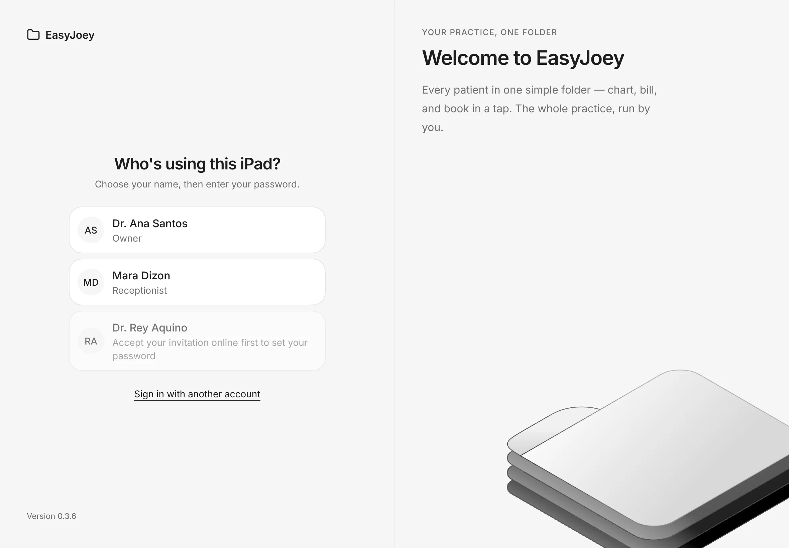
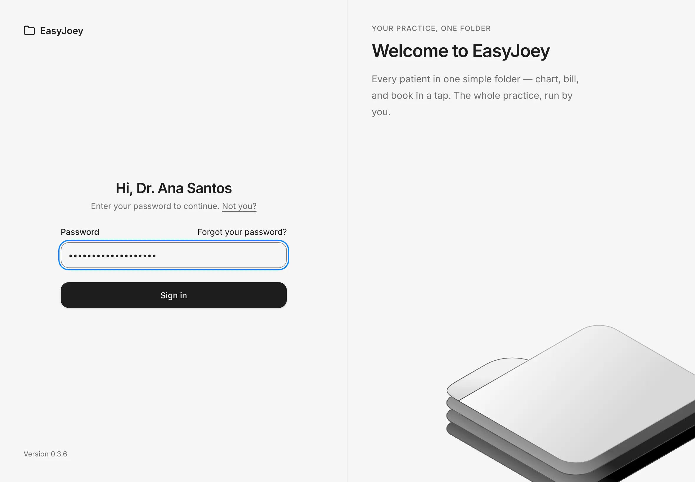
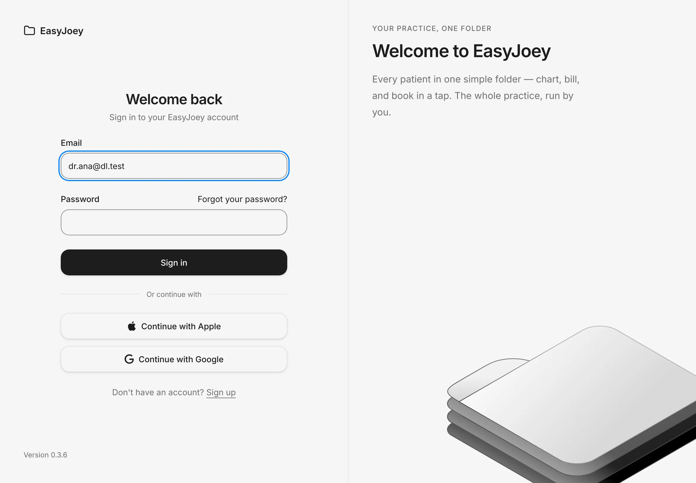
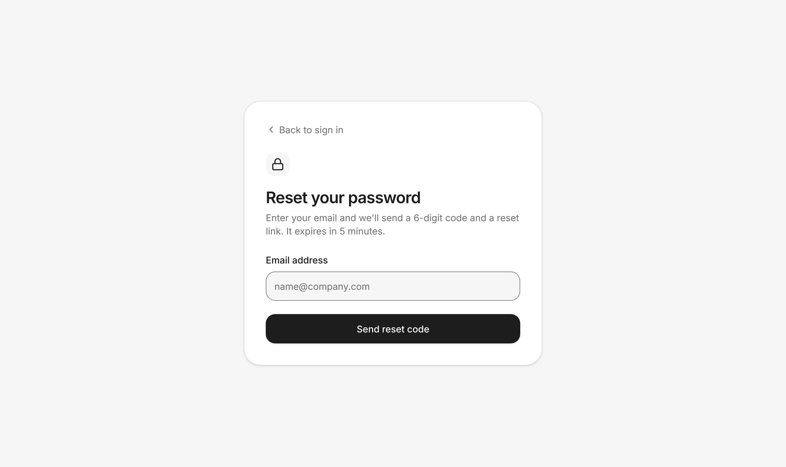
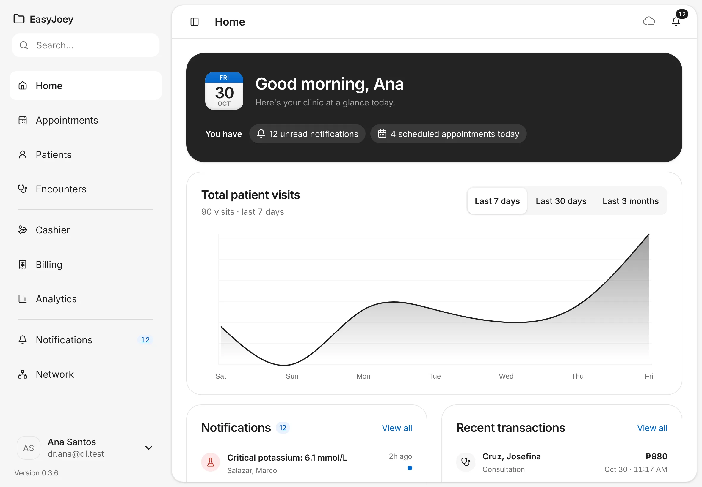
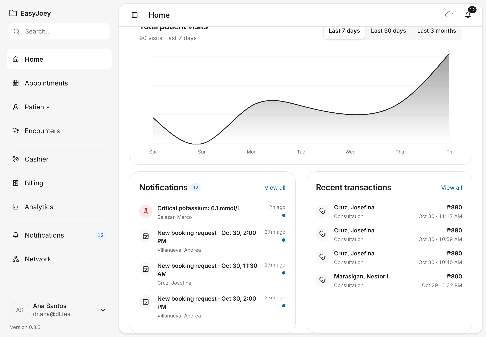
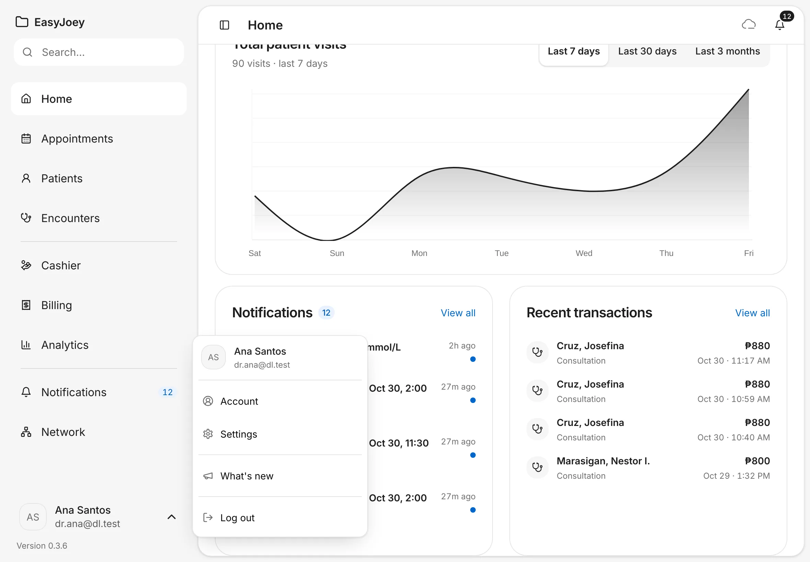
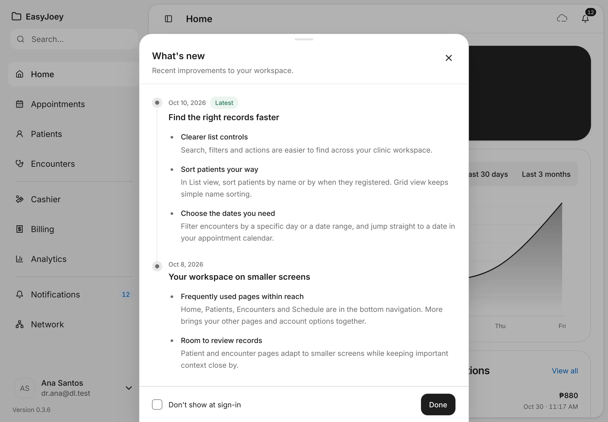

# Sign in and a first look around

Sign in on the clinic iPad, then find your way around Home, the sidebar and your account menu.
{ .meta }

**Time:** about 3 minutes · **You'll need:** an iPad that is already set up ([Get your account and set up your iPad](set-up-your-ipad.md)), and your password.
{ .meta }

## Before you start

- Clinic staff need an accepted invitation first. Your clinic owner sends it from **Settings › Users and access**.
- You only type your email the first time. After that, you pick your name from a list.

## Steps

### 1. Choose your name on the iPad

Open EasyJoey on the clinic iPad.

You should see: **Who's using this iPad?**, with everyone in your clinic who can use this iPad. Each name shows the person's role, such as **Owner**, **Doctor** or **Receptionist**.
{ .see }

Tap your name.

!!! note
    A greyed-out name says **Accept your invitation online first to set your password**. That person hasn't accepted their invitation yet. See the tips below.

### 2. Type your password

After you tap your name, EasyJoey greets you and asks for your password. Type your **Password**, then tap **Sign in**. Tap **Not you?** if you picked the wrong name.

You should see: **Hi,** and your name, with **Enter your password to continue.** After you sign in, EasyJoey opens **Home**.
{ .see }

Your name isn't on the list? Tap **Sign in with another account** on the list, then type your **Email** and **Password**.

### 3. Know that the iPad locks itself

When nobody touches the iPad for 5 minutes, EasyJoey signs you out and shows **Who's using this iPad?** again. The next person picks their own name.

You should see: the list of names again after 5 idle minutes.
{ .see }

Nothing is lost when the iPad locks. Everything you saved stays on the iPad.

### 4. Sign in on a computer (EasyJoey Cloud only)

If your plan includes **EasyJoey Cloud**, you can also open EasyJoey in a web browser. Type your **Email** and **Password**, then tap **Sign in**. You can also use **Continue with Apple** or **Continue with Google**.

You should see: **Welcome back** and **Sign in to your EasyJoey account**.
{ .see }

### 5. If you forgot your password

Tap **Forgot your password?** above the password box. Type your **Email address** and tap **Send reset code**.

You get an email with a 6-digit code and a reset link. Type the code on **Enter your code**, then set a new password. The code expires in 5 minutes.

You should see: **Reset your password**. Tap **Back to sign in** if you remembered it after all.
{ .see }

{ .shot-sm }

### 6. Read the top of Home

After you sign in, EasyJoey opens **Home**.

- The dark card greets you by name, with today's date.
- **You have** shows what's waiting for you. Tap a chip to go straight there:
    - **unread notifications** opens your unread notifications.
    - **scheduled appointments today** opens today's calendar.
- **Total patient visits** charts your visits. Switch between **Last 7 days**, **Last 30 days** and **Last 3 months**.

You should see: your greeting, the **You have** chips and the visits chart.
{ .see }

!!! note
    A chip only shows when EasyJoey knows the number. The visits chart is only for clinic admins. Other staff see **Visit trends are for clinic admins** instead.

### 7. Check notifications and recent payments

Scroll down. **Notifications** shows your newest alerts, such as lab results and booking requests. A blue dot marks one you haven't read. **Recent transactions** shows the latest payments. Tap **View all** on either card to see the full list.

You should see: the two cards side by side.
{ .see }

### 8. Find your way with the sidebar

The sidebar on the left is always there. It has three groups:

- **Home**, **Appointments**, **Patients**, **Encounters**: your daily clinic work.
- **Cashier**, **Billing**, **Analytics**: money and numbers.
- **Notifications** and **Network**: your alerts, and how this iPad syncs.

A small number next to **Cashier** is how many patients are waiting to pay. The number next to **Notifications** is how many you haven't read.
The **Search…** box at the top finds a patient: type a name and press Enter.

A lock next to an item means your clinic's plan doesn't include it. Only the clinic owner can add it.

### 9. Use the top bar

At the top right of every page are two buttons:

- The **cloud** shows whether your clinic data is up to date. See [Syncing and working offline](../clinic/sync-and-offline.md).
- The **bell** opens your newest notifications. See [Notifications and Analytics](../clinic/notifications-and-analytics.md).

Tap the panel button at the top left to hide or show the sidebar.

### 10. Open your account menu

Tap your name at the bottom of the sidebar.

- **Account**: your profile, photo and signature.
- **Settings**: your clinic, services, payments and more. See [Settings basics](../clinic/settings-basics.md).
- **What's new**: the latest changes to EasyJoey.
- **Log out**: sign out of EasyJoey.

You should see: the menu open above your name, with your email at the top.
{ .see }

### 11. Hand over the iPad or log out

On a shared iPad, sign out before you hand it to the next person. Tap your name at the bottom of the sidebar, then tap **Log out**.

You should see: on the iPad, **Who's using this iPad?** again. The next person taps their name and types their password.
{ .see }

- Picked the wrong name? Tap **Not you?** next to **Enter your password to continue.** to go back to the list.
- Forgot to log out? The iPad locks itself after 5 minutes without a touch, and shows the list of names.
- On the iPad, logging out only signs you out. Your records stay on the iPad, and syncing carries on.
- On a computer, **Log out** signs you out and shows the **Welcome back** sign-in page.

### 12. Read What's new

After an update, **What's new** may open by itself when you sign in. You can also open it from your account menu.

You should see: **What's new**, with the latest changes first, marked **Latest**. Tap **Done** to close it.
{ .see }

Tick **Don't show at sign-in** if you'd rather open it yourself.

## Tips

!!! tip "Open a different page after sign-in"
    To start each day on **Appointments** or **Patients**, change **Open after sign-in** in **Settings › General**.

!!! warning "If something goes wrong"
    **Incorrect email or password.** Check for a typo and that Caps Lock is off. Still stuck? Use **Forgot your password?**.

    **Accept your invitation online first to set your password.** Open the invitation your clinic owner sent you and create your password. Then keep the iPad online for a minute so your account reaches it, and try again.

    **Your account is on its way to this device. Try again in a minute.** You just joined the clinic. Keep the iPad online and try again shortly.

    **This account isn't a member of this clinic anymore.** Ask your clinic owner.

!!! info "Good to know"
    - On the iPad you sign in with email and password only. Apple and Google sign-in are only on the web.
    - Signing in on the iPad works without the internet once your account is on the iPad. Resetting your password needs the internet, because the code comes by email.

## What's next

- [Find or add a patient](../patients/find-or-add-a-patient.md)
- [Syncing and working offline](../clinic/sync-and-offline.md)
