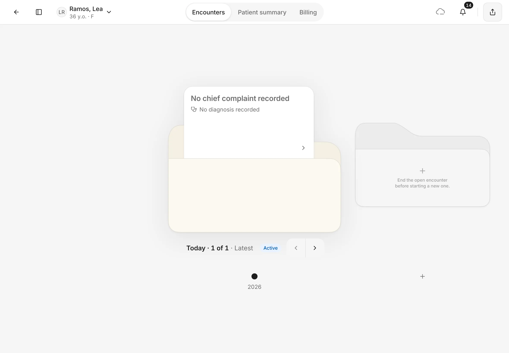
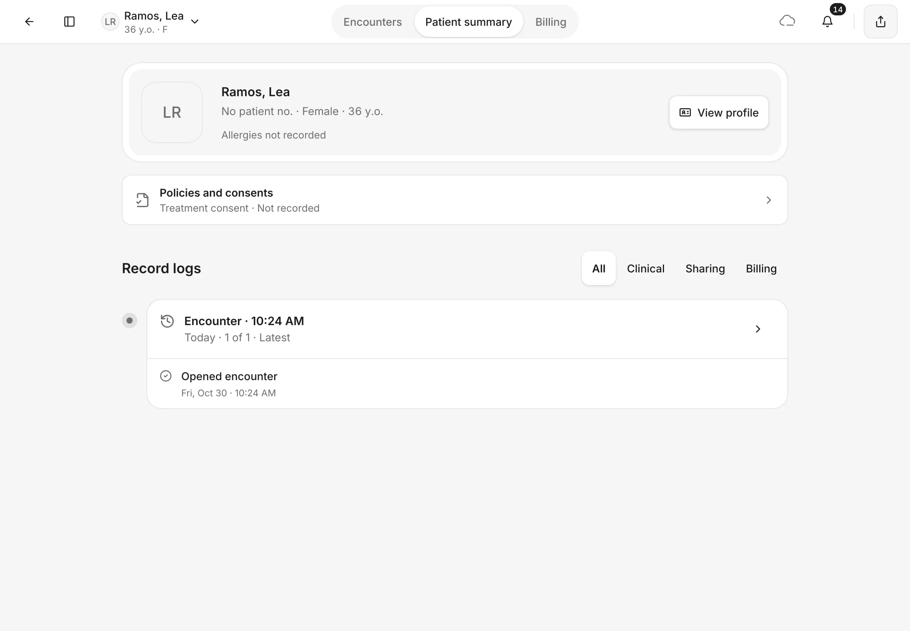
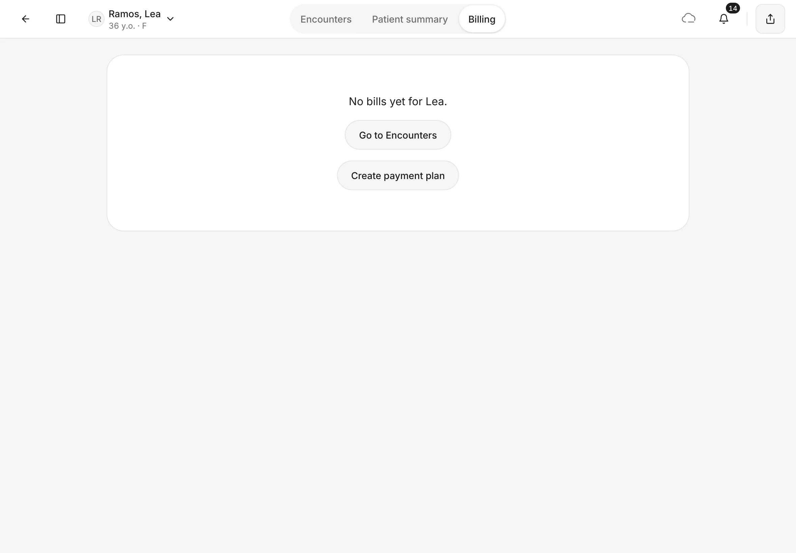
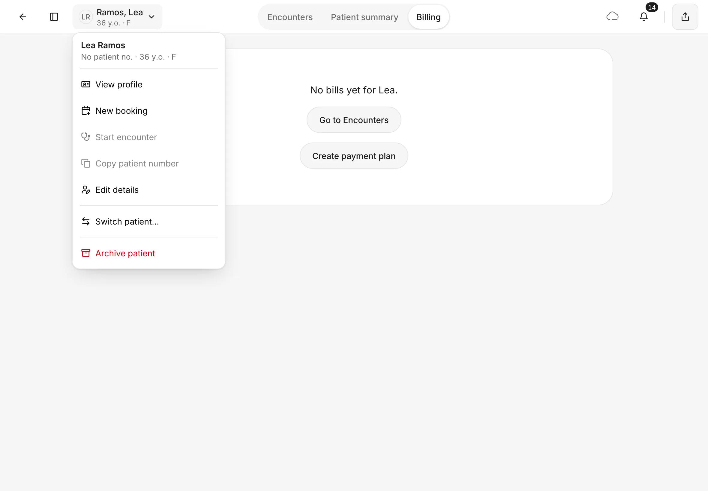
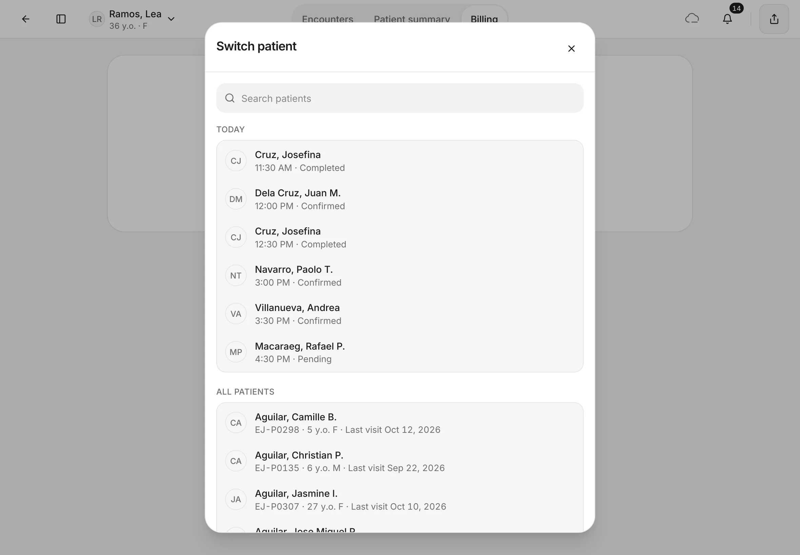
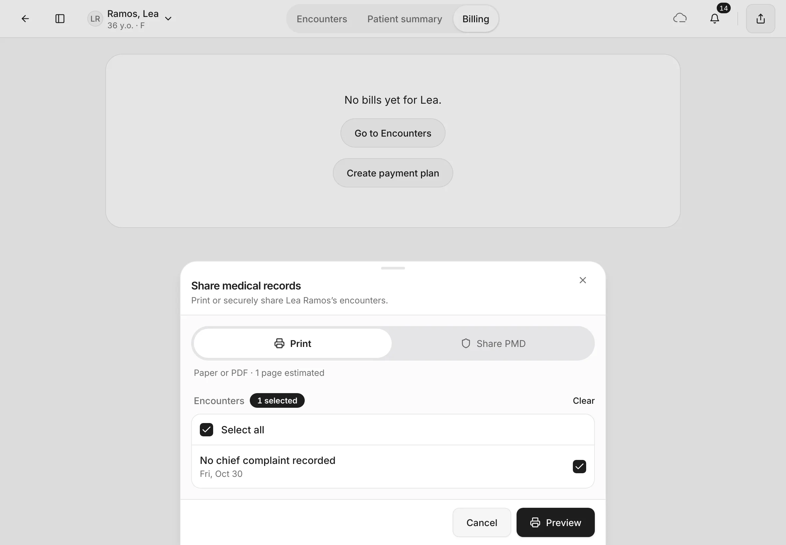
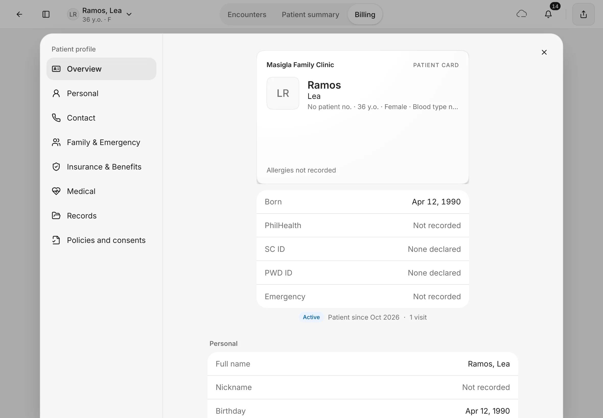
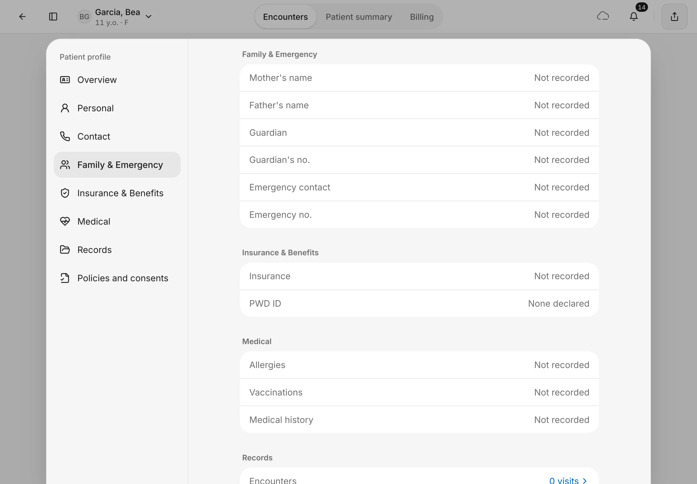
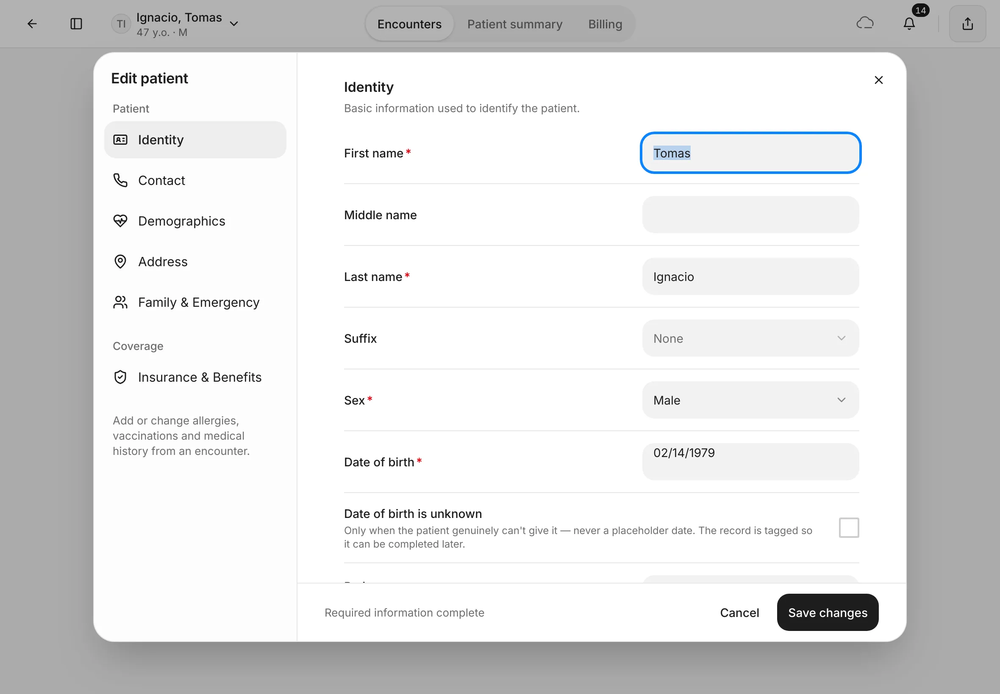
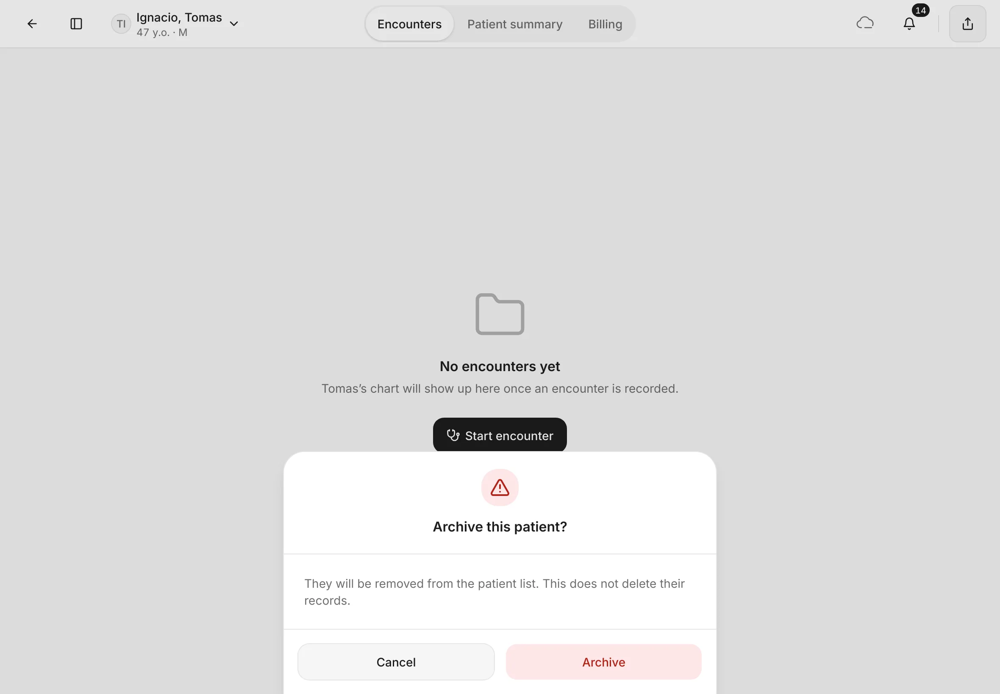

# The patient page and profile

Everything about one patient lives on their page: their encounters, a summary, and their bills.
{ .meta }

**Time:** about 4 minutes · **You'll need:** a patient on file ([Find or add a patient](find-or-add-a-patient.md)).
{ .meta }

## Before you start

- Tap **Patients** in the sidebar, then tap the patient's folder.
- If the patient has had an encounter, EasyJoey opens their latest one. Tap **←** at the top left to go back to their patient page.

## Steps

### 1. See past visits on Encounters

The tabs across the top are **Encounters**, **Patient summary** and **Billing**. Tap **Encounters**.

Each visit is a folder on a shelf, newest in the middle, with the main complaint on top.

- Tap **‹** and **›**, or a dot on the timeline, to move between visits.
- Tap the folder to open that encounter.
- The folder on the right with **+** starts a new visit. See [Start an encounter](../visits/start-an-encounter.md).

You should see: the latest visit in the middle, marked **Latest**. An encounter that is still going is marked **Active**.
{ .see }

!!! note
    A patient can only have one open encounter. While one is open, the new-encounter folder says **End the open encounter before starting a new one.**

### 2. Read the Patient summary

Tap **Patient summary**.

You should see: the patient's name, patient number, sex and age, and their allergies. Below are **Policies and consents** and **Record logs**, a list of everything recorded for this patient, newest first.
{ .see }

- Tap **All**, **Clinical**, **Sharing** or **Billing** above **Record logs** to show only one kind of activity.
- Tap **Policies and consents** to see the patient's consents. See [Consents](../visits/consents.md).

### 3. Check what the patient owes on Billing

Tap **Billing**.

You should see: the patient's bills. When there are none yet, it says so, with **Go to Encounters** and **Create payment plan**.
{ .see }

Once the patient has bills, switch between **Due**, **Statement**, **Invoices**, **Claims** and **Plans**. More in [Billing, balances and payment plans](../payments/billing-and-payment-plans.md).

### 4. Use the patient menu

Tap the patient's name at the top left. The menu has:

- **View profile**: the full patient card (step 7).
- **New booking**: book this patient. See [Appointments](../schedule/appointments.md).
- **Start encounter**: open a new visit now.
- **Copy patient number**: copies the number so you can paste it elsewhere.
- **Edit details**: change the patient's details (step 8).
- **Switch patient…**: jump to another patient (step 5).
- **Archive patient**: take the patient off your list (step 9).

You should see: the menu under the patient's name, with their patient number, age and sex at the top.
{ .see }

!!! note
    **Start encounter** is greyed out while the patient has an open encounter. **Copy patient number** is greyed out when the patient has no patient number.

### 5. Switch to another patient

Tap **Switch patient…**.

You should see: **Switch patient**, with **Today** (today's booked patients, their times and status) and **All patients**. Search by name, or tap a patient to go to their page.
{ .see }

### 6. Print the patient's records

Tap the share button at the top right (**Share records**).

You should see: **Share medical records**, with **Print** chosen and the patient's encounters ticked.
{ .see }

Untick any encounter you don't want to include, then tap **Preview**. From the preview you can print or save a PDF.

### 7. View the full profile

From the patient menu, tap **View profile**. You can also tap **View profile** on the Patient summary.

You should see: the **Patient profile** with your clinic's name on a patient card, the patient's allergies, then **Born**, **PhilHealth**, **SC ID**, **PWD ID** and **Emergency**.
{ .see }

The list on the left jumps to **Personal**, **Contact**, **Family & Emergency**, **Insurance & Benefits**, **Medical**, **Records** and **Policies and consents**. For a child, **Family & Emergency** holds the mother's, father's and guardian's details.

The profile is for reading. To change anything, use **Edit details**.

### 8. Edit the patient's details

From the patient menu, tap **Edit details**. Pick a section on the left: **Identity**, **Contact**, **Demographics**, **Address**, **Family & Emergency** or **Insurance & Benefits**. Change what you need, then tap **Save changes**. Tap **Cancel** to leave without saving.

You should see: **Edit patient**, with the same sections as when you added the patient.
{ .see }

!!! note
    Allergies, vaccinations and medical history aren't edited here. Add or change them during an encounter, so each change is dated to a visit.

### 9. Archive a patient (only when needed)

From the patient menu, tap **Archive patient**.

You should see: **Archive this patient?** Tap **Archive** to confirm, or **Cancel** to keep them.
{ .see }

{ .shot-sm }

Archiving takes the patient off your patient list. Their records are kept.

## When the patient has checked in

When a patient with an appointment today has been checked in, a line at the top of their page says **(name) is checked in**, with an **Open encounter** button. Tap it to go straight to the visit.

## Tips

!!! tip "Back to the list"
    Tap **←** at the top left to go back to where you came from.

!!! warning "If something goes wrong"
    **Start encounter is greyed out.** The patient already has an open encounter. Open it from **Encounters** instead.

    **I opened the patient and landed in an encounter.** That's normal: EasyJoey opens the latest encounter. Tap **←** for the patient page.

!!! info "Good to know"
    - **Share PMD** (an encrypted copy for one recipient) isn't available yet. The app says **Sharing records isn't available yet.** Use **Print** instead.
    - EasyJoey doesn't track who receives a printed copy.
    - An archived patient can't be brought back from the app yet. Archive only when you're sure.

## What's next

- [Start an encounter](../visits/start-an-encounter.md)
- [Consents](../visits/consents.md)
- [Appointments](../schedule/appointments.md)
