# Billing, balances and payment plans

See what came in, who still owes you, what HMOs and PhilHealth owe, and set up payment plans for bigger bills.
{ .meta }

**Time:** about 5 minutes to learn · **You'll need:** some bills already made at the [Cashier](charges-and-cashier.md).
{ .meta }

## Before you start

- **Billing** is for looking back and following up. Day-to-day payments happen at the [Cashier](charges-and-cashier.md).

## Steps

### 1. Open Billing

Tap **Billing** in the sidebar.

You should see: five tabs (**Transactions**, **Total sales**, **Payments due**, **Payment plans**, **Accounts receivable**) with **Transactions** open. The cards at the top sum up the period: **Collected**, **Transactions**, **Average ticket** and **Voided**.
{ .see }

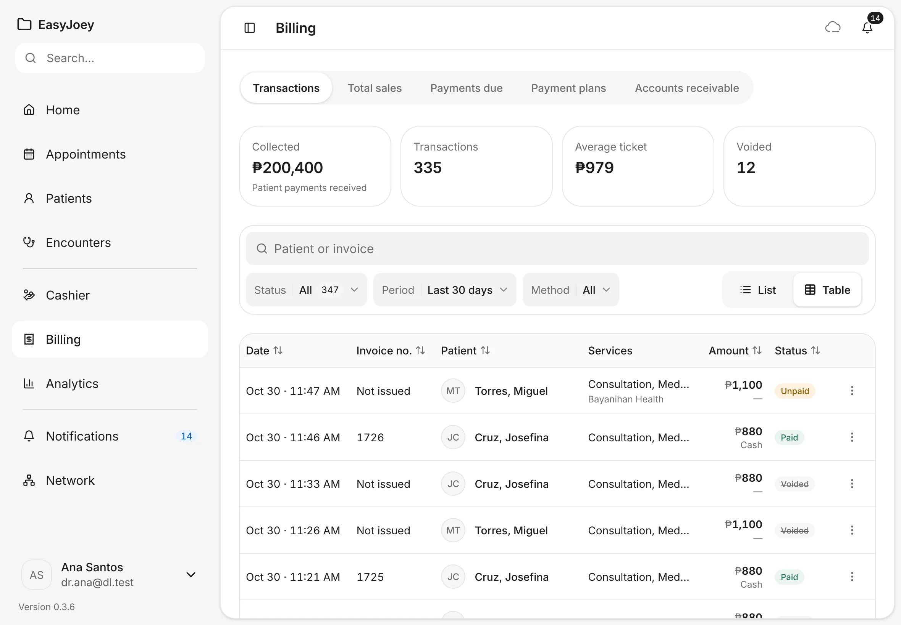

Use the search box (**Patient or invoice**) and the **Status**, **Period** and **Method** filters to narrow the list. **List** and **Table** switch the layout. An invoice reads **Not issued** until it is paid.

### 2. Check your sales

Tap **Total sales**.

You should see: **Gross sales**, **Discounts**, **Net sales** and **Collection rate** for the period, then one row per day with **Visits**, **Gross**, **Discounts**, **Net**, **Collected** and **Outstanding**. Use **Group by** to see weeks or months instead.
{ .see }

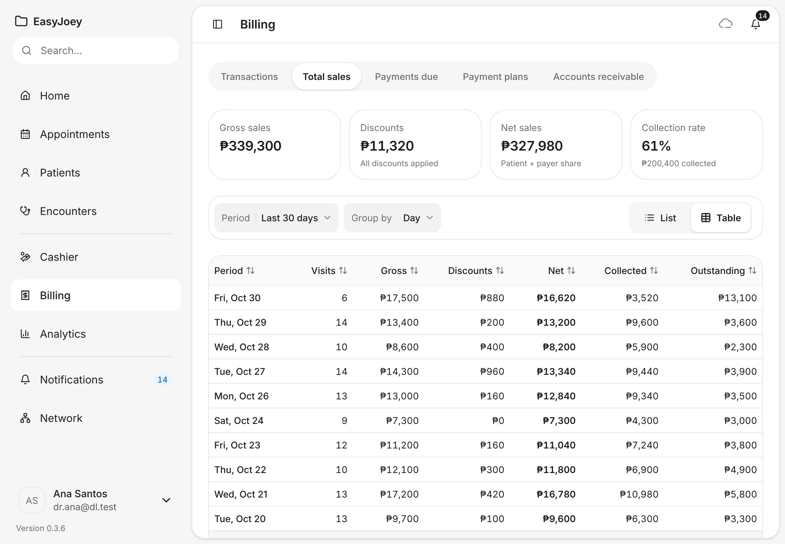

### 3. Follow up unpaid balances

Tap **Payments due**.

You should see: **Due now**, **Scheduled later**, **Overdue** and **Total unpaid**, then each patient who owes you, with their open invoices, what is unpaid, and the **Earliest unpaid date**. Overdue days show in orange. Tap **Overdue** to see only those.
{ .see }

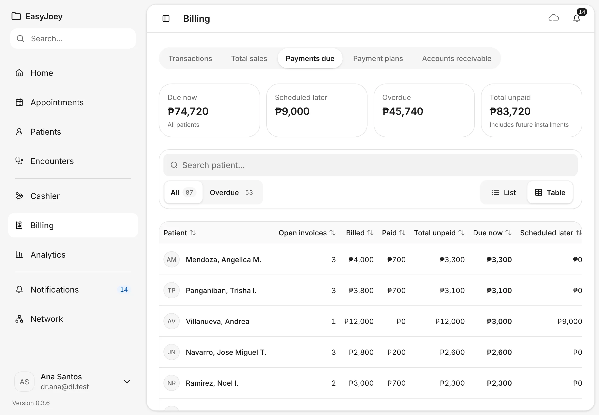

Tap **⋮** on a patient for **Collect at the cashier**, **View profile** and **View billing**. **Collect at the cashier** opens the bill at the Cashier, where you take the payment as in [Charges and payment at the Cashier](charges-and-cashier.md#9-collect-the-payment).

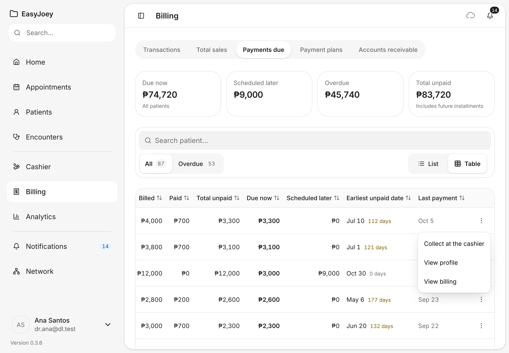

### 4. Track what payers owe you

Tap **Accounts receivable**. This is the money HMOs and PhilHealth owe the clinic for covered services.

You should see: the amounts grouped by age (**0–30 days**, **31–60 days**, **61–90 days**, **90+ days**), and a table of claims with the payer, the patient, the service date, when it was submitted, the amount, its age and its status.
{ .see }

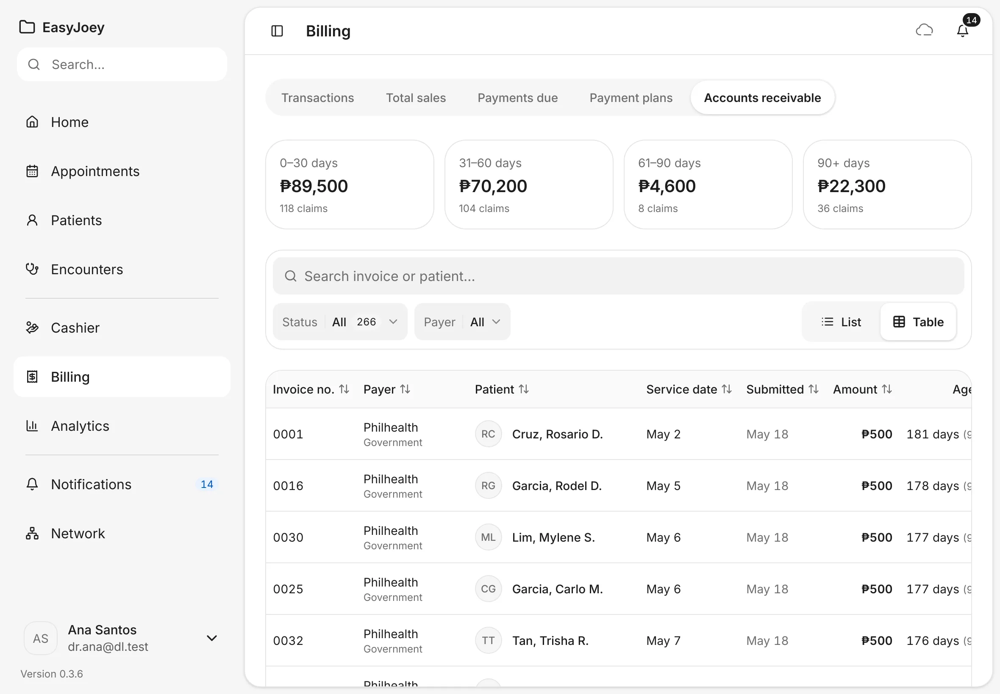

Filter by **Status** or **Payer**. Tap **⋮** on a claim to move it along. A draft claim offers **Mark submitted**, and a submitted one **Mark paid**.

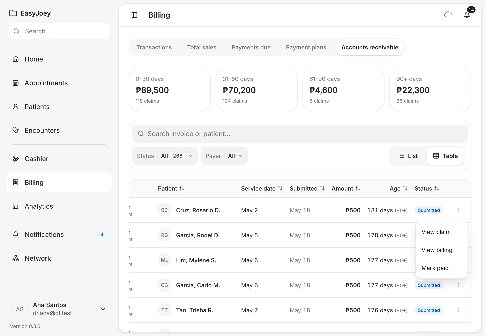

### 5. Create a payment plan

A payment plan splits a big bill into a down payment and monthly installments. Start it from the patient, so the patient is filled in for you.

Open the patient, tap the **Billing** tab, choose **Plans** from **View**, then tap **Create payment plan**. (You can also tap **Create payment plan** in **Billing › Payment plans** and choose the patient.)

Fill in **Plan title**, **Proposed total**, **Down payment**, **Number of monthly installments** and **First installment date**. Further down, fill in **Responsible payer**, **Payer relationship**, **Included services** and **Exclusions**. Tap **Save draft agreement**.

You should see: the form with the patient already filled in, and the note **Drafting terms does not start treatment, issue an invoice or collect payment.**
{ .see }

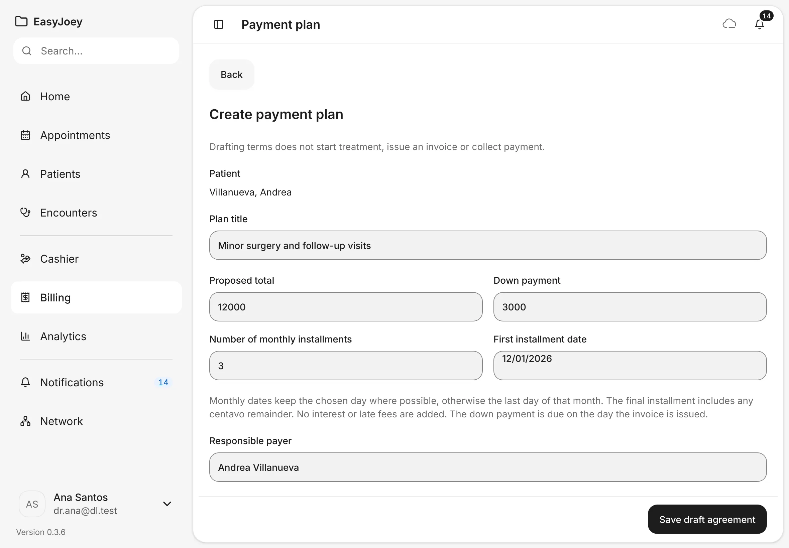

### 6. Offer the plan and record the patient's answer

You should see: the plan's page, marked **Not invoiced** and **Draft**, with **Edit draft** and **Offer agreement**, and the terms below.
{ .see }

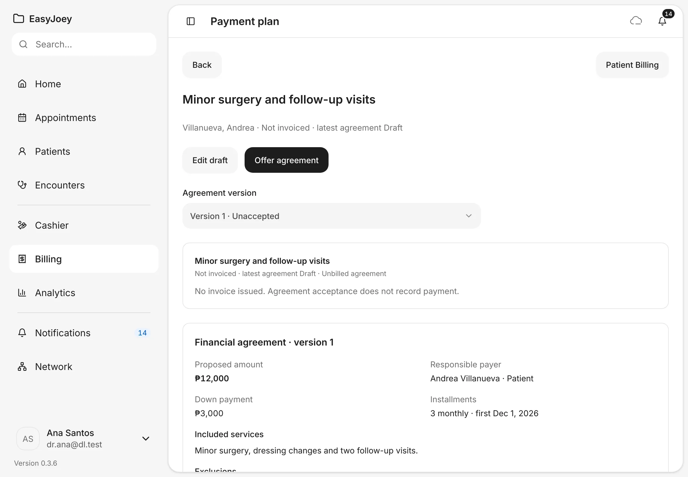

1. Tap **Offer agreement** when you show the terms to the patient. A note says **No message was sent**: EasyJoey only records that you offered it.
2. When the patient agrees, tap **Record acceptance**. Fill in **Accepted by**, **Capacity** and **Evidence method** (for example **Written agreement recorded**), tick the box to confirm you checked, then tap **Record acceptance**. If the patient says no, tap **Record decline** instead.

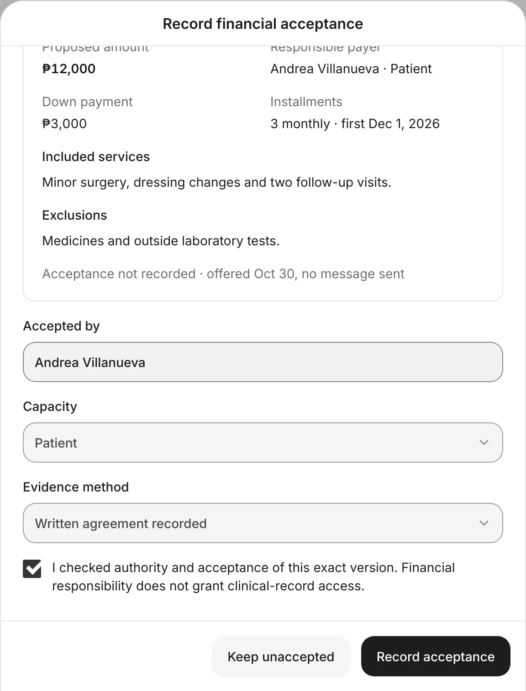{ .shot-sm }

### 7. Issue the plan's invoice

Tap **Issue package invoice**, read the summary, tick **I checked the accepted agreement and this invoice.**, then tap **Issue invoice**.

You should see: one invoice for the full amount, with the down payment due today and the installments on their dates.
{ .see }

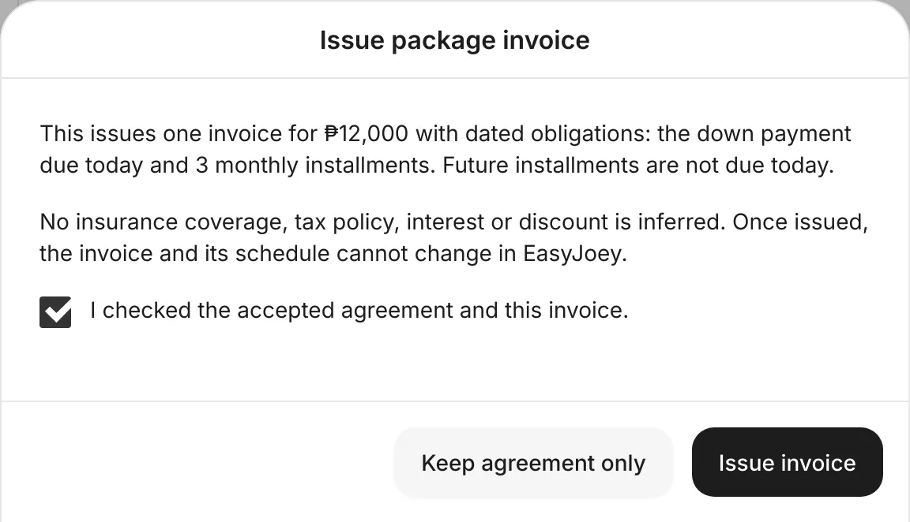{ .shot-sm }

!!! warning
    Once issued, the invoice and its schedule can't be changed in EasyJoey. Check the amounts before you tap **Issue invoice**.

You should see: **Package invoice issued. Payments can now be recorded; no money was collected.**, with **Record payment**, **View invoice** and **Financial statement**.
{ .see }

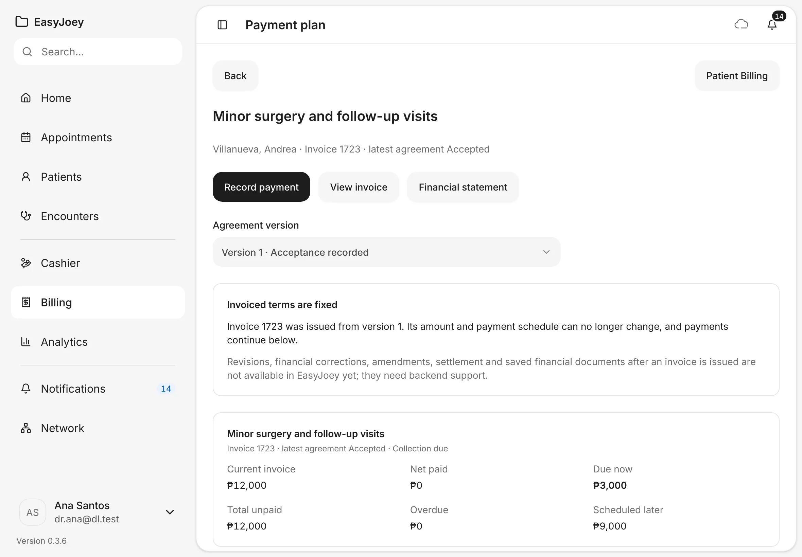

### 8. Record a payment on the plan

Tap **Record payment**. The down payment is ticked. Future installments start unticked: tick one to pay it early (the earlier ones are included). Check **Amount** and **Method**, then tap **Review allocation**, check what the payment settles, and tap **Record payment**.

You should see: under **This payment settles**, which installment the money pays.
{ .see }

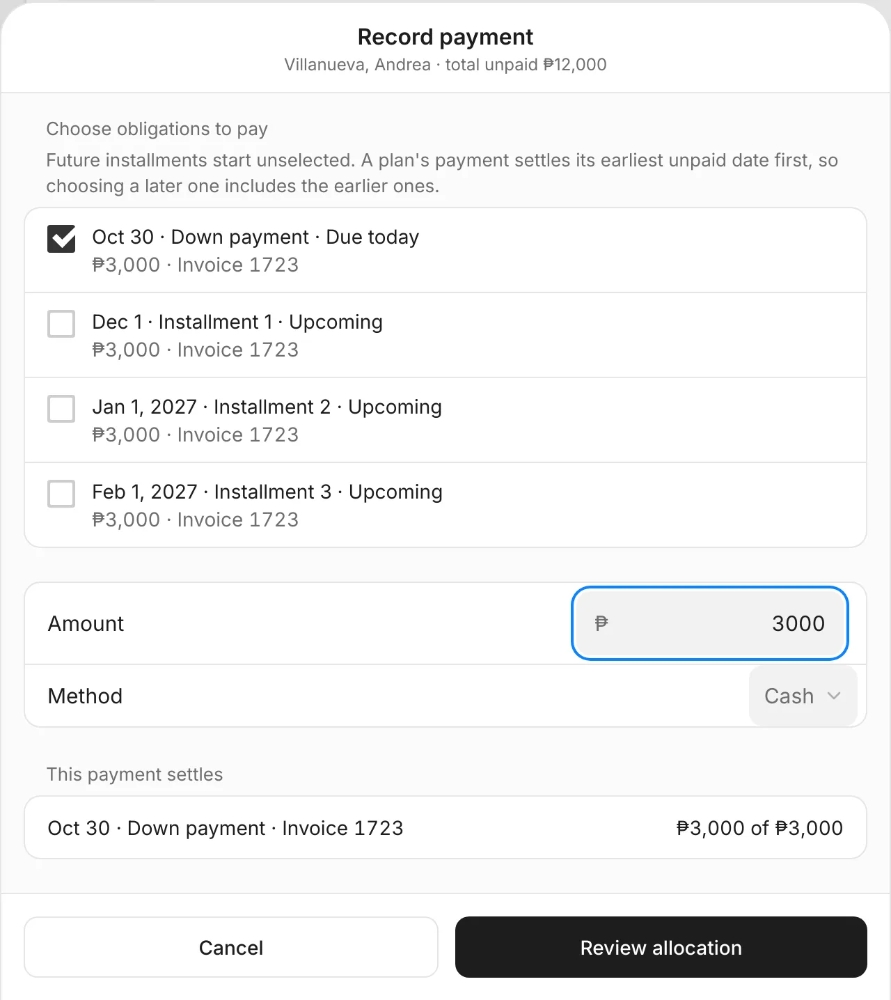{ .shot-sm }

### 9. Find your plans

Tap **Billing**, then **Payment plans**. Search by patient or plan, and use **Scope** to show **Outstanding arrangements**, **Settled balances** or **Unbilled agreements**.

You should see: each plan with its patient, its latest agreement and its **Financial position**, such as **Collection due**.
{ .see }

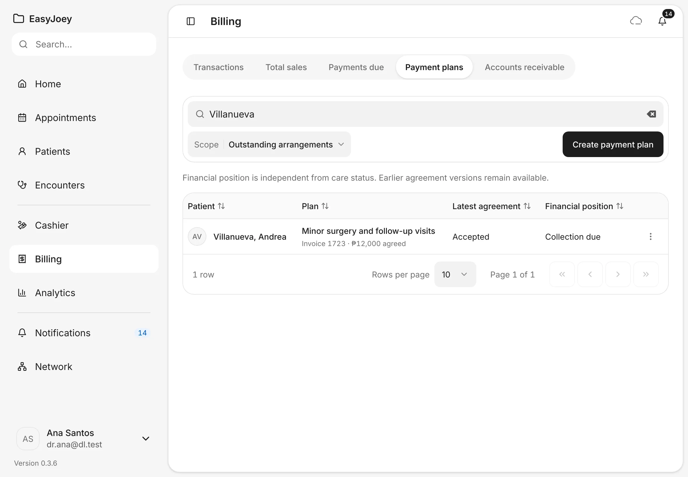

### 10. See one patient's billing

Open a patient and tap the **Billing** tab. Or, in Billing, tap **⋮ › View billing** on a row.

You should see: the patient's payment plans with **Due now** and **Scheduled later**, then **Balance due**, **Owed by payers** and **Last payment**, and their open invoices with **Collect at the cashier**. Use **View** to switch between **Due**, **Statement**, **Invoices**, **Claims** and **Plans**.
{ .see }

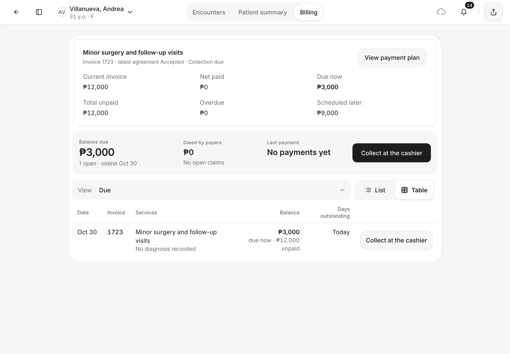

## Tips

!!! tip "Patient share only"
    **Payments due** counts only what patients owe. What HMOs and PhilHealth owe is under **Accounts receivable**, so the two never double-count.

!!! warning "If something goes wrong"
    **Review allocation stays greyed out.** Read the message in the sheet. **Choose what this payment settles.** means no installment is ticked. **Amount can't exceed the selected ₱X.** means the amount is more than the ticked installments: tick another one, or lower the amount.

!!! info "Good to know"
    - Claims are tracked by hand. **Mark submitted** and **Mark paid** only record what you did with the payer. EasyJoey doesn't send claims to PhilHealth or HMOs.
    - **Offer agreement** doesn't send anything to the patient. Show or give them the terms yourself.
    - A payment plan adds no interest or late fees. The last installment takes any centavo left over.
    - After a plan's invoice is issued, its terms can't be revised, corrected or settled differently in EasyJoey yet.

## What's next

- [Appointments](../schedule/appointments.md)
