# Charges and payment at the Cashier

Put the visit's services on the bill, send it to the Cashier, apply a Senior Citizen, PWD or HMO discount, and take payment.
{ .meta }

**Time:** about 3 minutes per patient · **You'll need:** an open encounter, and your price list set up in **Settings › Services**.
{ .meta }

## Before you start

- Prices come from your price list. See [Settings basics](../clinic/settings-basics.md).
- Payment is never taken inside the encounter. The encounter decides **what** is charged. The **Cashier** takes the money.
- What you see when you tap **Charges** depends on your account. A doctor who doesn't take payments sees the **Charges** sheet (steps 1 to 3). Anyone who can take payments, such as the clinic owner or the cashier, goes straight to the invoice at the Cashier (step 6).

## Steps

### 1. Open the charges from the encounter

In the encounter, look at the top right. The **Charges** button shows the running total, for example **Charges · ₱800**.

When an encounter opens with a visit type (for example from a booked appointment), EasyJoey puts that visit type's service on the bill by itself. A short message says so, for example **Invoice opened with Consultation**, with **Undo**.

An encounter started from a patient's page or from **Encounters** has no visit type, so nothing is added. Tap **Charges** and add the service yourself.

You should see: the encounter, with **Charges · ₱800** next to **End encounter**.
{ .see }

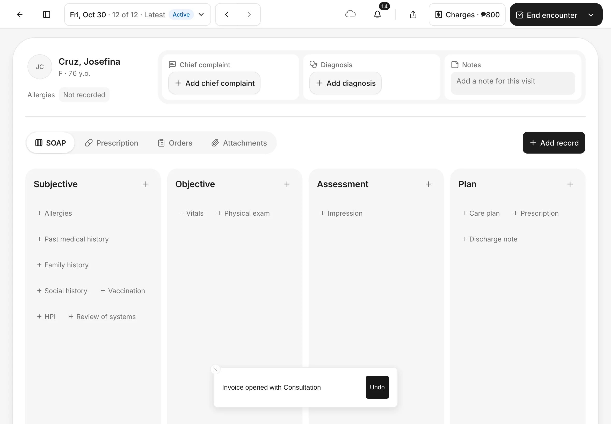

Tap **Charges**.

You should see: the **Charges** sheet. **Consultation** is ticked, marked **Visit type**, with its price. **Total charges** shows the sum.
{ .see }

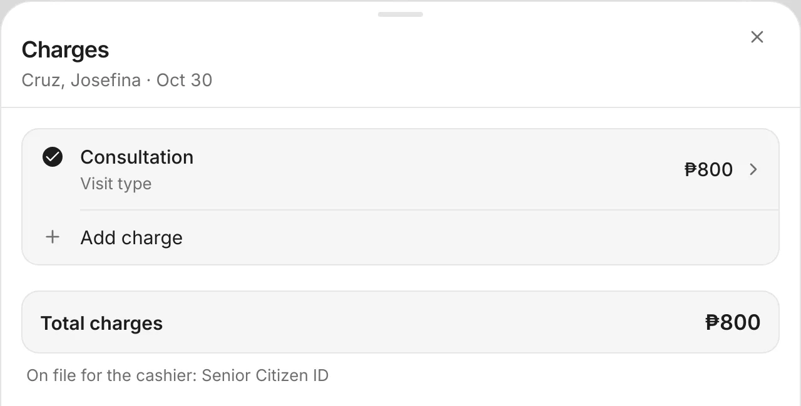{ .shot-sm }

A ticked line is on the bill. Tap a tick to take a line off the bill, and tap it again to put it back. If the patient has a Senior Citizen or PWD ID in their details, the sheet reminds you under **On file for the cashier**.

### 2. Add anything else from your price list (optional)

Tap **Add charge**, then type part of the name in **Search the price list**, for example *cert*.

You should see: the matching services with their prices.
{ .see }

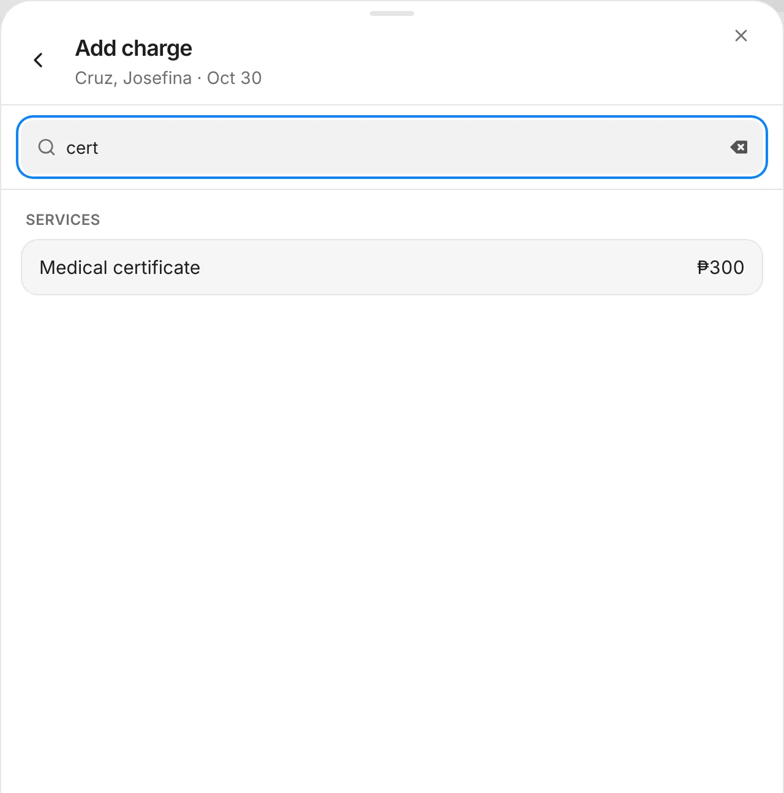{ .shot-sm }

Tap the service.

You should see: the service added to the list, already ticked, and a new **Total charges**. A message says, for example, **Medical certificate added to the invoice**, with **Undo**.
{ .see }

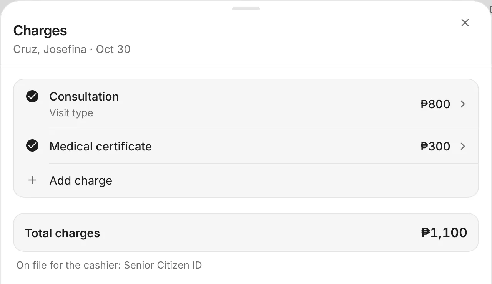{ .shot-sm }

!!! tip
    Tap a line (not its tick) to change its quantity.

### 3. End the encounter to send the bill to the Cashier

Close the sheet. Tap **End encounter** at the top right, then **End encounter** again to confirm.

You should see: **End this encounter?** with **Keep encounter**, **End early…** and **End encounter**.
{ .see }

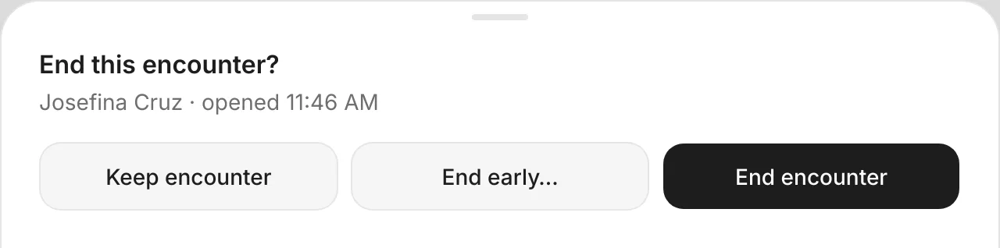{ .shot-sm }

Once the encounter ends, the bill moves to the Cashier's **Waiting** list. See [Finish the visit](../visits/finish-the-visit.md).

### 4. Find the bill at the Cashier

Tap **Cashier** in the sidebar.

You should see: the **Waiting** list. Each row shows the patient, the visit type, how many charges, when the bill was ready, and the amount.

!!! warning "After a part payment"
    The **Waiting** row keeps showing the bill's full amount after the patient pays part of it. Open the bill and check **Balance due** before you collect the rest. The number next to **Cashier** in the sidebar counts the bills waiting.
{ .see }

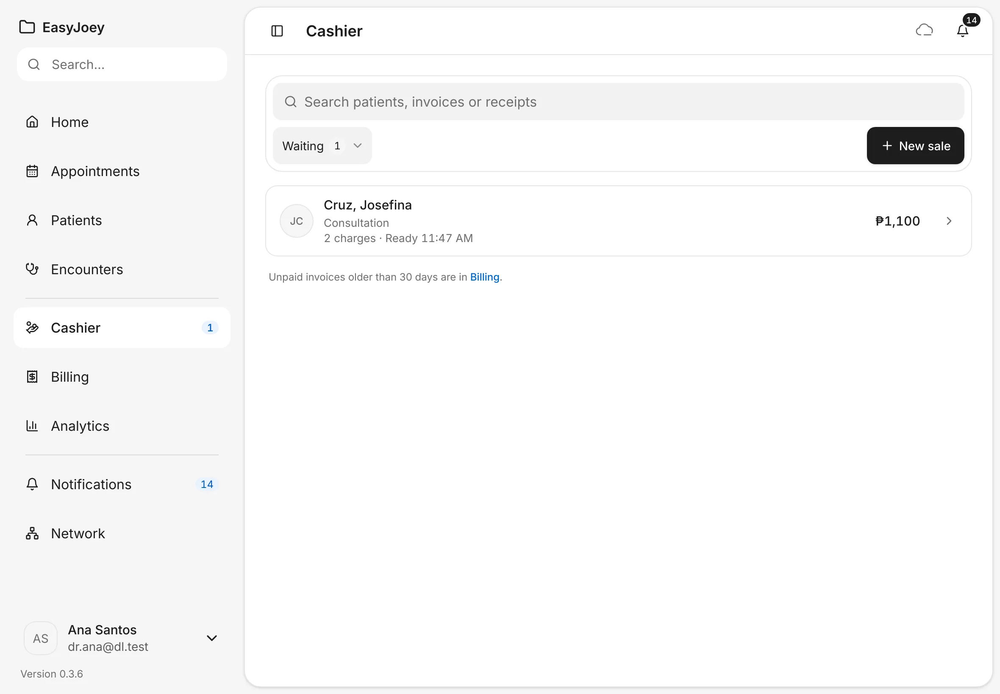

### 5. Switch between the lists

Tap the list menu (it shows **Waiting**).

You should see: four lists, each with a count:
{ .see }

- **Waiting**: the encounter has ended and the bill is ready to pay.
- **In consultation**: the patient is still with the doctor. The bill reaches **Waiting** when the encounter ends.
- **In progress**: the cashier has opened the bill but it isn't paid yet. A **New sale** is here too.
- **Paid today**: bills fully paid today.

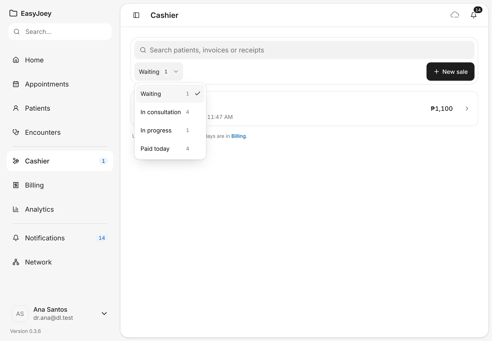

Use **Search patients, invoices or receipts** to find a bill in any list. Unpaid bills older than 30 days aren't here. They are in [Billing](billing-and-payment-plans.md).

### 6. Open the invoice

Tap the patient's row.

You should see: the invoice. **Items on this invoice** is in the middle and the totals are below it: **Subtotal**, **Discount**, **VAT**, **Total**, **Coverage** and **Balance due**. **Collect · ₱1,100** is at the bottom right. On the left, **Add to invoice** lets you add more from the price list: tap **Add** next to an item.
{ .see }

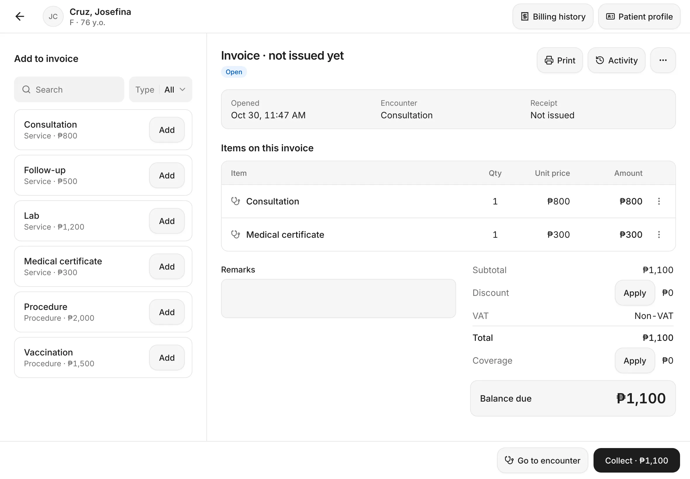

The invoice reads **Invoice · not issued yet** until it is paid. It gets its number when payment is collected.

### 7. Apply a Senior Citizen or PWD discount

Next to **Discount**, tap **Apply**. Under **Type**, choose **Senior Citizen** or **PWD**, and check the ID number. If the ID is in the patient's details, it fills in by itself.

You should see: **20% off** and the new **Total** before anything is saved.
{ .see }

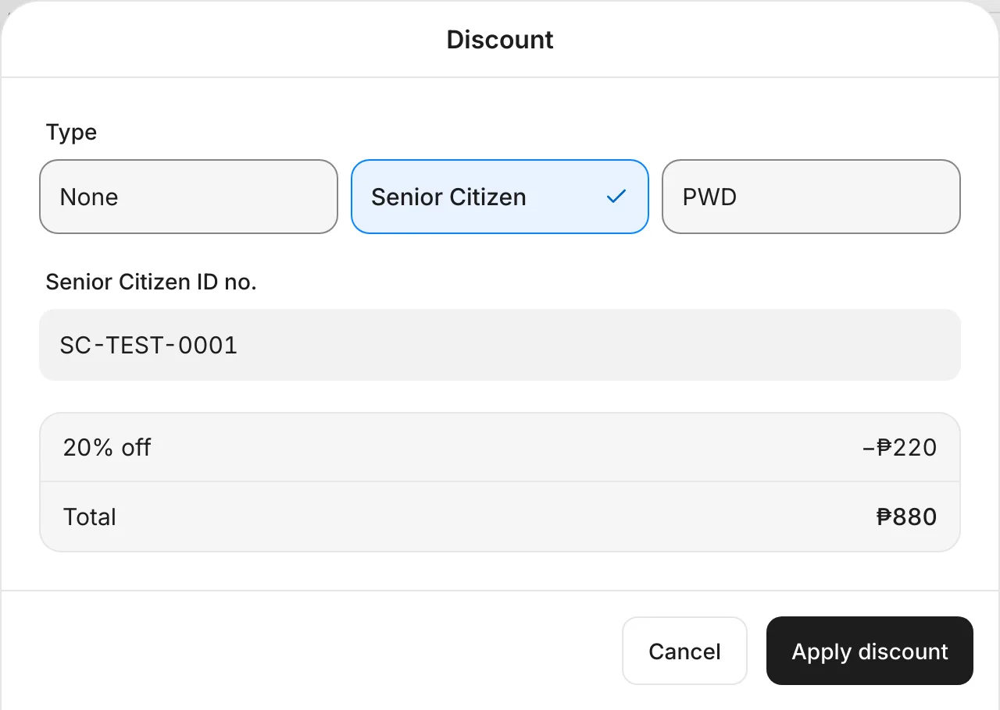{ .shot-sm }

Tap **Apply discount**.

You should see: **Senior Citizen discount** with its ID in the totals, each line's discount under **Adjustments**, and a lower **Balance due**.
{ .see }

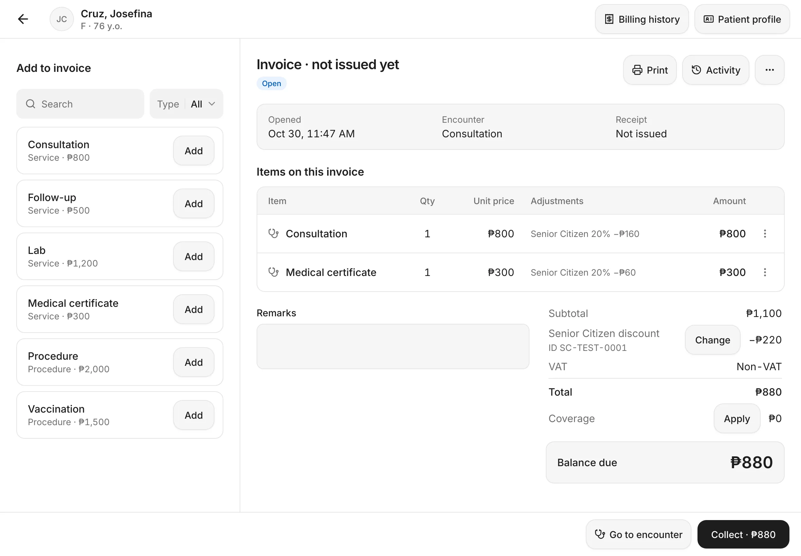

To take the discount off, tap **Change**, choose **None**, then tap **Remove discount**.

### 8. Apply HMO or PhilHealth coverage (if the patient has it)

Next to **Coverage**, tap **Apply**. Under **Payer**, choose **HMO** or **PhilHealth**, then the **Partner**. If the patient's card is in their details, it is chosen for you. Type the **Approval or LOA number (optional)** if you have one.

You should see: under **Items**, what the partner covers line by line (**Not covered** where it pays nothing), then what the partner pays and what the patient pays.
{ .see }

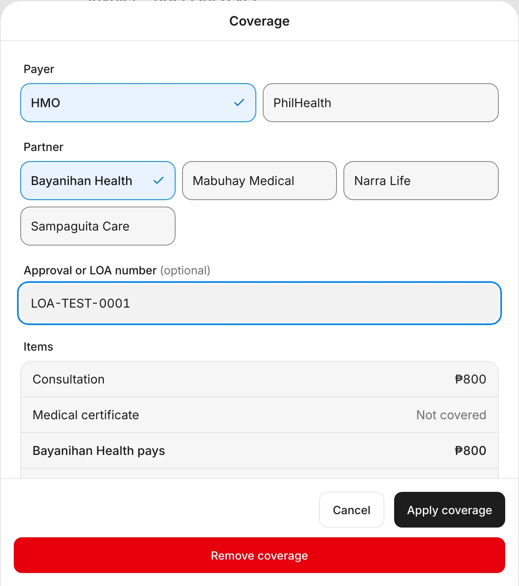{ .shot-sm }

Tap **Apply coverage**.

You should see: **Coverage · Bayanihan Health** with the approval number, then **Patient share**. **Collect** asks only for the patient's share.
{ .see }

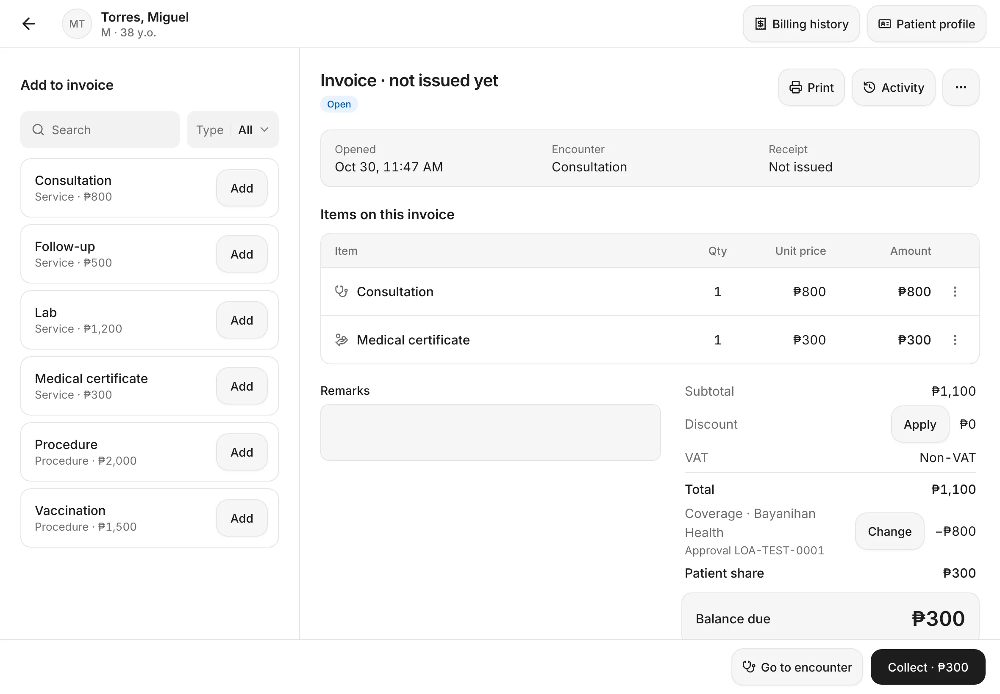

### 9. Collect the payment

Tap **Collect · ₱X**. Under **Pay with**, choose **Cash**, **GCash**, **Card** or **Bank transfer**.

For cash, type what the patient handed you in **Cash received**, or tap a quick amount such as **Exact ₱880** or **₱900**. EasyJoey works out the **Change**. The **Official receipt** number is the next in your series. To type your own, turn on **Manual OR number** and fill in **OR number**.

If the patient has a Senior Citizen or PWD ID on file and no discount yet, **Collect payment** reminds you, with an **Apply discount** button.

You should see: **Due now**, the amount, the change, and the **Official receipt** line.
{ .see }

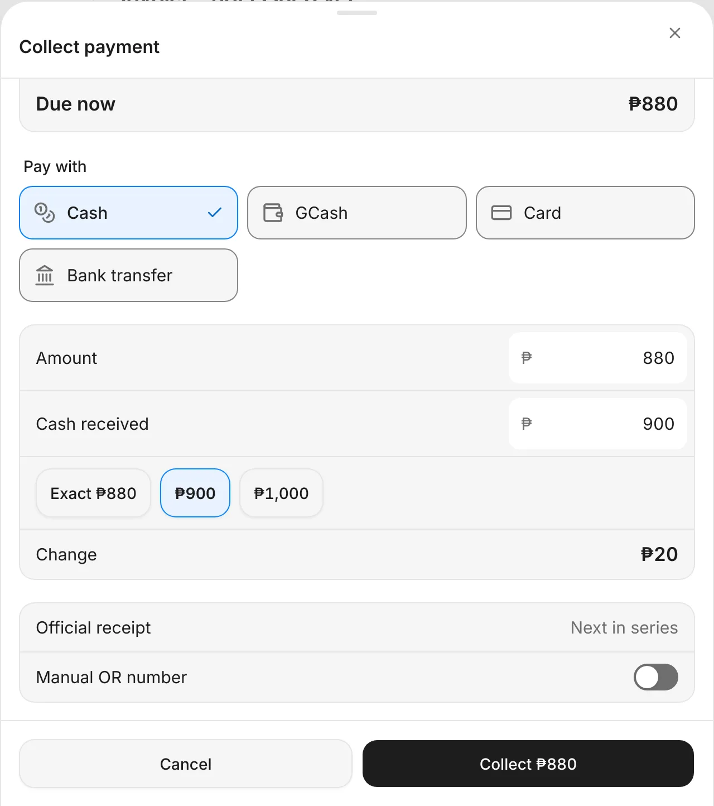{ .shot-sm }

Tap **Collect ₱X**.

You should see: the receipt with its number, the change, and **Balance due · Paid in full**. Tap **Done**.
{ .see }

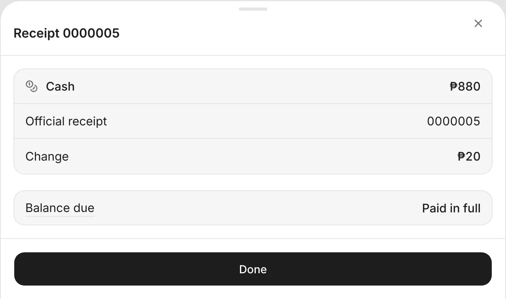{ .shot-sm }

The invoice now has its number and the status **Paid**.

### 10. Print the invoice (optional)

Tap **Print** at the top of the invoice, check the preview, then tap **Print**.

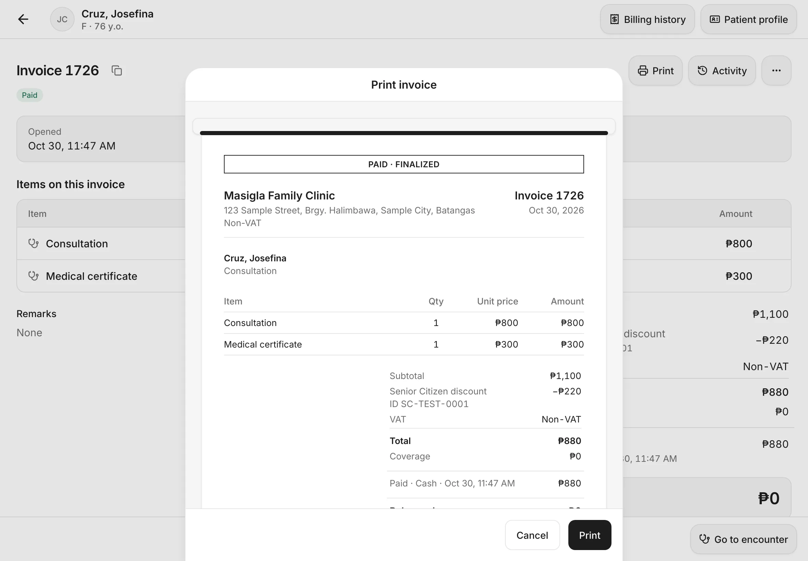

## Other things you can do

- **More (⋯)** on a paid invoice has **Send receipt**, **Duplicate as new sale** and **Void…**.

    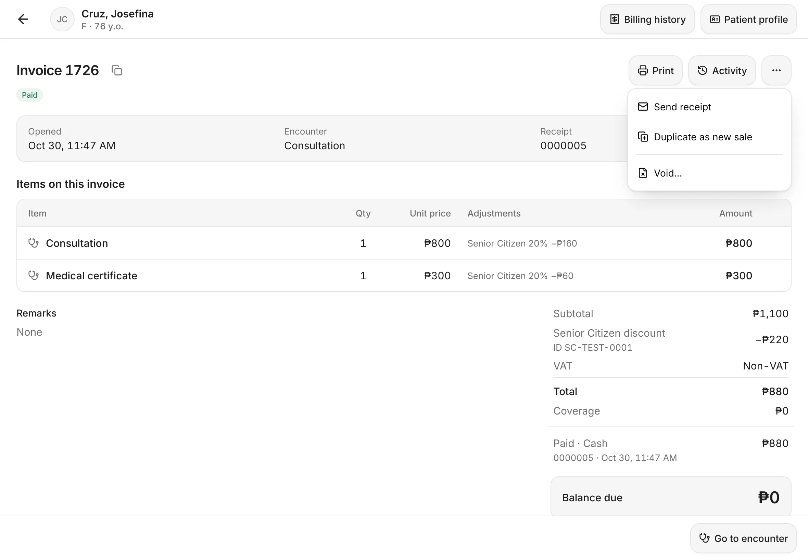

- **Void…** cancels the **Whole invoice** or only some **Items**. Type the **Reason for voiding**. The sheet shows what is voided and what goes back to the patient, then you confirm with **Void invoice · refund ₱X**. When you void a visit's whole invoice, its charges move to a **New invoice**, so the visit can be billed again.

    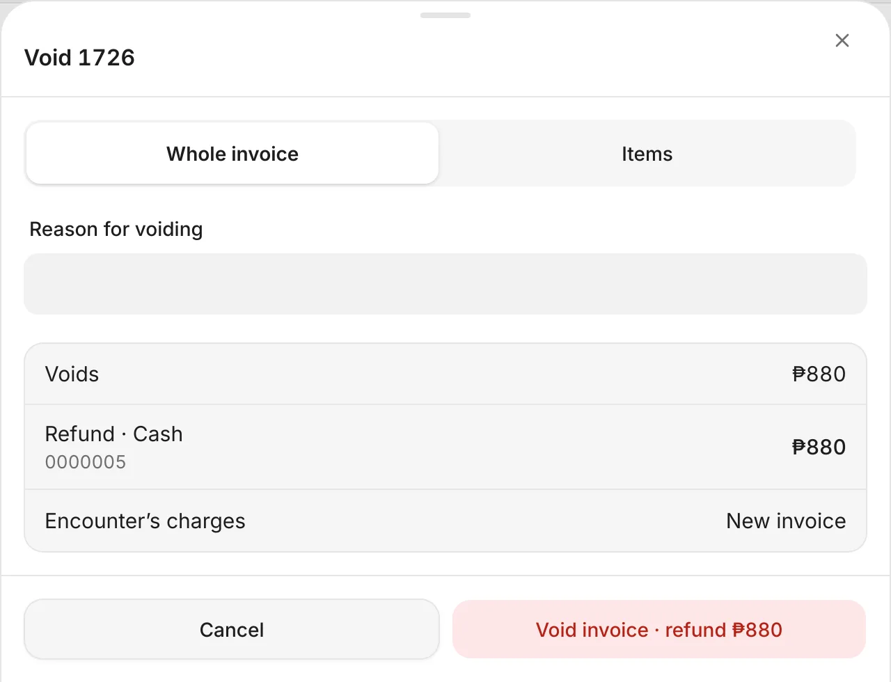{ .shot-sm }

- **New sale** (top of the Cashier page) bills someone without a visit, for example a patient who only needs a certificate. Search for the patient, or tap **Add a new patient**, then **Start sale**.

    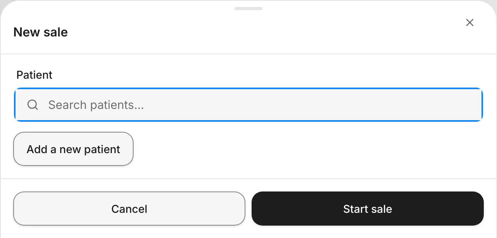{ .shot-sm }

- **Activity** at the top of the invoice lists everything done to it: charges added, discounts, payments and voids.

## Tips

!!! tip "Partial payments"
    To take part of the bill now, change **Amount** in **Collect payment** before you tap **Collect**. The rest stays in **Balance due**, and you can follow it up in [Billing](billing-and-payment-plans.md).

!!! warning "If something goes wrong"
    **The Discount or Coverage Apply button is gone.** These lock once the first payment is taken. Apply the discount or coverage before collecting.

    **"Enter the Senior Citizen ID no."** or **"Enter the PWD ID no."**: a discount needs the ID number from the patient's card.

    **"… is 24. The Senior Citizen discount starts at 60."**: the patient's date of birth says they are under 60. Check the date of birth in their details.

    **A bill is missing from Waiting.** Check **In consultation**: the encounter may still be open. End it, and the bill moves to **Waiting**.

!!! info "Good to know"
    - **Send receipt** opens your device's Mail or Messages app with the receipt. EasyJoey doesn't send it for you.
    - The Senior Citizen and PWD discounts are 20%. A patient can have one or the other, not both.
    - If the partner pays the whole bill, the button reads **Finalize · … pays all** instead of **Collect**. You'll be asked for a reason, such as "LOA covers the full visit".

## What's next

- [Billing, balances and payment plans](billing-and-payment-plans.md)
