# Appointments

Book patients, see your day, week and month at a glance, and check patients in when they arrive.
{ .meta }

**Time:** about 6 minutes · **You'll need:** your clinic hours set in Settings (see [Settings basics](../clinic/settings-basics.md)).
{ .meta }

## Before you start

- EasyJoey offers only times when your clinic is open. Set your opening hours first.

## Steps

### 1. Open the calendar

Tap **Appointments** in the sidebar, then **Calendar** at the top left.

Choose **Day**, **Week** or **Month** from **View**. Tap **Today** to come back to today, and **‹ ›** to move between days, weeks or months.

You should see: your appointments in the calendar, with today's date circled. Each appointment shows the patient and its status, such as **Confirmed**, **Pending** or **Completed**. A blue line marks the time now. Closed days are greyed out.
{ .see }

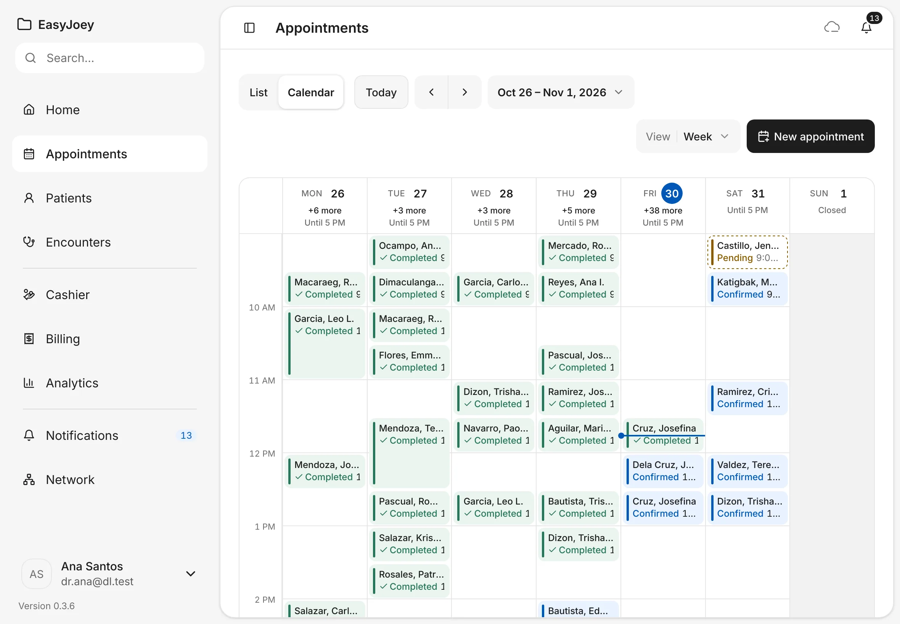

In **Month** view, tap a day to open it in **Day** view.

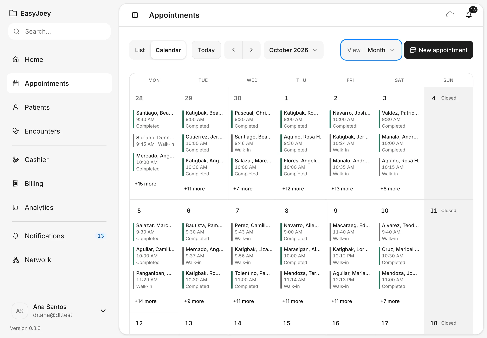

### 2. See one day

Choose **Day** from **View**. In **Week** view you can also tap a day's name at the top.

You should see: one day from morning to evening, with each appointment, its status and its time. A blue line marks the time now. Use **‹ ›** to go to the day before or after.
{ .see }

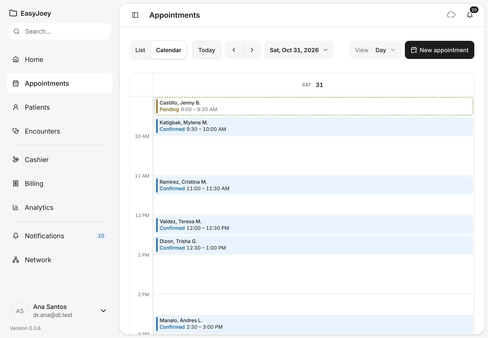

Tap an empty time to book it, or tap an appointment to open it.

### 3. Use the list

Tap **List**. The cards at the top show **Next available**, **Awaiting confirmation**, **This week's fill** and **No-show rate**.
Below, filter by **Timing** (**Upcoming**, **Past** or **Cancelled**) and **Status**, or search for a patient.

You should see: a table with **Date**, **Time**, **Patient**, **Reason** and **Status**.
{ .see }

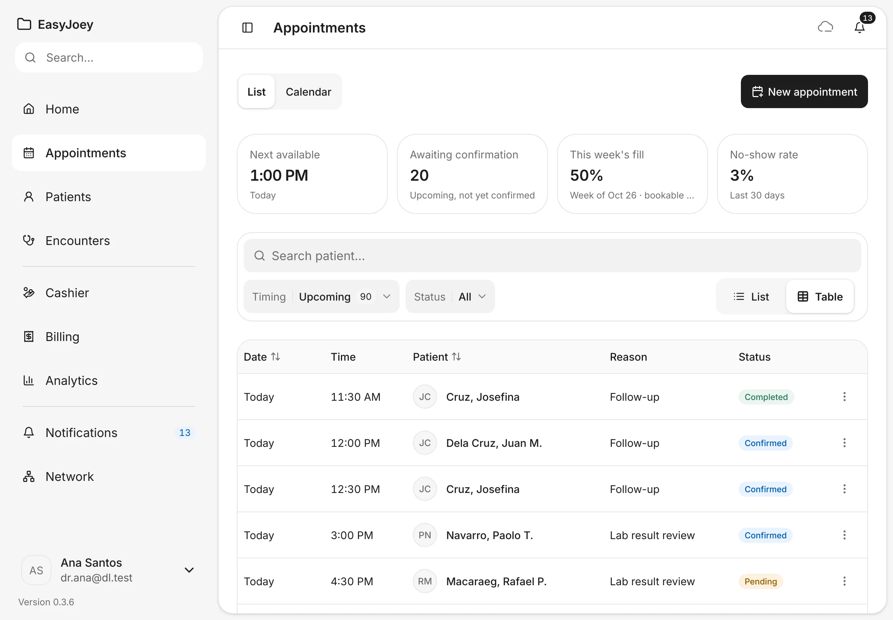

### 4. Book a new appointment

Tap **New appointment**. (In **Day** or **Week** view you can also tap an empty time in the calendar.)

1. **Patient**: type a name and pick the patient. For someone new, tap **New patient**.
2. **Visit**: choose a **Reason**, such as **Consultation**. The length shows next to it. Add a **Note** if you like.

You should see: the patient's name, the reason with its length, and your note.
{ .see }

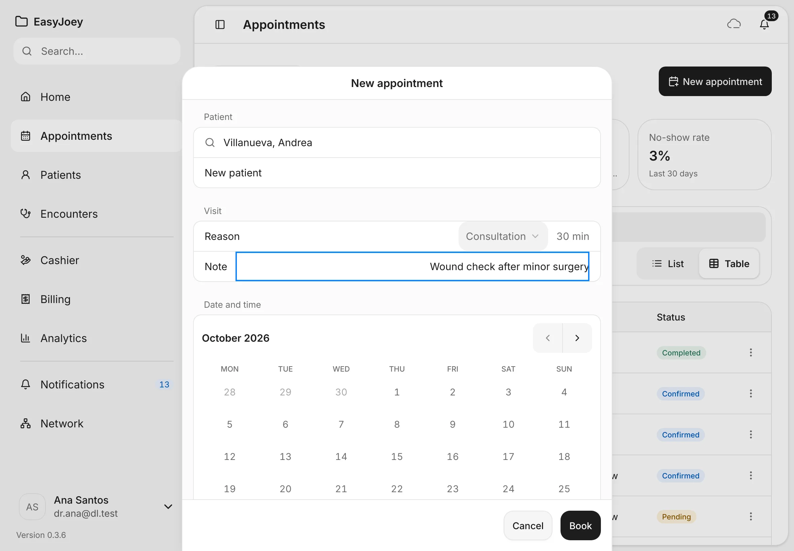

### 5. Pick a day and time, then book

Scroll to **Date and time**. Tap a day, then one of the times shown. Only free times appear, for example **Fri, Oct 30 · 8 times available**. If a day is full, tap **Next available**.

Under **Status**, choose **Confirmed** if the patient has agreed to the time, or **Not yet confirmed** if you still need to check with them. Tap **Book**.

You should see: your chosen day circled and the time highlighted.
{ .see }

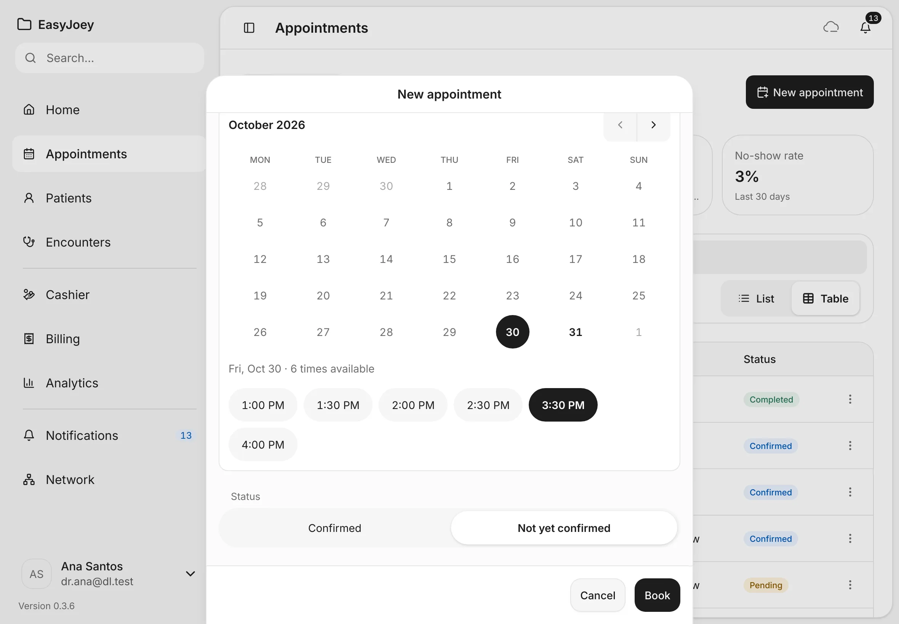

### 6. Check the booking

A message confirms the booking, for example **Booked Villanueva, Andrea · Fri, Oct 30 · 2:00 – 2:30 PM** (with your patient, day and time). Tap **View** on it to open the appointment.

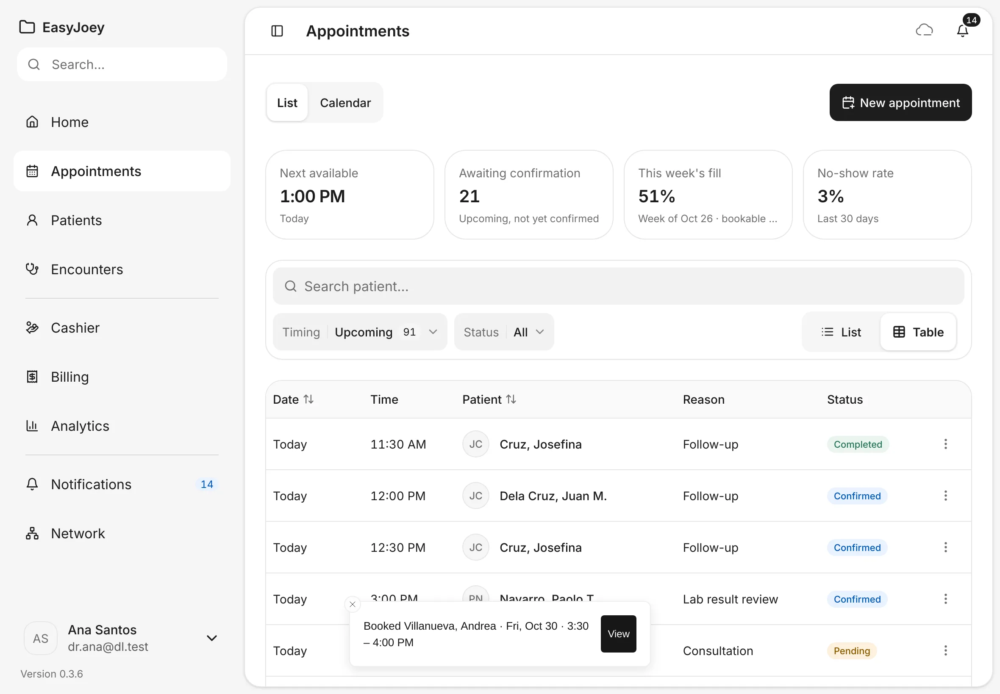

### 7. Open an appointment

Tap any appointment in the list or the calendar.

You should see: **When**, **Status**, **Booked** and **Note**, with **View profile**. Below are the actions for this appointment.
{ .see }

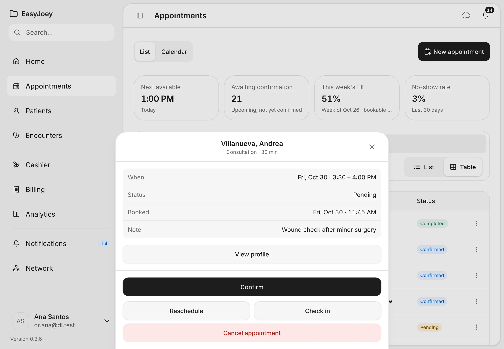

The big button changes with the appointment:

- **Confirm** for one that isn't confirmed yet.
- **Check in** for a confirmed appointment today.
- **Open encounter** or **View encounter** once the patient is checked in.

### 8. Confirm the appointment

When the patient agrees to the time, tap **Confirm**.

You should see: the message **Confirmed Villanueva, Andrea**, and the status **Confirmed** in the list.
{ .see }

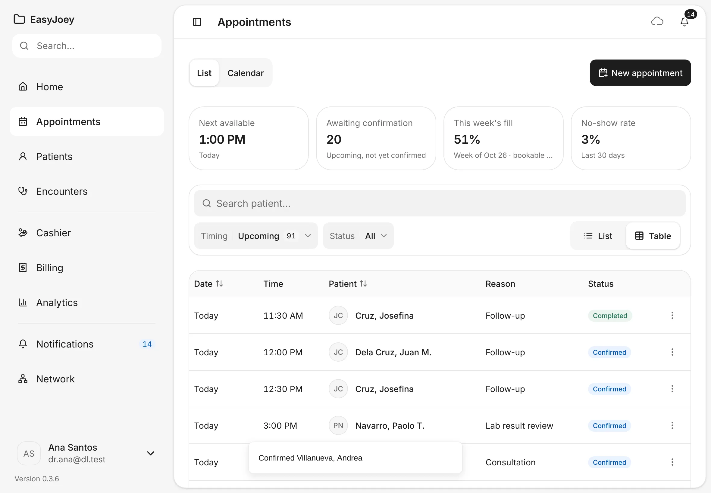

### 9. Reschedule

Open the appointment, tap **Reschedule**, pick a new day and time, then tap **Save**.

You should see: **Reschedule appointment**, with the patient and visit already filled in.
{ .see }

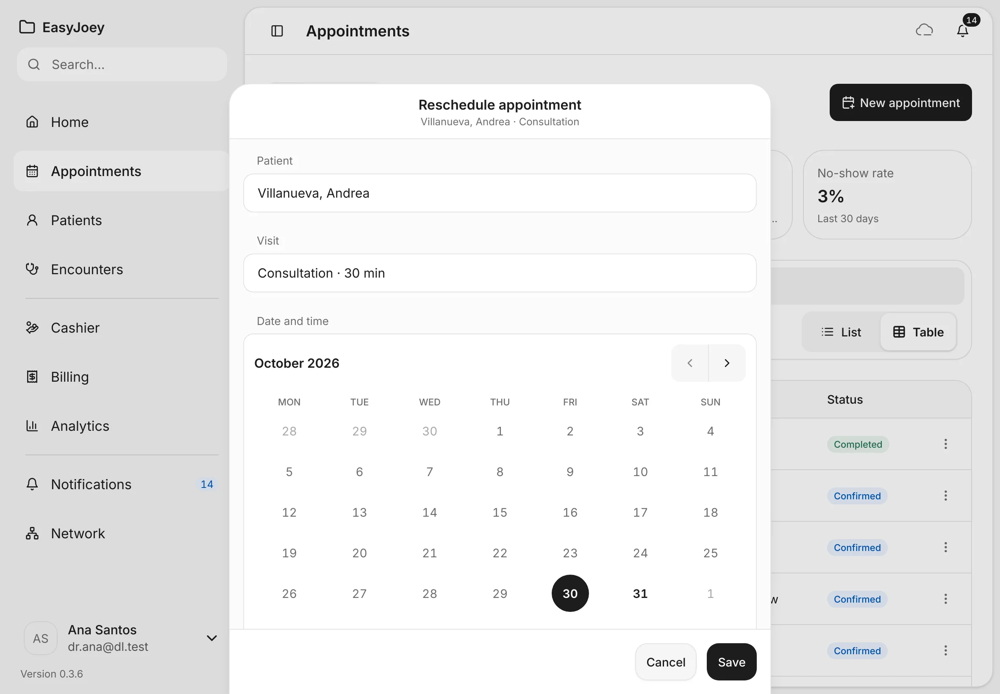

A **Moved…** message appears with an **Undo** button. The old time is freed once the Undo is gone.

### 10. Cancel an appointment

Tap **Cancel appointment**. Add a **Reason (optional)**, then tap **Cancel appointment** again to confirm. Tap **Keep appointment** if you changed your mind.

You should see: **Cancel appointment?** with the appointment's details.
{ .see }

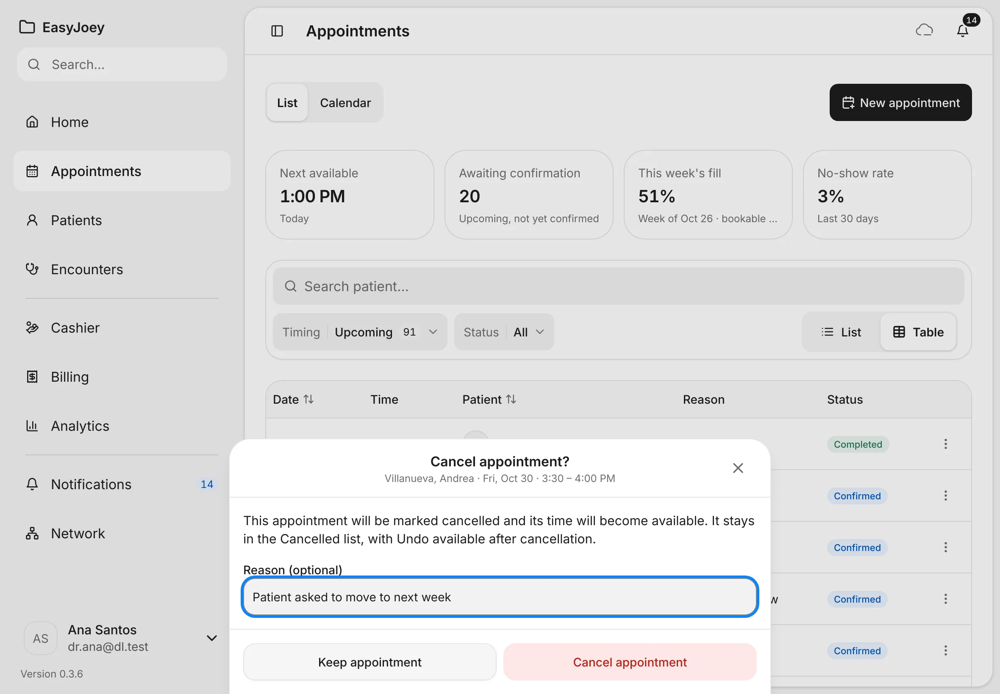

A message with **Undo** appears. The appointment is cancelled once you close that message. It then shows under **Timing › Cancelled**.

### 11. Check the patient in

When the patient arrives, open their appointment.

You should see: **Check in** as the big button.
{ .see }

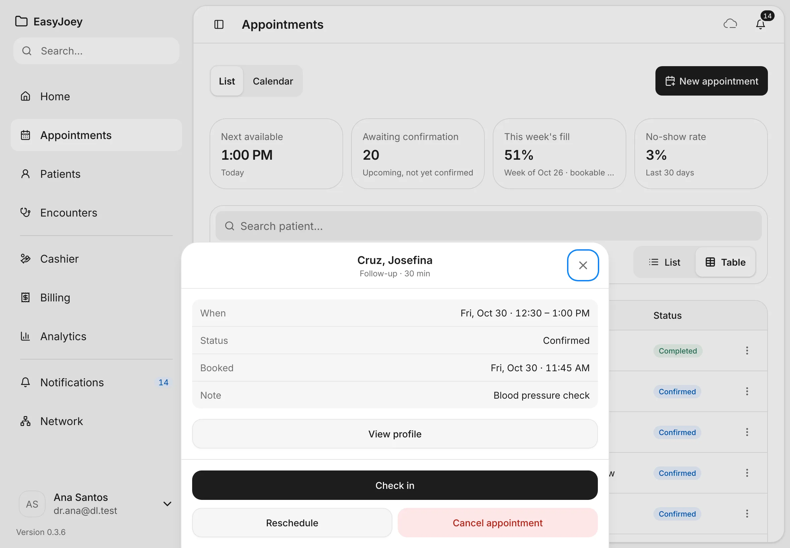

Tap **Check in**.

You should see: **Cruz, Josefina checked in**, with an **Open encounter** button. The appointment's status changes to **Checked in**.
{ .see }

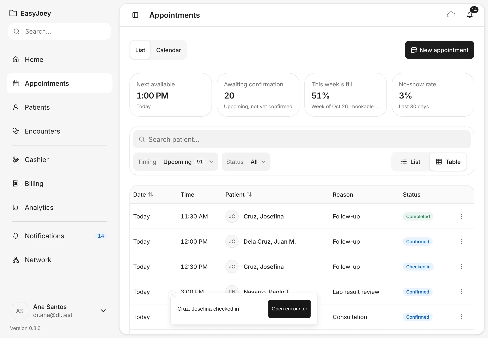

Checking in opens the patient's encounter for today, with its bill ready for charges. Tap **Open encounter** to go straight there.

### 12. Mark a no-show

If a patient doesn't come, open their appointment. **No-show** appears on a **Confirmed** appointment from 5 minutes after its start time.

You should see: **No-show** next to **Reschedule**.
{ .see }

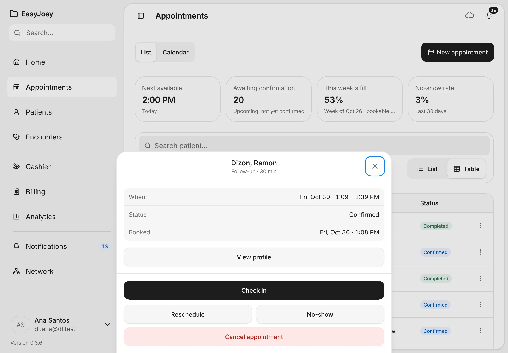

Tap **No-show**. (In the list, you can also tap **⋮** on the row, then **Mark no-show**.)

You should see: the message **Marked Dizon, Ramon as a no-show** with an **Undo** button, and the status **No-show** in the list.
{ .see }

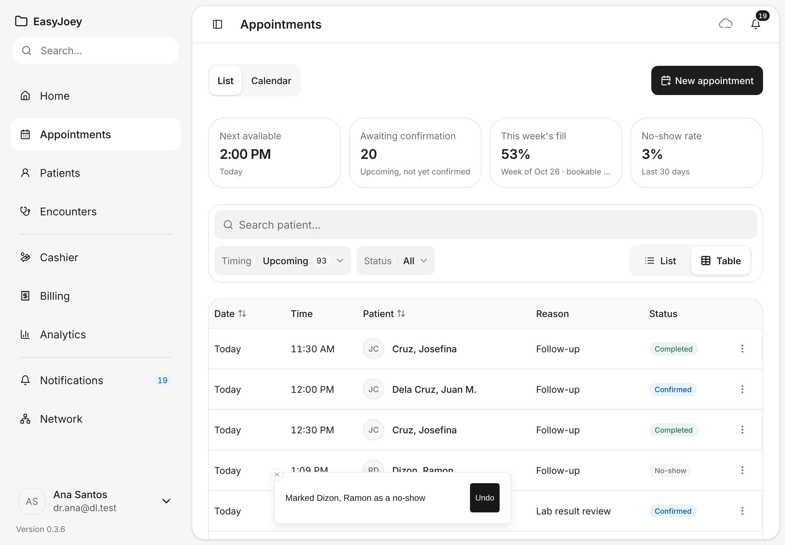

Tapped it by mistake? Tap **Undo**. **Undo** stays until you close the message, do something else with an appointment, or leave **Appointments**. After that the no-show is saved and can't be undone.

A no-show counts in the **No-show rate** card. Its time stays taken.

### 13. Answer an online booking request

If your clinic has an online booking page, patients can ask for a time there. A request arrives as an appointment that isn't linked to a patient yet. It shows the name the patient typed, followed by **· Online booking**, with the status **Pending**.

You should see: the request in the list, for example **Liza Navarro · Online booking**.
{ .see }

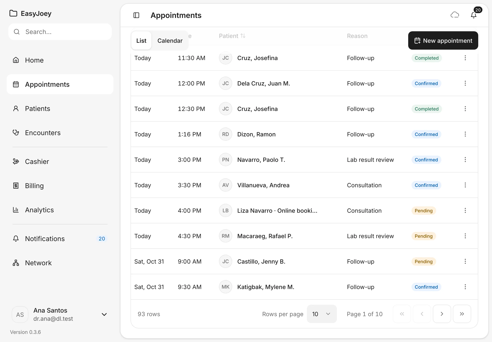

Tap the request to open it.

You should see: **When**, **Status** and **Booked**, and the line **Booked online. Confirming or checking in asks which patient it is for.** There is no **View profile** yet.
{ .see }

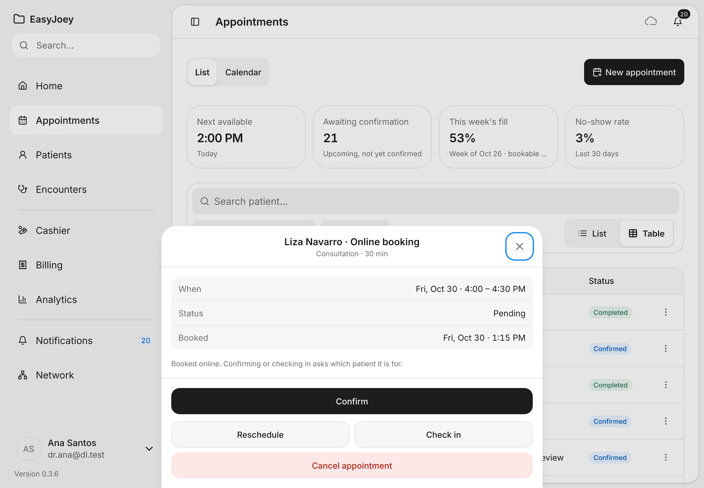

### 14. Choose who the booking is for

Tap **Confirm** (or **Check in**, if the patient is already here).

You should see: **Link to a patient**, with the **Name**, **Mobile** and **Email** from the request. Under **Who is this booking for?**, EasyJoey lists patients who may be the same person. Each one says why: **Same name**, **Same mobile** or **Same email**.
{ .see }

Choose one:

- **A matching patient**: tap the patient, if it's the same person.
- **Another patient**: search for the right patient yourself.
- **New patient from this booking**: for someone who hasn't been to your clinic. The name, mobile and email are filled in from the request. Check them before you go on.

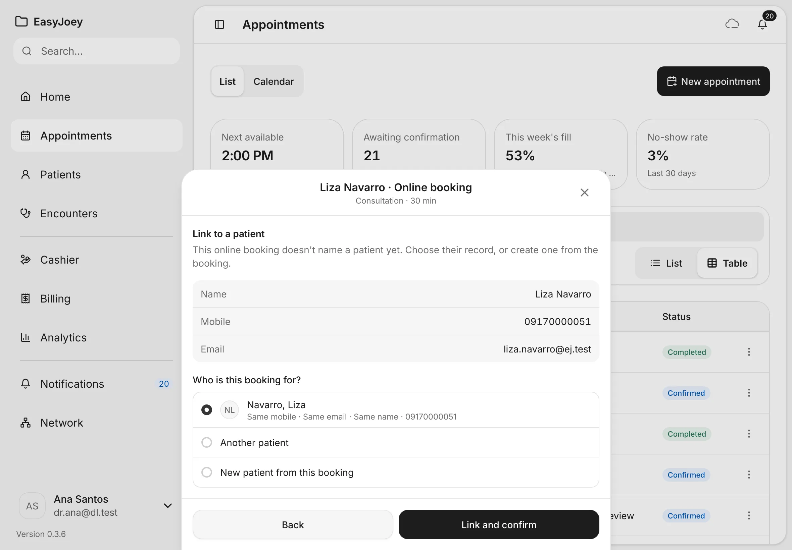

The button says what will happen:

- **Link and confirm** or **Link and check in**: for a patient you already have.
- **Create patient and confirm** or **Create patient and check in**: makes the new patient first.

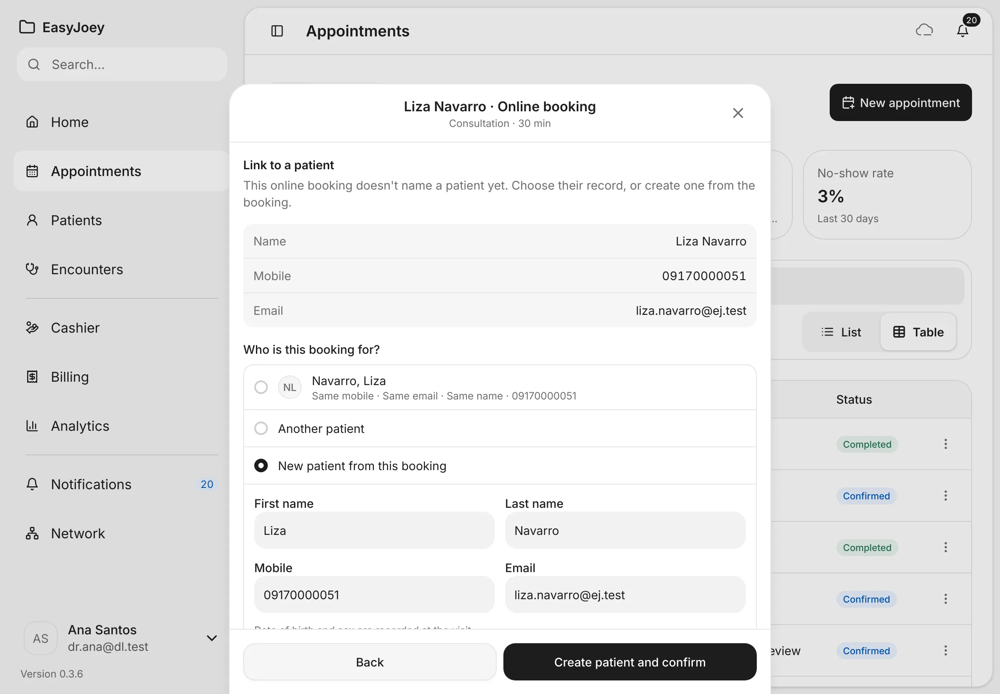

Tap the button.

You should see: the message **Confirmed** with the patient's name (or **checked in**). The appointment now shows the patient's name like any other.
{ .see }

A new patient made this way has no date of birth or sex yet. Fill them in at the visit.

## Tips

!!! tip "Not sure the patient will come?"
    Book as **Not yet confirmed**. Those appointments count in **Awaiting confirmation**, so you can call them later and tap **Confirm**.

!!! warning "If something goes wrong"
    **"That time isn't available"** or **"That time was just booked."**: someone else booked that time while you were choosing. Pick another time.

    **No times appear for a day**: the clinic is closed that day, or it's fully booked. Tap **Next available**, or check your clinic hours.

!!! info "Good to know"
    - EasyJoey doesn't send reminders or confirmation messages to patients. Contact them yourself. **Appointment reminders** in Settings are notifications for your staff.
    - You can check patients in only on the day of their appointment.
    - Nothing is linked to a patient until you choose in **Who is this booking for?**. EasyJoey never picks for you.
    - EasyJoey doesn't send a notification when an online request arrives yet. Check **Awaiting confirmation** in the list.
    - Patients can ask for a time online from 2 hours to 30 days ahead. They get an email saying the clinic will contact them to confirm.

## What's next

- [Start an encounter](../visits/start-an-encounter.md)
- [Charges and payment at the Cashier](../payments/charges-and-cashier.md)
