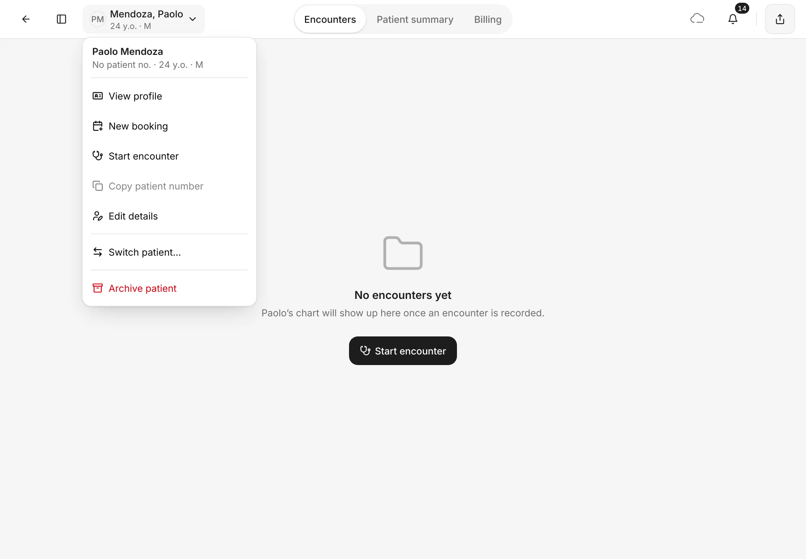
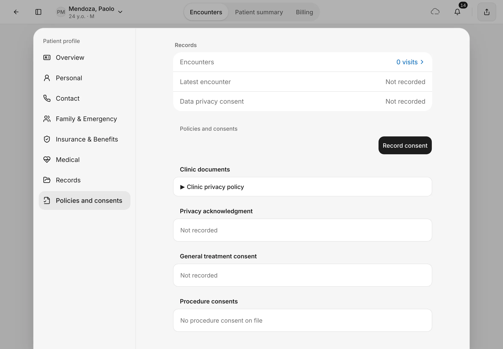
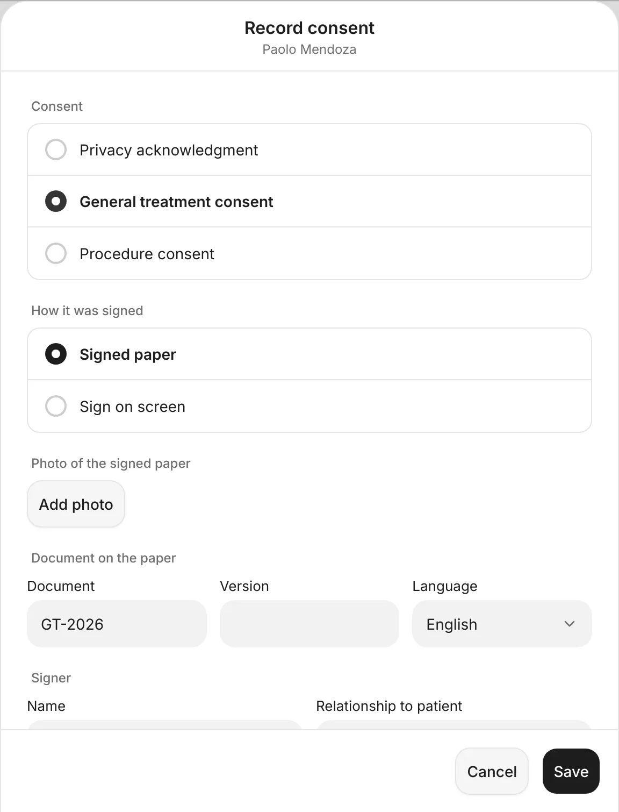
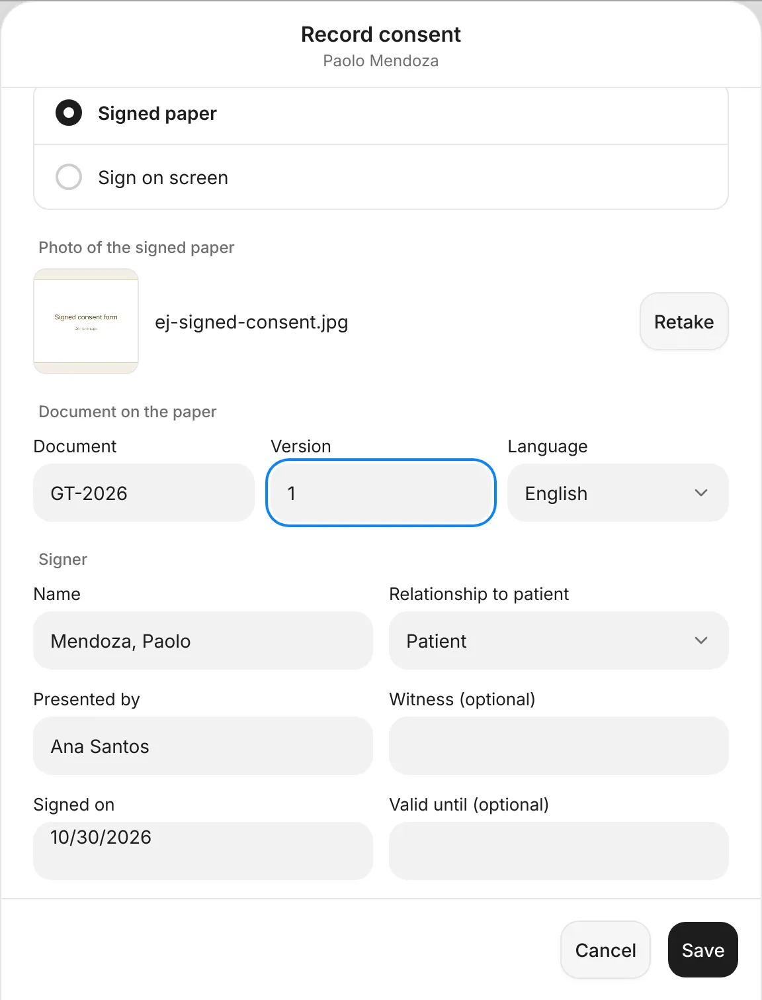
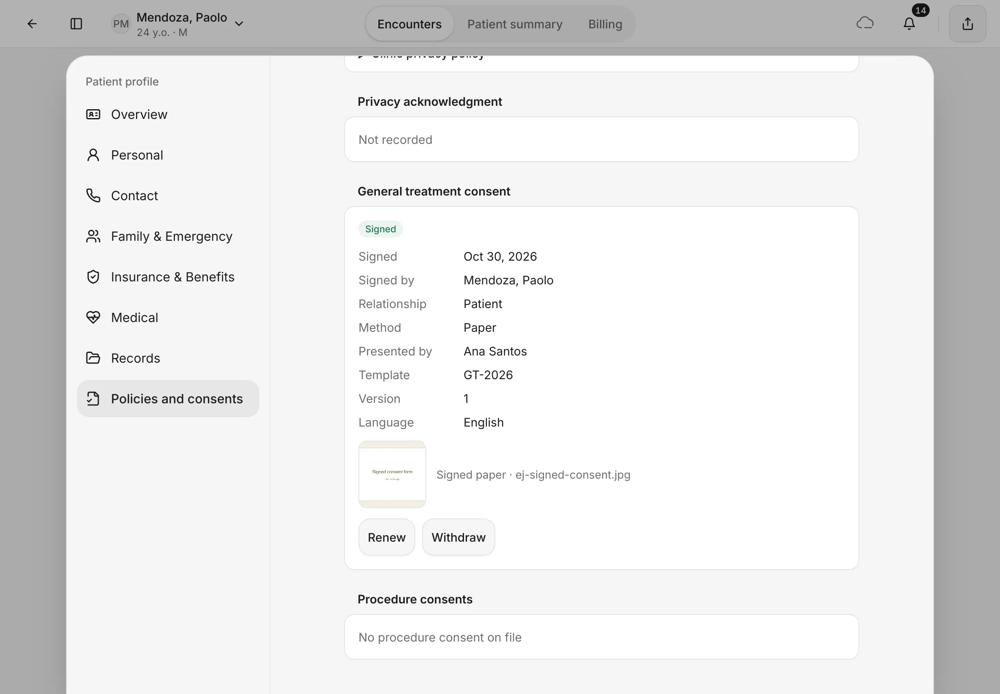
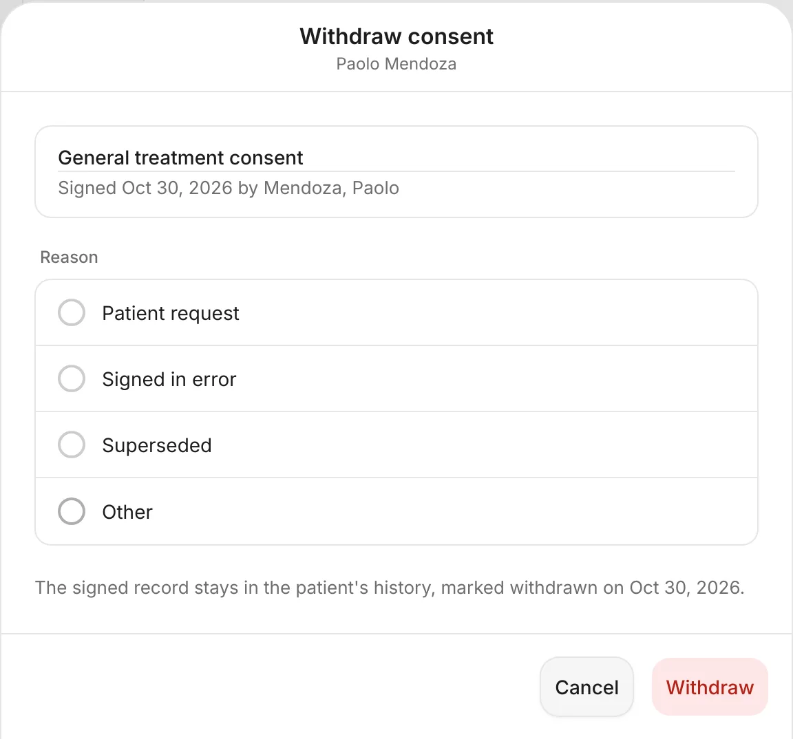
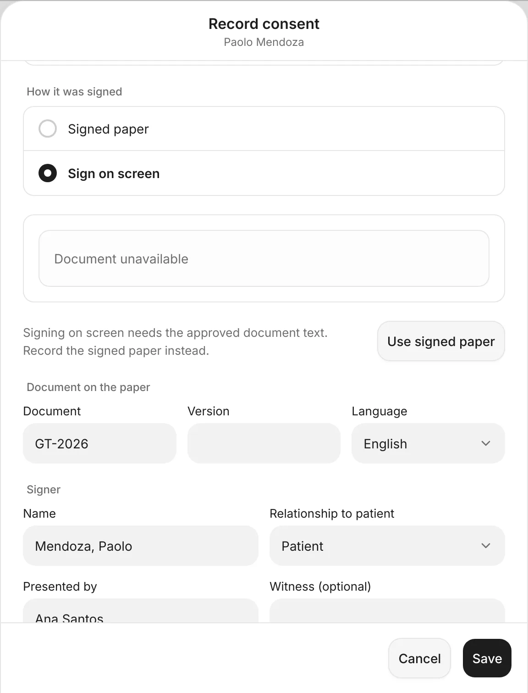

# Consents

Keep a record of the consents a patient has signed: privacy, general treatment and procedure consents.
{ .meta }

**Time:** about 2 minutes · **You'll need:** the patient's signed paper form, and the iPad camera to photograph it.
{ .meta }

## Before you start

- Have the patient sign your clinic's paper form first.
- Consents live in the patient's profile. See [The patient page and profile](../patients/patient-page-and-profile.md).

## Steps

### 1. Open the patient's profile

On the patient's page, tap the patient's name at the top left, then **View profile**.

You should see: the patient menu with **View profile** at the top.
{ .see }

### 2. Open Policies and consents

In the profile, tap **Policies and consents** on the left.

Each kind of consent has its own box: **Privacy acknowledgment**, **General treatment consent** and **Procedure consents**. One that hasn't been signed says **Not recorded**. Your clinic's own documents, such as the **Clinic privacy policy**, are under **Clinic documents**.

You should see: the consent boxes and **Record consent** at the top.
{ .see }

### 3. Choose the consent

Tap **Record consent**.

1. Under **Consent**, choose **Privacy acknowledgment**, **General treatment consent** or **Procedure consent**. For a procedure consent, also type the **Procedure** and pick the **Encounter** it belongs to.
2. Under **How it was signed**, keep **Signed paper**.

You should see: **Record consent** with the patient's name under the title.
{ .see }

{ .shot-sm }

### 4. Add a photo of the signed paper

1. Under **Photo of the signed paper**, tap **Add photo** and take a clear photo of the whole signed page. Tap **Retake** if it's blurry.
2. Under **Document on the paper**, type the **Document** code and **Version** printed on the form, for example *GT-2026* and *1*, and check the **Language**. If your clinic has recorded this kind of consent before, **Document** is filled in for you: check it matches the paper.
3. Under **Signer**, check the **Name** and **Relationship to patient**. **Presented by** and **Signed on** are filled in for you. Add a **Witness (optional)** and **Valid until (optional)** if you need them.
4. Tap **Save**.

You should see: the photo next to its file name, and the document code and version filled in.
{ .see }

{ .shot-sm }

### 5. Check the saved consent

The box now shows **Signed**, with the date, who signed, the method (**Paper**), who presented it, the document, version and language, and the photo.

- **Renew**: record a new signature, for example when the form changes. The earlier one stays on record.
- **Withdraw**: the patient takes back their consent.

You should see: **General treatment consent** marked **Signed**, with **Renew** and **Withdraw**.
{ .see }

### 6. Withdraw a consent

Tap **Withdraw**, choose a **Reason** (**Patient request**, **Signed in error**, **Superseded** or **Other**), then tap **Withdraw**.

The signed record isn't deleted: it stays in the patient's history, marked withdrawn on that day.

You should see: **Withdraw consent** with the consent's name and date at the top.
{ .see }

{ .shot-sm }

## Signing on the iPad screen

**How it was signed** also offers **Sign on screen**, where the patient would sign on the iPad (**Hand to patient**). This needs the clinic's approved wording of the document, which can't be added in EasyJoey yet.

So for now, choosing **Sign on screen** shows **Document unavailable** and **Signing on screen needs the approved document text. Record the signed paper instead.** Tap **Use signed paper** to go back.

{ .shot-sm }

## Tips

!!! tip "Photograph the whole page"
    Lay the form flat in good light so the signature and the document code are easy to read later.

!!! warning "If something goes wrong"
    - **Add a photo of the signed paper.** A paper consent needs its photo before you can save.
    - **Enter the document and version printed on the paper.** Fill in **Document** and **Version** from the form.
    - **Name the procedure this consent covers.** A procedure consent needs the **Procedure** filled in.
    - **Record consent is greyed out.** You need the "Create medical records" permission. Ask your clinic owner.

!!! info "Good to know"
    - A procedure consent linked to an encounter also shows in that encounter's **Attachments** view. See [Prescriptions, orders and attachments](prescriptions-orders-attachments.md).
    - A renewed or withdrawn consent is never deleted. Earlier ones stay under the box as **Earlier consent**.

## What's next

- [Finish the visit](finish-the-visit.md)
