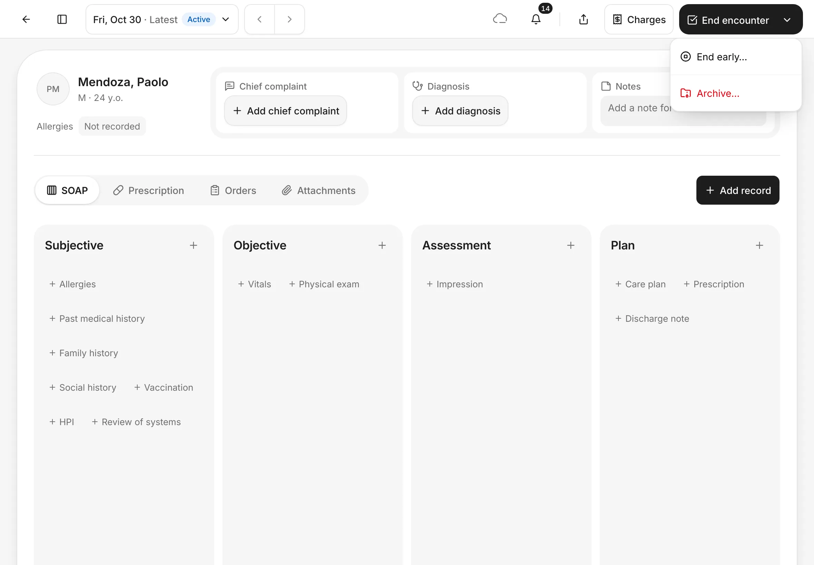
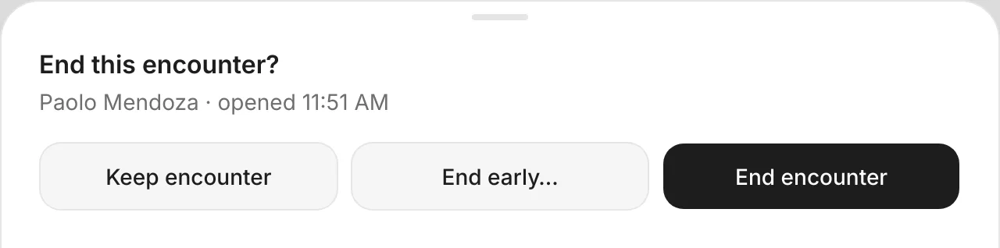
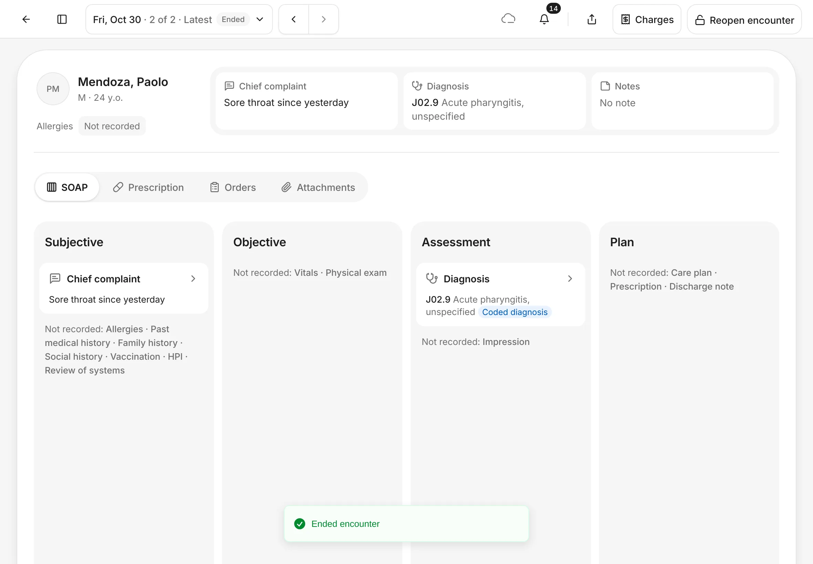
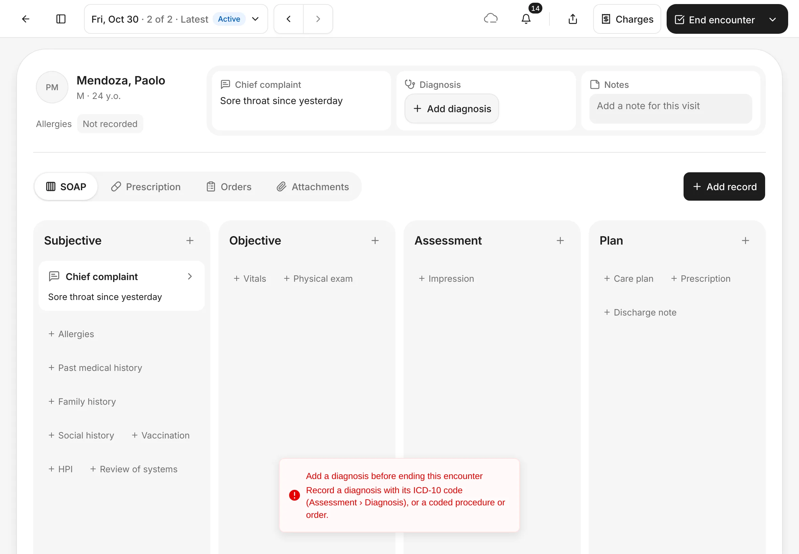
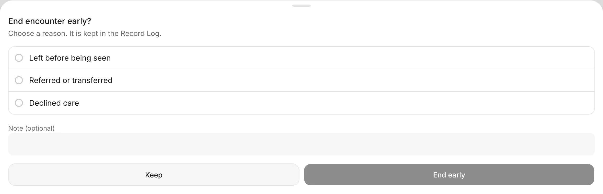
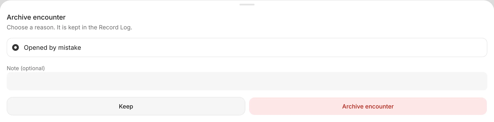
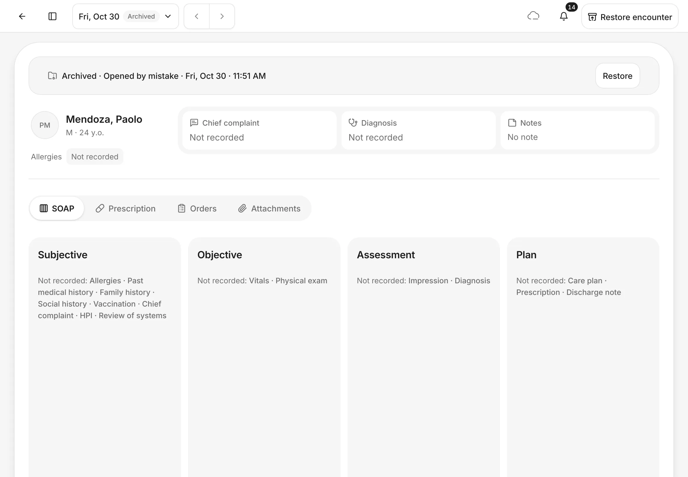

# Finish the visit

End the encounter when the patient is done, so the visit's records are final. You can also end a visit early, or archive one opened by mistake.
{ .meta }

**Time:** about 1 minute · **You'll need:** an open encounter.
{ .meta }

## Before you start

- Record the visit first: at least the chief complaint and the diagnosis. See [Record notes in the encounter](record-notes.md).
- Charges and payment are handled from **Charges** in the top bar. See [Charges and the Cashier](../payments/charges-and-cashier.md).

## End the encounter

### 1. Tap End encounter

In the encounter's top bar, tap **End encounter**.

The **⌄** beside it has other choices:

- **End early…**: the patient couldn't finish the visit.
- **Archive…**: remove an encounter that was opened by mistake. This only shows while nothing has been recorded.

You should see: **End encounter** at the top right. The **⌄** shows **End early…** and **Archive…**.
{ .see }

### 2. Confirm

EasyJoey asks **End this encounter?** with the patient's name and the time the encounter was opened.

- **End encounter**: end the visit.
- **End early…**: end it with a reason instead (see below).
- **Keep encounter**: go back and keep working.

You should see: **End this encounter?** with three buttons.
{ .see }

{ .shot-sm }

### 3. Check that it ended

The message **Ended encounter** shows. The status next to the date says **Ended**, and nothing on the visit can be changed any more. Records are now final: to correct one, use **Amend…** (see [Record notes in the encounter](record-notes.md)).

The top button now says **Reopen encounter**.

You should see: **Ended** next to the date and **Reopen encounter** at the top right.
{ .see }

### 4. Reopen if you need to

If you ended the visit too soon, tap **Reopen encounter**. The status goes back to **Active** and you can add records again. End it again when you're done.

You can only reopen an encounter from today. Older ones stay view only.

## When a diagnosis is required

Your clinic, or your own settings, may require a diagnosis before an encounter can end. The switch is **Require a diagnosis before closing** in **Settings › Encounter**.

When it's on and the visit has no coded diagnosis, tapping **End encounter** shows **Add a diagnosis before ending this encounter**. Add a diagnosis with its ICD-10 code (**Add diagnosis**), or a coded procedure or order, then tap **End encounter** again.

## End a visit early

If the patient left before being seen, was referred elsewhere or declined care, tap **⌄ › End early…** (or **End early…** in the confirmation).

Choose the reason: **Left before being seen**, **Referred or transferred** or **Declined care**. Add a note if you want, then tap **End early**.

The encounter shows a band at the top with **Ended early**, the reason and the time. If it's from today, the band has a **Reopen** button.

## Archive an encounter opened by mistake

### 1. Choose Archive…

Tap **⌄ › Archive…**. The reason **Opened by mistake** is chosen. Add a note if you want, then tap **Archive encounter**.

You can only archive an encounter with nothing recorded and nothing on its bill.

### 2. Check that it's archived

A band at the top says **Archived · Opened by mistake** with the date and time. The status says **Archived**.

To bring it back, tap **Restore** on the band (or **Restore encounter** at the top right). It comes back as an ended encounter.

You should see: the **Archived** band with **Restore**.
{ .see }

## Tips

!!! tip "When the bill is already paid"
    If the patient has paid the whole bill while the encounter is still open, a blue band shows **Bill paid in full · ₱*amount*. You can end the encounter.** Tap **End encounter** on the band to finish.

!!! warning "If something goes wrong"
    - **Add a diagnosis before ending this encounter.** See [When a diagnosis is required](#when-a-diagnosis-is-required).
    - **Archive… isn't in the menu.** Something has been recorded or billed on this encounter. End it instead, or end it early.
    - **Reopen encounter isn't there.** The encounter is from an earlier day, or archived.

!!! info "Good to know"
    - There's no Undo after ending or archiving. **Reopen** and **Restore** are the way back.
    - **End early…** never asks for a diagnosis.
    - If **Confirm before closing an encounter** is off in **Settings › Encounter**, **End encounter** ends the visit straight away, without asking.
    - Ending early with **Left before being seen** or **Declined care** also clears the visit's unbilled charges.

## What's next

- [Charges and the Cashier](../payments/charges-and-cashier.md)
- [Appointments](../schedule/appointments.md)
