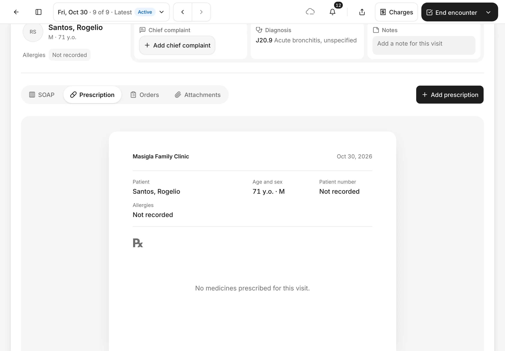
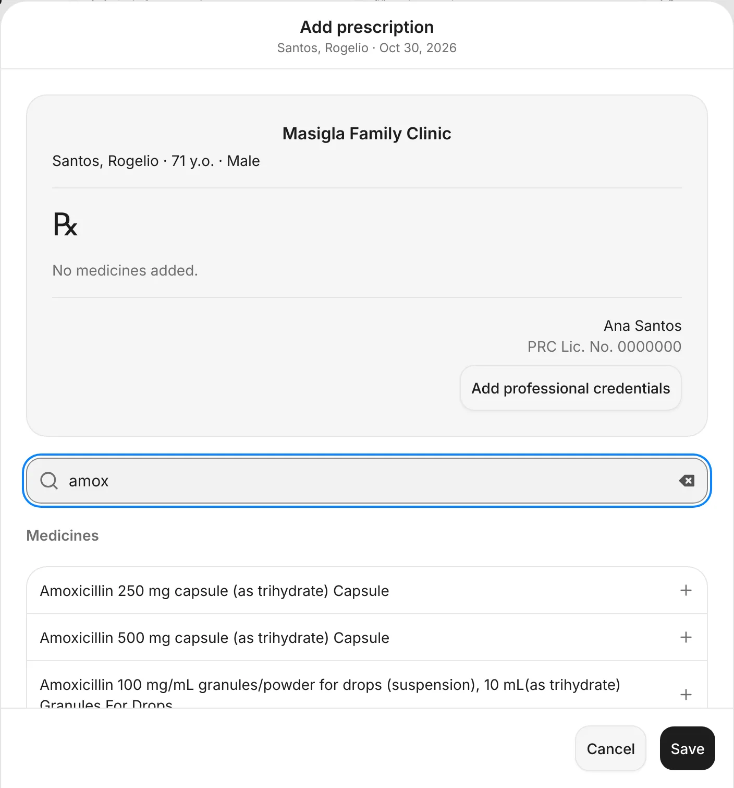
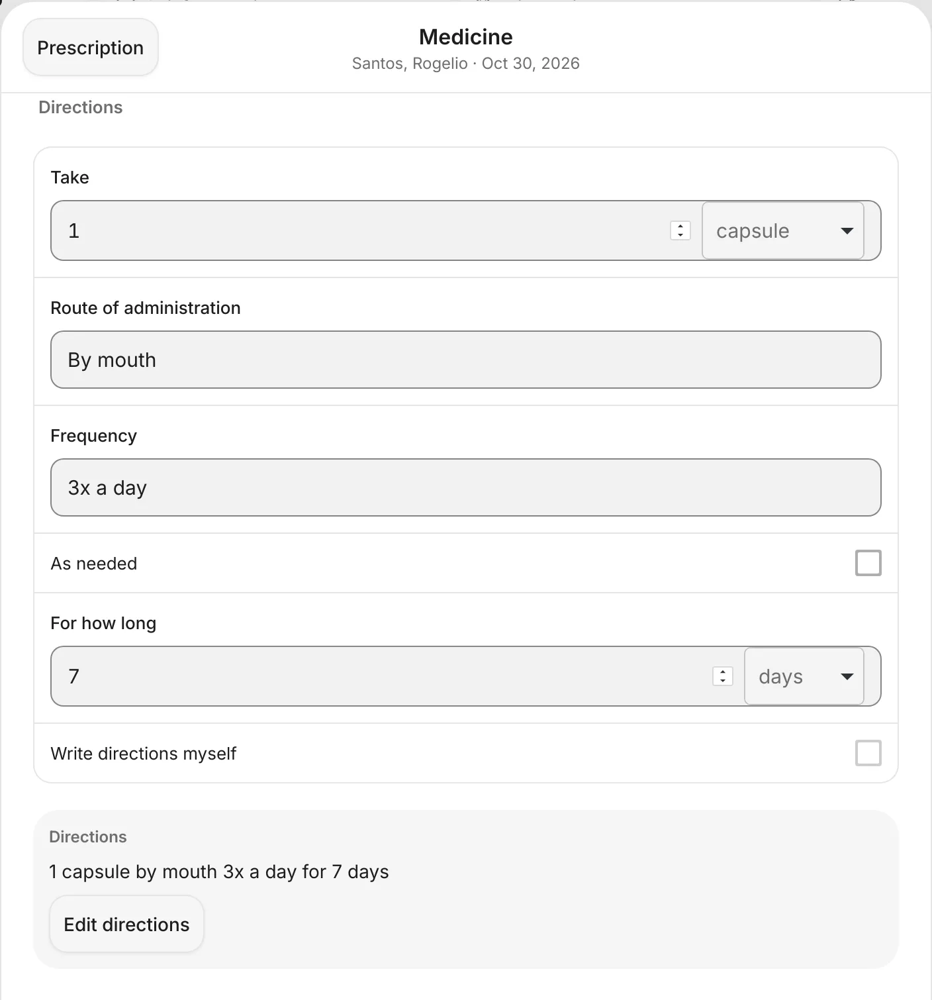
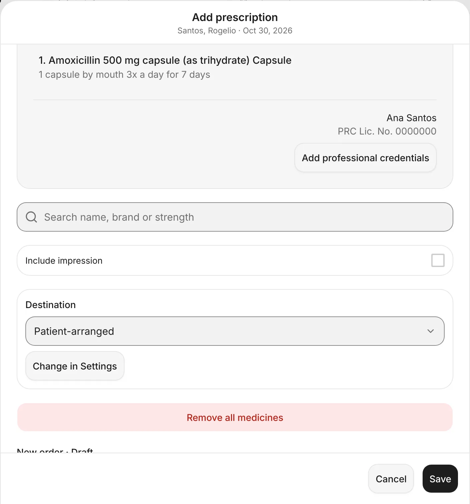
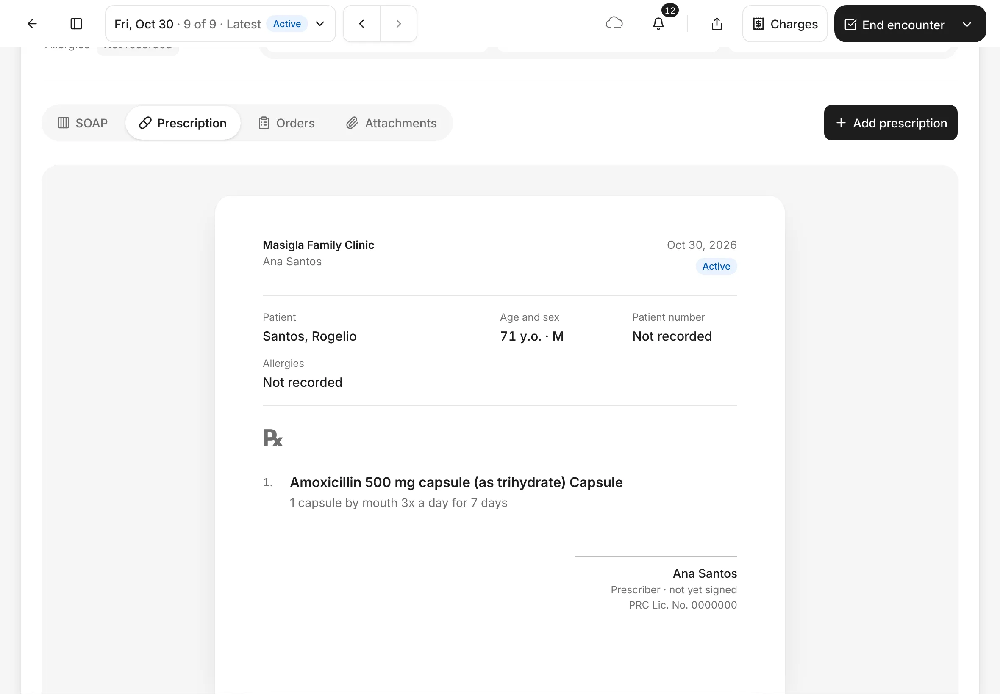
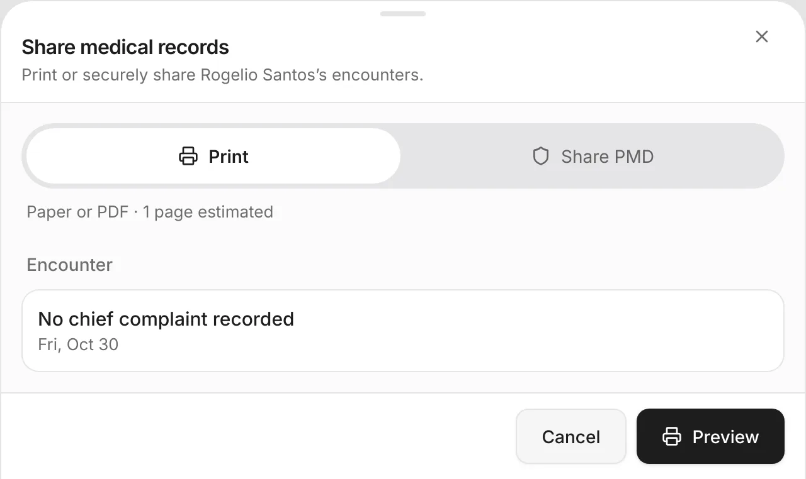
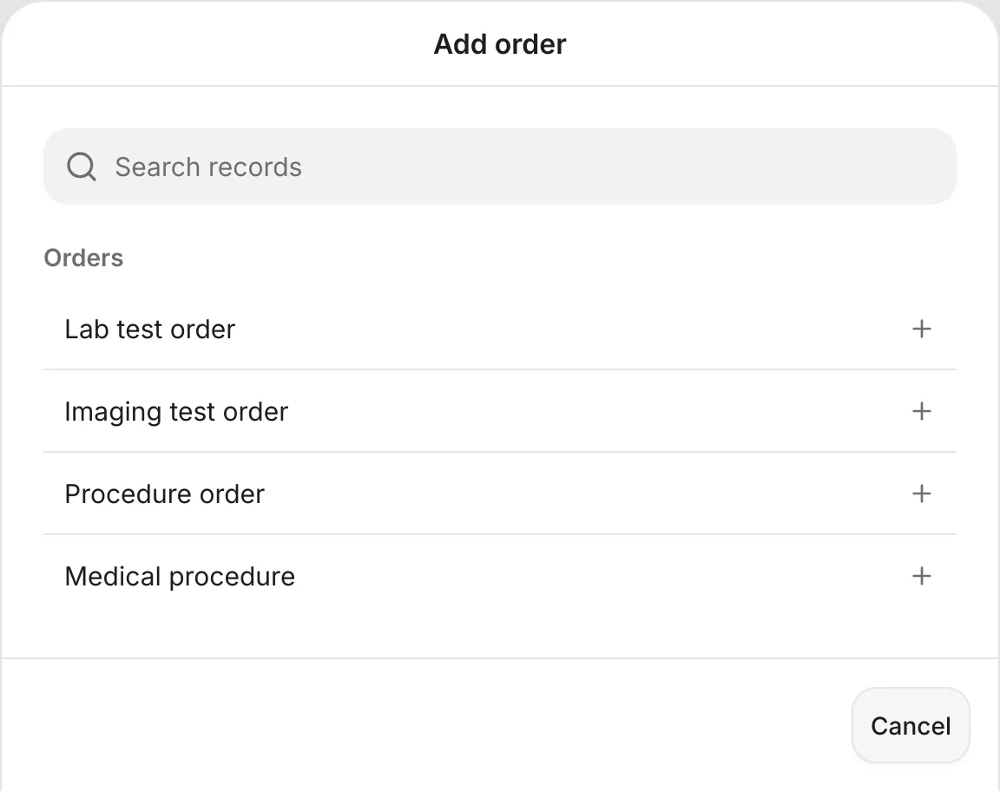
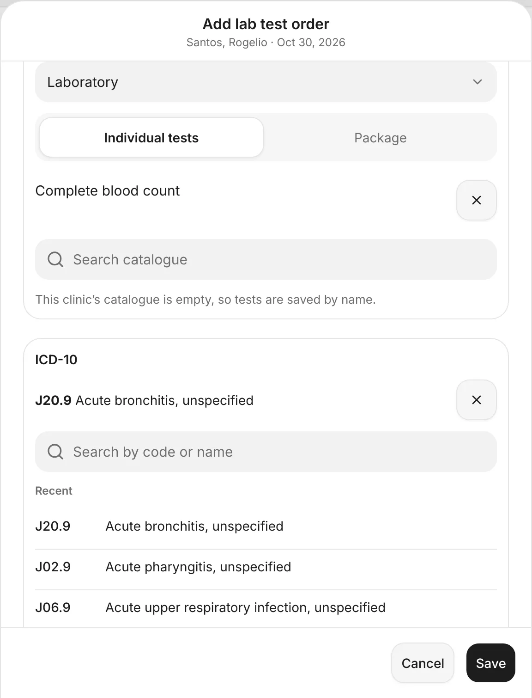
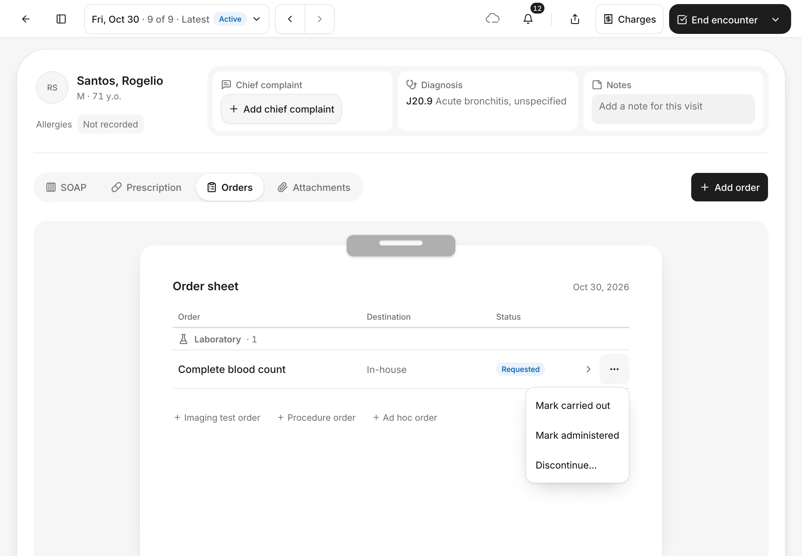
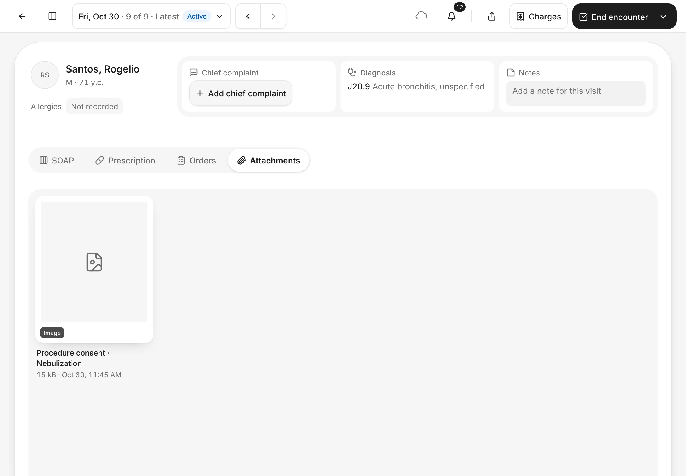

# Prescriptions, orders and attachments

Prescribe medicine, order lab or imaging tests, and see the files kept with the visit, all from the encounter.
{ .meta }

**Time:** about 5 minutes · **You'll need:** an open encounter for the patient.
{ .meta }

## Before you start

- Open the patient's encounter. See [Start an encounter](start-an-encounter.md).
- Record the diagnosis first. The prescription and the order can then carry it. See [Record notes in the encounter](record-notes.md).
- Everything on this page is in the row of views under the top of the encounter: **Prescription**, **Orders** and **Attachments**.

## Prescribe medicine

### 1. Open Prescription

Tap **Prescription** in the row of views. It shows the prescription laid out on paper: your clinic, the patient, **Allergies** and the **℞**.

You should see: **No medicines prescribed for this visit.** and **Add prescription** at the right.
{ .see }

### 2. Find the medicine

Tap **Add prescription**. Type part of the name in **Search name, brand or strength**, for example *amox*, then tap the medicine and strength you want.

You should see: a list of matching medicines under **Medicines**.
{ .see }

{ .shot-sm }

### 3. Fill in the directions

The **Medicine** page opens with the name, strength and form filled in. Under **Directions**, fill in:

- **Take**: the amount and unit, for example *1* and *capsule*
- **Route of administration**: for example *By mouth*
- **Frequency**: start typing and pick a suggestion, for example *3x a day*. Tick **As needed** if it's only when needed.
- **For how long**: for example *7 days*

Under **Quantity and refills**, enter the **Quantity** to give. You can also add **Refills** and **Remarks**.

The **Directions** box shows the instructions in plain words. To write them your own way, tick **Write directions myself**.

You should see: the directions, for example **1 capsule by mouth 3x a day for 7 days**.
{ .see }

{ .shot-sm }

### 4. Check and save the prescription

Tap **Prescription** at the top left to go back. The medicine is now listed with its directions. To add another medicine, search again.

Check **Destination**: **In-house**, **Referral partner** or **Patient-arranged** (the patient buys it themselves). Tick **Include impression** to print your impression on the prescription. Then tap **Save**.

You should see: **1. Amoxicillin 500 mg capsule…** with your name and licence number under it.
{ .see }

{ .shot-sm }

### 5. Check the saved prescription

The message **Added prescription** shows. The **Prescription** view now shows the prescription marked **Active**, with the **℞**, the directions, and your name as **Prescriber**.

You should see: the medicine on the prescription.
{ .see }

### 6. Print it

Tap the **Share** button in the top bar. Under **Print**, the visit's papers are listed. Tap **Preview** to see the pages, then print or save them as a PDF.

You should see: **Share medical records** with **Print** chosen.
{ .see }

{ .shot-sm }

## Order lab or imaging tests

### 7. Add an order

Tap **Orders** in the row of views, then **Add order**. Choose **Lab test order**, **Imaging test order**, **Procedure order** or **Medical procedure**.

You should see: the **Add order** list.
{ .see }

{ .shot-sm }

### 8. Choose the tests

1. Check the **Kind**, for example **Laboratory**.
2. Choose **Individual tests** or **Package**.
3. Type the test in **Search catalogue** and tap it. If your clinic has no list of tests yet, tap **Use "…"** to save the test by name.
4. Under **ICD-10**, tap the diagnosis. The visit's diagnosis is at the top of **Recent**.
5. Add a **Clinical reason**, and a **Follow-up date** if you want one.
6. Check **Destination**, then tap **Save**.

You should see: the test you picked, with **×** to remove it, and the diagnosis under **ICD-10**.
{ .see }

{ .shot-sm }

### 9. Check the order sheet

The **Orders** view shows every order for this visit on one **Order sheet**, grouped by kind, with its **Destination** and **Status**. A new order is **Requested**. Tap a line to see its details.

You should see: your order with the status **Requested**.
{ .see }

### 10. Update the order

When the test is done, tap **⋯** on its line:

- **Mark carried out** or **Mark administered**: for an in-house order. A referral partner's or patient-arranged order offers **Mark endorsed** instead.
- **Discontinue…**: cancel it. You'll be asked why.

Each change offers **Undo** for a few seconds. To take back a change later, use **Correct status…**.

You should see: **Mark carried out**, **Mark administered** and **Discontinue…**.
{ .see }

## See the visit's attachments

### 11. Open Attachments

Tap **Attachments** in the row of views. It shows the files kept with this visit, such as a signed consent linked to the encounter, with each file's name, size and when it was added.

You should see: a tile for each file, or **No attachments for this visit.**
{ .see }

## Tips

!!! tip "Check allergies before you prescribe"
    The prescription shows the patient's **Allergies**. If it says **Not recorded**, ask the patient and add them with **Add record › Allergies**.

!!! warning "If something goes wrong"
    - **The medicine isn't in the list.** Try fewer letters, or the generic name. You can also type the details yourself on the **Medicine** page.
    - **Your licence number is missing on the prescription.** Tap **Add professional credentials** on the prescription, or add it in **Settings › Profile**.
    - **You marked an order by mistake.** Tap **Undo** right away. Later, use **⋯ › Correct status…**.

!!! info "Good to know"
    - **Attachments** only shows files. You can't add, open or delete files there yet. A signed consent that you link to the visit shows up there. See [Consents](consents.md).
    - Marking an order doesn't send it anywhere: give the patient the printout or contact the lab yourself.
    - After the encounter ends, a prescription or an order can't be edited. You can still mark it **entered in error**.

## What's next

- [Consents](consents.md)
- [Finish the visit](finish-the-visit.md)
