# Record notes in the encounter

Write down why the patient came, your diagnosis and your findings, so the visit is on the patient's chart.
{ .meta }

**Time:** about 5 minutes · **You'll need:** an open encounter for the patient.
{ .meta }

## Before you start

- Open the patient's encounter. See [Start an encounter](start-an-encounter.md).
- The encounter page is one sheet of paper. At the top are the patient's name and three boxes: **Chief complaint**, **Diagnosis** and **Notes**. Below them is a row of views: **SOAP**, **Prescription**, **Orders** and **Attachments**. This page covers the top boxes and the **SOAP** view.

## Fill in the top of the encounter

### 1. Open the encounter

The status next to the date says **Active** while you can still write.

You should see: **Add chief complaint** and **Add diagnosis** at the top, and four empty columns in the **SOAP** view: **Subjective**, **Objective**, **Assessment** and **Plan**.
{ .see }

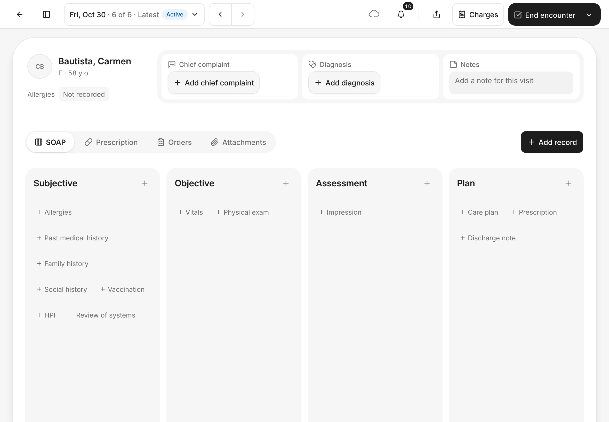

### 2. Add the chief complaint

Tap **Add chief complaint**, type why the patient came in **Chief complaint**, then tap **Save**.

You should see: the **Add chief complaint** form. After you save, the message **Added chief complaint** shows.
{ .see }

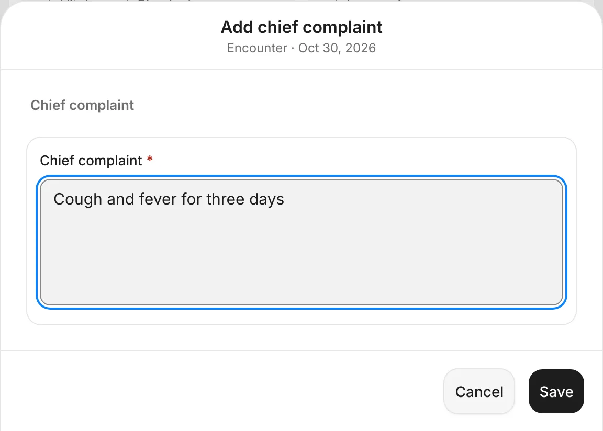{ .shot-sm }

### 3. Add the diagnosis

Tap **Add diagnosis**. Under **ICD-10**, type a code or a name in **Search by code or name**, for example *J06*, then tap the right line. Codes you used lately are listed under **Recent**.

If you can't find a code, tap **Use "…" as free text**, or type in the **Diagnosis** box. Add **Additional notes** if you need to, then tap **Save**.

You should see: a list of matching codes, such as **J06.9 Acute upper respiratory infection, unspecified**.
{ .see }

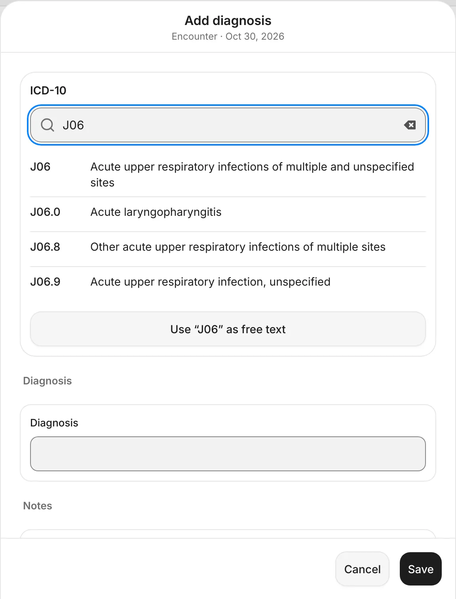{ .shot-sm }

### 4. Write a note for the visit

Tap **Add a note for this visit** in the **Notes** box and type. There's no Save button: the note saves by itself when you stop typing.

You should see: **Saved** for a moment in the corner of the **Notes** box. Your note stays in the box.
{ .see }

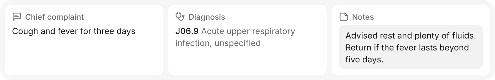

## Add records in the SOAP view

### 5. Choose a record

Tap **Add record**. The list is grouped by **Subjective**, **Objective**, **Assessment**, **Plan** and **Orders**. Type in **Search records** to find one quickly, for example *Vitals*, and tap it.

The most common records also have their own **+** buttons inside each column, such as **+ Vitals** under **Objective**.

You should see: the **Add record** list, starting with **Allergies**, **Vaccination** and **Past medical history**.
{ .see }

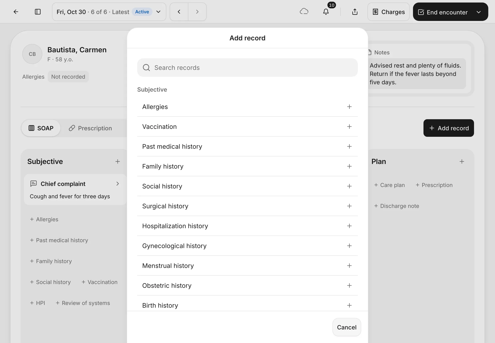

??? info "Which records can I add?"
    | Part of the visit | Records |
    |---|---|
    | **Patient history** (kept with the patient and shown at every visit) | **Allergies**, **Vaccination**, **Past medical history**, **Family history**, **Social history**, **Surgical history**, **Hospitalization history**, **Birth history**, **Dental history**. For female patients also **Gynecological history**, **Menstrual history** and **Obstetric history**. |
    | **Subjective**: what the patient tells you | **Chief complaint**, **HPI** (history of the present illness), **Review of systems** |
    | **Objective**: what you measure and find | **Vitals**, **Physical exam**, **ENT note**, **Nutritional assessment** |
    | **Assessment**: what you think it is | **Impression**, **Diagnosis** |
    | **Plan**: what happens next | **Care plan**, **Prescription**, **Discharge note**, **Nutritional plan** |
    | **Orders** | **Lab test order**, **Imaging test order**, **Procedure order**, **Medical procedure** |

    You can add the same kind of record more than once in a visit, for example a second set of **Vitals** later in the day.

### 6. Fill in the record

Fill in the boxes you need and leave the rest empty. For **Vitals**, that's **Systolic BP**, **Diastolic BP**, **Pulse rate**, **Respiratory rate**, **Temperature**, **Oxygen saturation**, height and weight. If the patient was measured before, the last readings show at the top under **Previous visit**. Then tap **Save**.

You should see: the form for that record, with its units beside each box.
{ .see }

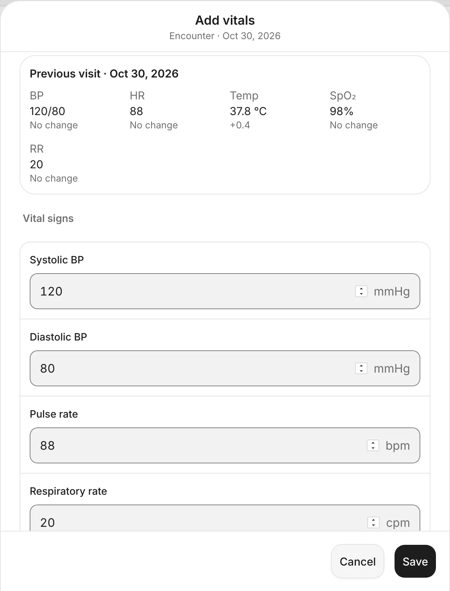{ .shot-sm }

### 7. Check the SOAP view

Each saved record shows as a card in its column. The chief complaint is under **Subjective**, vitals under **Objective** and the diagnosis under **Assessment**. A diagnosis with an ICD-10 code is marked **Coded diagnosis**. A value outside the normal range gets a label, such as **Fever**.

You should see: your records as cards.
{ .see }

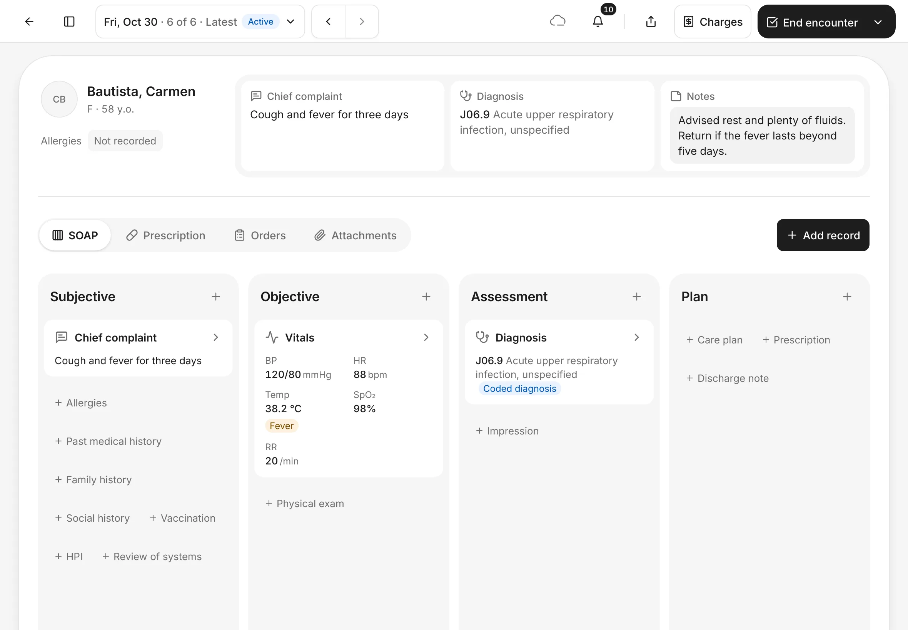

## Change or remove a record

### 8. Open the card

Tap a card to open it. You see everything on the record, who recorded it and when. For vitals, it also shows the change since the last measurement.

Tap **Edit** to change it while the encounter is still open.

You should see: the record with **Edit** and a **⋯** button.
{ .see }

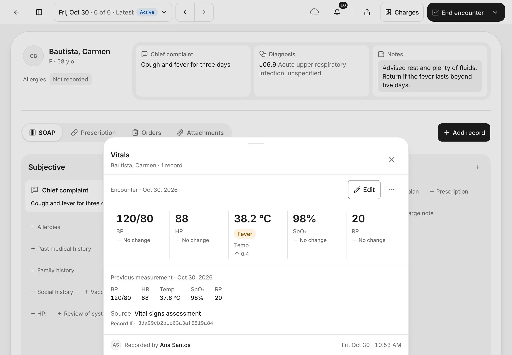

### 9. Use the ⋯ menu

Tap **⋯** for more:

- **Preview**: see the record as it will print.
- **View record log**: see every change made to this record, by whom and when.
- **Remove…**: take a record off the visit, for example one added by mistake.

You should see: **Preview**, **View record log** and **Remove…**.
{ .see }

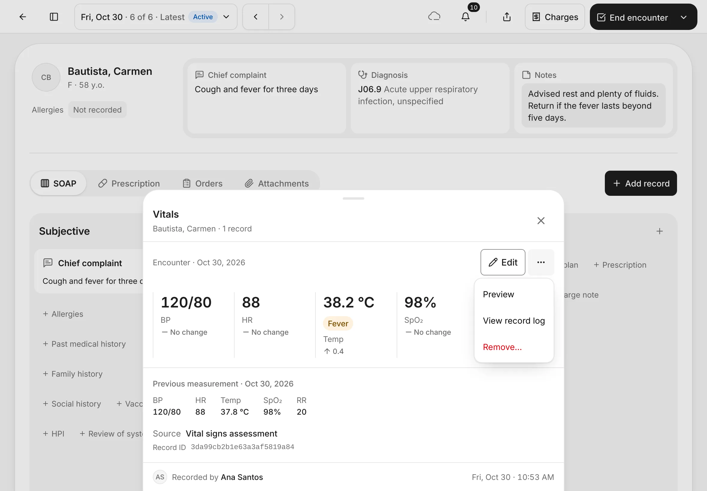

### 10. Remove a record

Tap **Remove…**, choose a **Reason** (**Duplicate**, **Wrong patient**, **Added by mistake** or **Other**), then tap **Remove record**. Tap **Keep record** to change your mind.

The record leaves the visit, but what it said, who wrote it and your reason stay in its record log.

You should see: **Remove record** with the reasons.
{ .see }

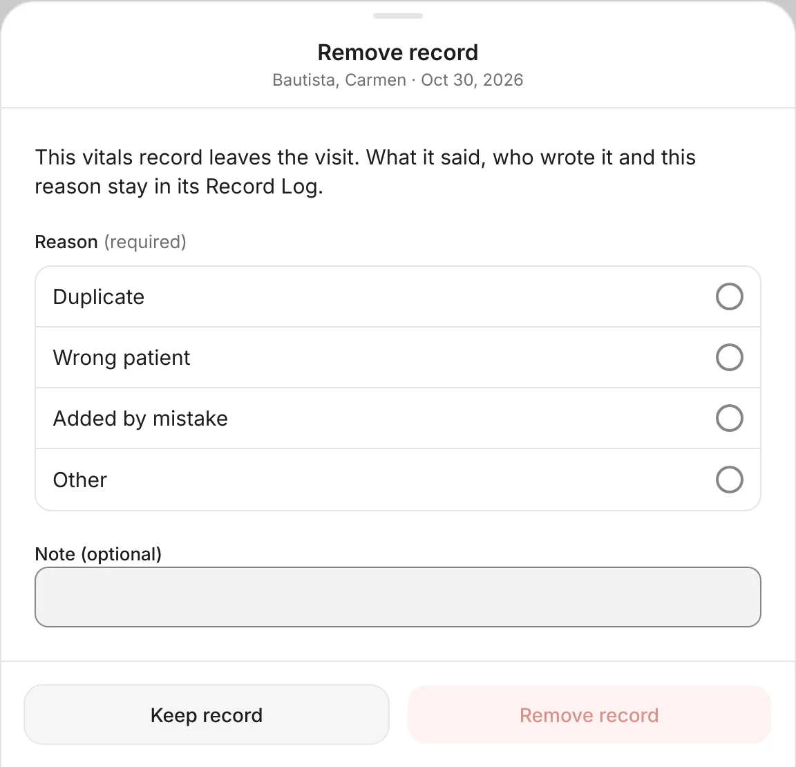{ .shot-sm }

## Correct a record after the visit has ended

Once an encounter has ended, its records are final. You can't edit or remove them, but you can **amend** them or mark them **entered in error**. Both keep the original in the record log.

### 11. Amend a record

Open the card and tap **Amend…**. Make your change, then tap **Continue**.

You should see: **Amend…** where **Edit** used to be.
{ .see }

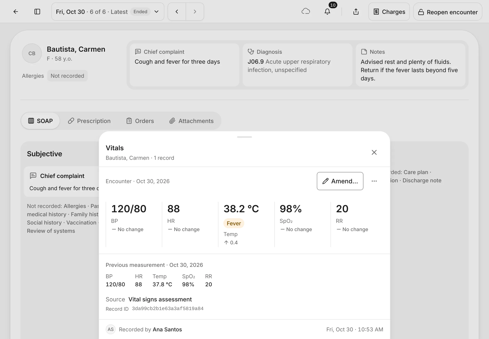

### 12. Give the reason

Choose why you're changing it: **Correction**, **Late entry**, **Clinical update** or **Other**. Add a note if you need to, then tap **Amend**.

You should see: **Amend record** with **Choose a reason. It is kept in the Record Log.**
{ .see }

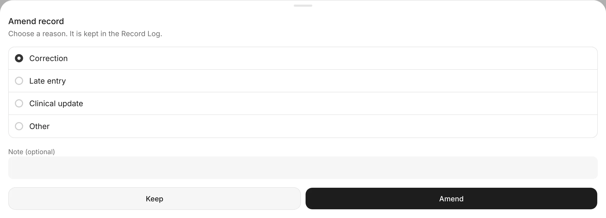

The message **Amended vitals** shows, and the card is now marked **Amended**.

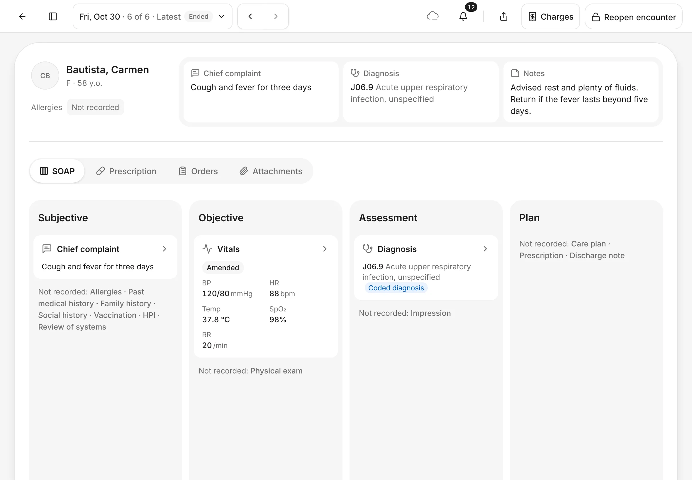

### 13. Mark a record entered in error

If a final record should never have been written, for example it belongs to another patient, open the card, tap **⋯**, then **Mark entered in error…**. Choose a reason (**Wrong patient**, **Duplicate**, **Wrong record type** or **Other**) and confirm.

The card stays on the visit, struck through, so the chart shows what happened.

You should see: **Mark entered in error…** in the **⋯** menu.
{ .see }

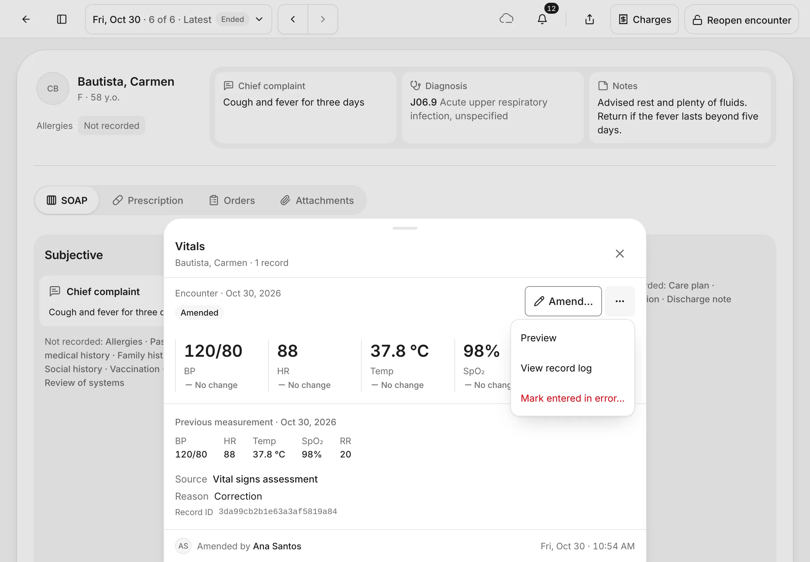

## Tips

!!! tip "Use the + buttons in the columns"
    The **+** buttons inside each SOAP column open the most common records in one tap. **Add record** has the full list.

!!! warning "If something goes wrong"
    - **The note says Not saved.** Your note is still there. Tap **Retry**.
    - **The note says Not saved yet, with a Save note button.** **Auto-save drafts** is off in **Settings › Encounter**. Tap **Save note** when you finish typing.
    - **You don't see Amend… or Mark entered in error….** You need permission to change final records. Ask your clinic owner.
    - **You can't add anything.** The encounter has ended. Reopen it if it's from today. See [Finish the visit](finish-the-visit.md).

!!! info "Good to know"
    - Records like allergies and past medical history belong to the patient, not to one visit. An encounter with none of its own shows the latest from an earlier visit, marked with its date.
    - **Remove…** is only for records on an open encounter. After the encounter ends, use **Amend…** or **Mark entered in error…**.

## What's next

- [Prescriptions, orders and attachments](prescriptions-orders-attachments.md)
- [Finish the visit](finish-the-visit.md)
