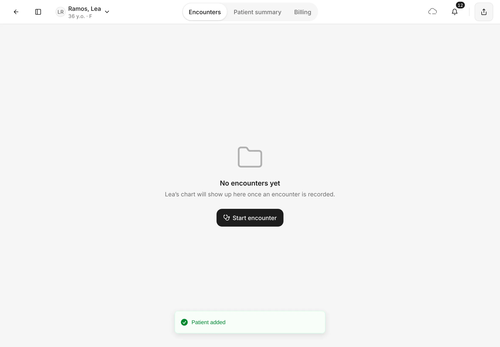
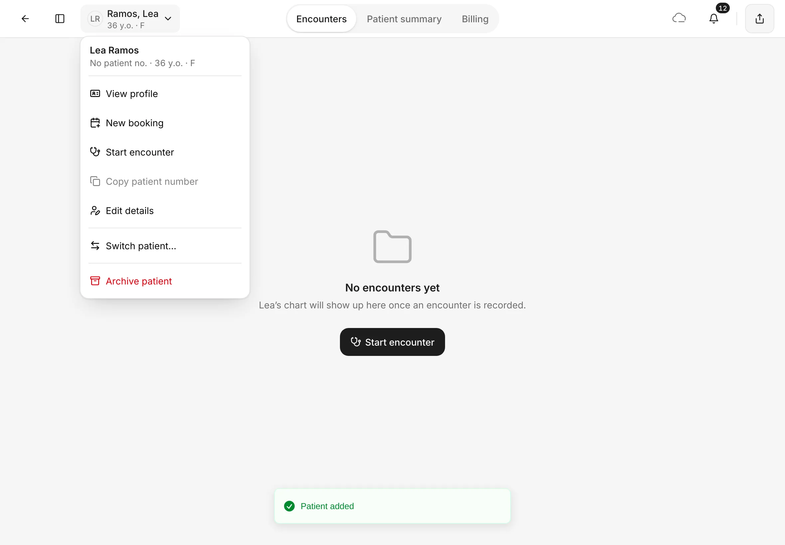
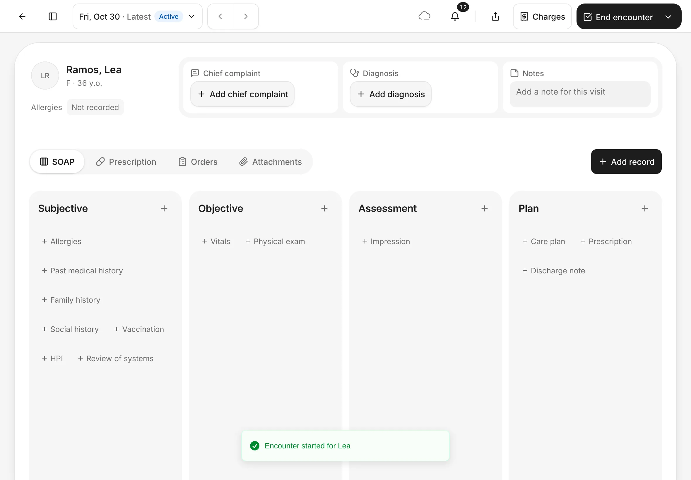
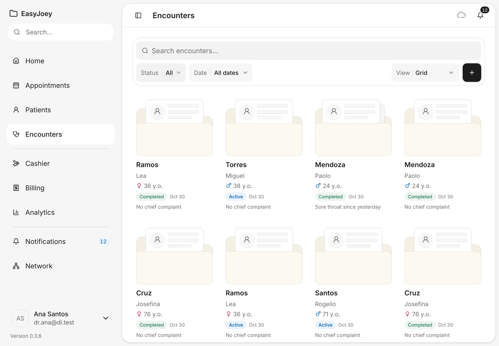
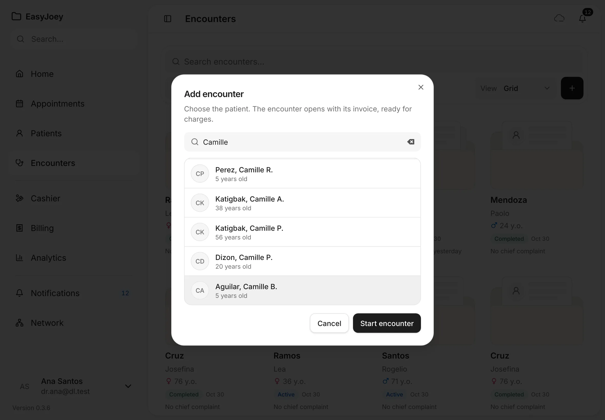

# Start an encounter

An encounter is one visit. It holds the chief complaint, diagnosis, notes, prescriptions, orders and charges for that day.
{ .meta }

**Time:** about 2 minutes · **You'll need:** the patient on file ([Find or add a patient](../patients/find-or-add-a-patient.md)).
{ .meta }

## Before you start

- A patient can have only one open encounter at a time. If they already have one, open it instead of starting a new one.

## Ways to start an encounter

Pick whichever is closest to where you are:

| Where you are | What to tap |
|---|---|
| **Appointments** | **Check in** on the appointment, then **Open encounter** (see [Appointments](../schedule/appointments.md)) |
| The patient's page, **Encounters** tab | **Start encounter** (first visit), or the **New encounter** folder |
| The patient menu (tap the patient's name at the top) | **Start encounter** |
| **Encounters** in the sidebar | The **+** button, then choose the patient |

## Steps

### 1. Start from the patient's page

Open the patient. Their page opens on **Encounters**. For a patient's first visit, you see **No encounters yet**.

Tap **Start encounter**.

You should see: **No encounters yet** and a **Start encounter** button.
{ .see }

!!! tip "Other ways from the same page"
    Tap the patient's name at the top left to open the patient menu, then tap **Start encounter**. For a patient who has been here before, tap the **New encounter** folder at the right end of their encounters instead.

    { .shot-sm }

### 2. Find your way around the encounter

The encounter opens straight away, with an **Encounter started for *name*** message.

- **Top bar:** **←** goes back. The date button (for example **Fri, Oct 30 · Latest · Active**) lists the patient's other encounters, and **‹ ›** step through them. At the right are sync, notifications, share, **Charges** and **End encounter**.
- **Header:** the patient's name, age and **Allergies**, then **Chief complaint**, **Diagnosis** and **Notes**.
- **Views:** **SOAP**, **Prescription**, **Orders** and **Attachments**. Tap one to switch. **Add record** adds to the view you're on.

You should see: the patient's name, the header boxes and the **SOAP** view with **Subjective**, **Objective**, **Assessment** and **Plan**.
{ .see }

### 3. Or start from the Encounters page

Tap **Encounters** in the sidebar.

You should see: every encounter as a folder, newest first, each with a status such as **Active** (still open) or **Completed**. Use **Status** and **Date** to filter, or **Search encounters…**.
{ .see }

### 4. Choose the patient

Tap the **+** button. In **Add encounter**, search for the patient, tap their name, then tap **Start encounter**.

You should see: **Add encounter** with the patient you picked highlighted.
{ .see }

{ .shot-sm }

EasyJoey confirms with **Encounter started for *name*** and opens the new encounter.

## Tips

!!! tip "The bill is ready too"
    Every encounter opens with its own invoice. Add what you did under **Charges**.
    See [Charges and the Cashier](../payments/charges-and-cashier.md).

!!! warning "If something goes wrong"
    **Start encounter is greyed out.** The patient already has an open encounter. The **New encounter** folder says **End the open encounter before starting a new one.** Open that encounter from their page.

!!! info "Good to know"
    An encounter stays **Active** until you end it. See [Finish the visit](finish-the-visit.md).

## What's next

- [Record notes in the encounter](record-notes.md)
